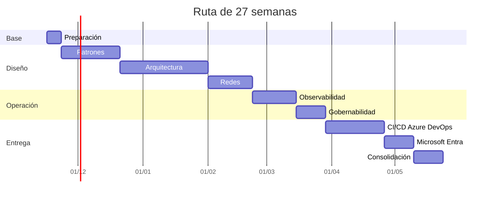

# 📅 Plan de estudio — 27 semanas

> **Dedicación sugerida:** 8–10 horas por semana (≈ 1,5 h entre semana + 3 h el fin de semana).
> **Si tienes menos tiempo:** estira cada semana a dos; el orden importa más que la velocidad.

[⬅ Volver al índice](README.md) · [Glosario](01-glosario.md) · [Proyecto integrador](proyecto-integrador/README.md)

---

## 🧭 Visión general

| Fase | Semanas | Tema | Entregable en OrderFlow |
|------|---------|------|-------------------------|
| 0 | 1 | Preparación y diagnóstico | Repo + solución base + pipeline "hola mundo" |
| 1 | 2–5 | Patrones de diseño | Dominio de pedidos con patrones aplicados |
| 2 | 6–11 | Arquitecturas escalables y robustas | Modular monolith con Clean Architecture, caching, mensajería y resiliencia |
| 3 | 12–14 | Redes (networking) | Conexiones bien gestionadas, gRPC, red privada en Azure |
| 4 | 15–17 | Observabilidad | Logs estructurados, trazas distribuidas, métricas, dashboards, alertas |
| 5 | 18–19 | Gobernabilidad | Reglas de arquitectura automáticas, ADRs, contratos de API, políticas Azure |
| 6 | 20–23 | CI/CD con Azure DevOps | Pipeline multi-stage con templates, IaC y aprobaciones |
| 7 | 24–25 | Microsoft Entra | API protegida con Entra ID + Managed Identities (cero secretos) |
| 8 | 26–27 | Consolidación | Demo final, retrospectiva y portafolio |

> **¿Por qué este orden?** Primero aprendes a diseñar bien el código (patrones), luego a organizar sistemas (arquitectura), después entiendes el medio por donde viajan las peticiones (redes), cómo verlos en producción (observabilidad), cómo mantener el orden (gobernanza), cómo entregarlos (CI/CD) y cómo asegurarlos (identidad). Cada fase usa lo anterior.

---

## 🔁 Rutina semanal recomendada

| Día | Actividad | Tiempo |
|-----|-----------|--------|
| Lunes | Leer la teoría del módulo | 1–1,5 h |
| Miércoles | Copiar y ejecutar los ejemplos; romperlos a propósito | 1–1,5 h |
| Viernes | Responder el checklist sin mirar; repasar el glosario | 45 min |
| Sábado | Ejercicio en OrderFlow | 3 h |
| Domingo | Escribir una nota corta de "qué aprendí" (tu diario técnico) | 30 min |

> 🧠 **Técnica clave:** al terminar cada tema, explícaselo a alguien (o escribe un párrafo como si fuera un post). Si no lo puedes explicar simple, todavía no lo dominas.

---

## Fase 0 — Preparación (Semana 1)

**Objetivo:** tener el entorno listo y saber dónde estás parado.

- [ ] Instalar .NET 10 SDK (y opcionalmente .NET 11), Visual Studio 2026 o VS Code + C# Dev Kit, Docker Desktop, Azure CLI, Bicep CLI, Wireshark.
- [ ] Crear una organización/proyecto gratuito en Azure DevOps y una suscripción Azure de pruebas (o usar la de tu empresa en un resource group sandbox).
- [ ] Crear el repo `OrderFlow` en Azure Repos.
- [ ] Leer el [enunciado del proyecto integrador](proyecto-integrador/README.md).
- [ ] **Autodiagnóstico:** califícate de 1 a 5 en cada área (lo repetirás en la semana 27).

| Área | Hoy (1–5) | Semana 27 (1–5) |
|------|-----------|-----------------|
| Patrones de diseño | | |
| Arquitectura | | |
| Redes | | |
| Observabilidad | | |
| Gobernabilidad | | |
| CI/CD Azure DevOps | | |
| Microsoft Entra | | |

**Entregable:** solución `OrderFlow.sln` con un proyecto Web API vacío, `README.md` y un pipeline YAML mínimo que compile. Ver [5.1](modulo-05-cicd-azure-devops/01-fundamentos-pipelines-yaml.md#ejemplo-mínimo).

---

## Fase 1 — Patrones de diseño (Semanas 2–5)

### Semana 2 — Fundamentos
- 📖 [1.1 Fundamentos SOLID](modulo-01-patrones-diseno/01-fundamentos-solid.md)
- 💻 Refactoriza una clase "dios" (God class) de tu trabajo real aplicando SRP y DIP.
- ✅ Sabes explicar cada letra de SOLID con un ejemplo propio.

### Semana 3 — Creacionales y estructurales
- 📖 [1.2 Creacionales](modulo-01-patrones-diseno/02-patrones-creacionales.md) y [1.3 Estructurales](modulo-01-patrones-diseno/03-patrones-estructurales.md)
- 💻 OrderFlow: `Order.Create(...)` (Factory Method), `OrderBuilder` para tests, Decorator de caching sobre un repositorio.
- ✅ Sabes cuándo **no** usar Singleton y por qué DI lo reemplaza.

### Semana 4 — Comportamiento
- 📖 [1.4 Comportamiento](modulo-01-patrones-diseno/04-patrones-comportamiento.md)
- 💻 OrderFlow: Strategy para descuentos; State para el ciclo de vida del pedido; Chain of Responsibility para validaciones.
- ✅ Reconoces Strategy, Chain of Responsibility y Template Method dentro de ASP.NET Core.

### Semana 5 — Patrones empresariales
- 📖 [1.5 Patrones empresariales](modulo-01-patrones-diseno/05-patrones-empresariales.md)
- 💻 OrderFlow: Result pattern, Options pattern, CQRS ligero con handlers, Specification.
- ✅ Sabes argumentar si un Repository sobre EF Core aporta valor o es una capa innecesaria.

**🏁 Hito Fase 1:** dominio de pedidos con reglas de negocio testeadas (≥ 80 % cobertura en el dominio).

---

## Fase 2 — Arquitecturas escalables y robustas (Semanas 6–11)

### Semana 6 — Estilos arquitectónicos
- 📖 [2.1 Estilos arquitectónicos](modulo-02-arquitectura/01-estilos-arquitectonicos.md)
- 💻 Reorganiza OrderFlow en Clean Architecture (Domain / Application / Infrastructure / Api).
- ✅ Dibujas de memoria la regla de dependencias de Clean Architecture.

### Semana 7 — DDD táctico
- 📖 [2.2 DDD](modulo-02-arquitectura/02-domain-driven-design.md) (parte táctica)
- 💻 Convierte `Order` en Aggregate Root con Value Objects (`Money`, `Address`) y Domain Events.
- ✅ Sabes por qué un aggregate debe cambiarse en una sola transacción.

### Semana 8 — DDD estratégico + Modular Monolith
- 📖 [2.2 DDD](modulo-02-arquitectura/02-domain-driven-design.md) (parte estratégica) y sección Modular Monolith de [2.1](modulo-02-arquitectura/01-estilos-arquitectonicos.md)
- 💻 Separa OrderFlow en módulos: `Ordering`, `Catalog`, `Payments`. Haz un Context Map.
- ✅ Justificas por qué empezar con modular monolith antes que microservicios.

### Semana 9 — Escalabilidad
- 📖 [2.3 Escalabilidad](modulo-02-arquitectura/03-escalabilidad.md)
- 💻 HybridCache en catálogo, rate limiting, paginación por cursor, mensajería asíncrona entre módulos.
- ✅ Explicas escalado vertical vs horizontal y qué hace a una app "stateless".

### Semana 10 — Resiliencia
- 📖 [2.4 Resiliencia](modulo-02-arquitectura/04-resiliencia.md)
- 💻 `AddStandardResilienceHandler()` en el cliente de pagos; Outbox; endpoint idempotente con `Idempotency-Key`.
- ✅ Sabes por qué un retry sin idempotencia puede cobrar dos veces a un cliente.

### Semana 11 — Cloud-native con Aspire
- 📖 [2.5 Cloud-native con Aspire](modulo-02-arquitectura/05-cloud-native-aspire.md)
- 💻 AppHost de Aspire que levante API, SQL, Redis y Service Bus emulator.
- ✅ Levantas todo OrderFlow con un solo comando.

**🏁 Hito Fase 2:** OrderFlow corre localmente con Aspire, separa módulos, cachea, publica eventos de forma confiable y sobrevive a fallos del servicio de pagos.

---

## Fase 3 — Redes (Semanas 12–14) 🌐

### Semana 12 — Fundamentos, HTTP, TLS y DNS
- 📖 [7.1 Fundamentos de redes](modulo-07-redes/01-fundamentos-redes.md) y [7.2 HTTP, TLS y DNS](modulo-07-redes/02-http-tls-dns.md)
- 💻 Captura con Wireshark un handshake TCP; inspecciona certificados con `openssl`; sigue la cadena DNS de tu App Service; diseña el plan de direccionamiento (CIDR) de OrderFlow.
- ✅ Calculas subredes sin calculadora y explicas qué pasa desde que escribes una URL hasta que llega la respuesta.

### Semana 13 — Redes desde .NET
- 📖 [7.3 Redes en .NET](modulo-07-redes/03-redes-en-dotnet.md)
- 💻 Reproduce socket exhaustion y corrígelo con `IHttpClientFactory`; expón `GetOrder` por gRPC; mide fases de una petición con `curl -w`; configura Forwarded Headers.
- ✅ Diagnosticas un problema siguiendo DNS → TCP → TLS → HTTP.

### Semana 14 — Redes en Azure
- 📖 [7.4 Redes en Azure](modulo-07-redes/04-redes-en-azure.md)
- 💻 Bicep: VNet, subnets, NSG, Private Endpoints (SQL y Key Vault) con Private DNS Zones; App Service con VNet Integration; acceso público de SQL deshabilitado.
- ✅ Explicas Service Endpoint vs Private Endpoint y eliges entre Front Door, Application Gateway y Load Balancer.

**🏁 Hito Fase 3:** la base de datos de OrderFlow solo es accesible por red privada y sabes demostrarlo (`nslookup` → IP privada, Network Watcher).

---

## Fase 4 — Observabilidad (Semanas 15–17)

### Semana 15 — Fundamentos + logging
- 📖 [3.1 Fundamentos](modulo-03-observabilidad/01-fundamentos.md) y [3.2 Logging estructurado](modulo-03-observabilidad/02-logging-estructurado.md)
- 💻 Reemplaza logs con interpolación por `[LoggerMessage]`; ProblemDetails con `traceId`; redaction de PII.
- ✅ Defines 2 SLIs y 2 SLOs para OrderFlow.

### Semana 16 — OpenTelemetry
- 📖 [3.3 OpenTelemetry](modulo-03-observabilidad/03-opentelemetry-dotnet.md)
- 💻 Trazas distribuidas API → Service Bus → worker; métricas de negocio (`orderflow.orders.placed`, `orderflow.orders.amount`).
- ✅ Sigues una petición completa en el dashboard de Aspire de punta a punta.

### Semana 17 — Producción
- 📖 [3.4 Health checks y Azure Monitor](modulo-03-observabilidad/04-health-checks-azure-monitor.md)
- 💻 Liveness/readiness, Application Insights, Workbook con KQL, alerta basada en SLO + runbook.
- ✅ Respondes "¿qué falló y a quién afectó?" en menos de 5 minutos.

**🏁 Hito Fase 4:** dashboard con golden signals + métricas de negocio + una alerta accionable con runbook.

---

## Fase 5 — Gobernabilidad (Semanas 18–19)

### Semana 18 — Código, arquitectura y APIs
- 📖 [4.1 Gobernanza de código y arquitectura](modulo-04-gobernabilidad/01-gobernanza-codigo-arquitectura.md) y [4.2 Gobernanza de APIs](modulo-04-gobernabilidad/02-gobernanza-apis.md)
- 💻 `Directory.Build.props`, `.editorconfig`, Central Package Management, NetArchTest, 3 ADRs, OpenAPI + Spectral + oasdiff, versionado.
- ✅ Una violación de arquitectura o un breaking change de API rompe el build.

### Semana 19 — Azure
- 📖 [4.3 Gobernanza en Azure](modulo-04-gobernabilidad/03-gobernanza-azure.md)
- 💻 Azure Policy (tags y regiones), presupuesto con alertas, Well-Architected Review.
- ✅ Explicas la jerarquía Management Group → Subscription → Resource Group → Resource.

**🏁 Hito Fase 5:** las reglas del equipo están en código, no en una wiki que nadie lee.

---

## Fase 6 — CI/CD con Azure DevOps (Semanas 20–23)

### Semana 20 — Pipelines YAML
- 📖 [5.1 Fundamentos YAML](modulo-05-cicd-azure-devops/01-fundamentos-pipelines-yaml.md)
- 💻 CI completo: restore bloqueado, formato, build, tests, cobertura, auditoría, artefacto; branch policies con build validation.
- ✅ Un PR no puede mergearse si los tests fallan.

### Semana 21 — Templates
- 📖 [5.2 Templates](modulo-05-cicd-azure-devops/02-templates-reutilizacion.md)
- 💻 Repo `pipeline-templates` versionado; `extends` con pasos obligatorios.
- ✅ Un pipeline nuevo para otro servicio son < 25 líneas.

### Semana 22 — Seguridad del pipeline
- 📖 [5.3 Seguridad y environments](modulo-05-cicd-azure-devops/03-seguridad-environments.md)
- 💻 Service connections con Workload Identity Federation, Key Vault, environments `dev`/`qa`/`prod` con approvals y checks.
- ✅ No hay ni un solo secreto en texto plano en el repo ni en el pipeline.

### Semana 23 — IaC y estrategias de despliegue
- 📖 [5.4 Bicep y despliegues](modulo-05-cicd-azure-devops/04-iac-bicep-despliegues.md)
- 💻 Infra en Bicep con what-if; blue-green con slots; migration bundle de EF Core.
- ✅ Destruyes y recreas el entorno `dev` desde cero con el pipeline.

**🏁 Hito Fase 6:** commit → PR → CI → dev → qa (aprobación) → prod (aprobación + swap), todo automatizado.

---

## Fase 7 — Microsoft Entra (Semanas 24–25)

### Semana 24 — Identidad para APIs
- 📖 [6.1 Fundamentos](modulo-06-microsoft-entra/01-fundamentos-identidad.md) y [6.2 App registrations](modulo-06-microsoft-entra/02-app-registrations-identity-web.md)
- 💻 Protege OrderFlow con Microsoft.Identity.Web: scopes para usuarios, app roles para el Worker, autorización por recurso.
- ✅ Decodificas un JWT y explicas `aud`, `iss`, `scp`, `roles`, `oid`, `tid`.

### Semana 25 — Identidades sin secretos y seguridad avanzada
- 📖 [6.3 Managed Identities](modulo-06-microsoft-entra/03-managed-identities-rbac.md) y [6.4 Seguridad avanzada](modulo-06-microsoft-entra/04-seguridad-avanzada.md)
- 💻 La API accede a SQL, Key Vault, Service Bus y Storage con Managed Identity.
- ✅ Explicas la diferencia entre Entra roles, Azure RBAC y app roles.

**🏁 Hito Fase 7:** OrderFlow no tiene un solo secreto de aplicación; todo es identidad.

---

## Fase 8 — Consolidación (Semanas 26–27)

### Semana 26 — Pulido y documentación
- [ ] Diagramas C4 (niveles 1 y 2) y diagrama de red de OrderFlow.
- [ ] README con decisiones de arquitectura (enlaza tus ADRs).
- [ ] Runbook por cada alerta.
- [ ] Revisión de seguridad: dependencias vulnerables, permisos mínimos, exposición de red.

### Semana 27 — Demo y retrospectiva
- [ ] Graba un video de 10 minutos (o preséntale a tu equipo) mostrando OrderFlow de punta a punta.
- [ ] Repite el autodiagnóstico de la semana 1.
- [ ] Elige tu siguiente frontera (ideas: Event Sourcing, Kubernetes/AKS, platform engineering, IA con Microsoft.Extensions.AI, certificación AZ-305/AZ-400/AZ-700).

---

## 📏 Criterios para saber que "ya lo domino"

| Nivel | Señal |
|-------|-------|
| 🥉 Conozco | Sé qué es y puedo reconocerlo en código ajeno |
| 🥈 Aplico | Lo implementé en OrderFlow sin copiar todo |
| 🥇 Decido | Puedo explicar **cuándo NO usarlo** y sus trade-offs |
| 💎 Enseño | Lo expliqué a otra persona o escribí sobre ello |

> La meta del plan es llegar a 🥇 en todo y 💎 en al menos dos temas.

---

## 🧯 Si te atrasas

- Es normal. Prioriza: **Fase 1 → Fase 2 (semanas 6, 9, 10) → Fase 3 (semanas 12–13) → Fase 4 → Fase 6**. Gobernabilidad y Entra se pueden comprimir.
- Nunca saltes el ejercicio práctico: leer sin aplicar se olvida en dos semanas.
