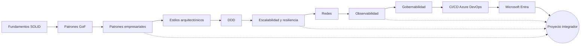

# 🚀 mejorar.dev — Plan de crecimiento para desarrolladores .NET

> Guía de estudio en español (con los términos técnicos en inglés) para pasar de "escribo código que funciona" a "diseño sistemas escalables, observables, gobernados, bien conectados y desplegados de forma segura".

**Stack de referencia:** .NET 10 (LTS) · C# 14 · ASP.NET Core · EF Core · Azure · Azure DevOps · Microsoft Entra ID
**Última revisión:** noviembre 2026

---

## 📌 Cómo usar esta guía

1. Lee primero el **[Plan de estudio](00-plan-de-estudio.md)**: está ordenado por semanas y te dice qué leer, qué practicar y cómo saber que ya dominas el tema.
2. Ten abierto el **[Glosario](01-glosario.md)**: cada término en inglés que aparece en los módulos está definido ahí.
3. Cada módulo sigue la misma estructura:
   - 🎯 **Objetivos** — lo que vas a poder hacer al terminar.
   - 🧠 **Concepto** — explicación corta y en lenguaje simple.
   - 💻 **Ejemplo práctico** — código .NET listo para copiar y adaptar.
   - ⚠️ **Errores comunes / antipatrones**.
   - ✅ **Checklist** — autoevaluación.
   - 🏋️ **Ejercicio** — aplicado al proyecto integrador.
4. Todo converge en el **[Proyecto integrador](proyecto-integrador/README.md)** — una API de pedidos ("OrderFlow") que vas construyendo y mejorando módulo a módulo.

> 💡 Los diagramas están en **Mermaid**. Se ven renderizados en VS Code (extensión *Markdown Preview Mermaid Support*), GitHub, Azure DevOps Wiki y Obsidian.

---

## 🗂️ Índice general

### Documentos base
| # | Documento | Descripción |
|---|-----------|-------------|
| 00 | [Plan de estudio](00-plan-de-estudio.md) | Ruta de 27 semanas, ordenada y con entregables |
| 01 | [Glosario](01-glosario.md) | +220 términos explicados en español |

### Módulo 1 — Patrones de diseño (Design Patterns)
| # | Tema |
|---|------|
| 1.1 | [Fundamentos: SOLID, DRY, KISS, YAGNI, composición](modulo-01-patrones-diseno/01-fundamentos-solid.md) |
| 1.2 | [Patrones creacionales (Creational)](modulo-01-patrones-diseno/02-patrones-creacionales.md) |
| 1.3 | [Patrones estructurales (Structural)](modulo-01-patrones-diseno/03-patrones-estructurales.md) |
| 1.4 | [Patrones de comportamiento (Behavioral)](modulo-01-patrones-diseno/04-patrones-comportamiento.md) |
| 1.5 | [Patrones empresariales en .NET (Repository, UoW, CQRS, Result, Specification, Outbox…)](modulo-01-patrones-diseno/05-patrones-empresariales.md) |

### Módulo 2 — Arquitecturas escalables y robustas
| # | Tema |
|---|------|
| 2.1 | [Estilos arquitectónicos: Layered, Clean, Hexagonal, Vertical Slice, Modular Monolith, Microservices](modulo-02-arquitectura/01-estilos-arquitectonicos.md) |
| 2.2 | [Domain-Driven Design (DDD) práctico](modulo-02-arquitectura/02-domain-driven-design.md) |
| 2.3 | [Escalabilidad: caching, mensajería, particionamiento, rate limiting](modulo-02-arquitectura/03-escalabilidad.md) |
| 2.4 | [Resiliencia: retries, circuit breaker, idempotencia, Polly](modulo-02-arquitectura/04-resiliencia.md) |
| 2.5 | [Cloud-native con Aspire y contenedores](modulo-02-arquitectura/05-cloud-native-aspire.md) |

### Módulo 7 — Redes para ingenieros (Networking) 🌐
> Se estudia justo después de Arquitectura (ver plan). Numerado como 7 porque se agregó al final.

| # | Tema |
|---|------|
| 7.1 | [Fundamentos: OSI/TCP-IP, IP y CIDR, TCP vs UDP, NAT/SNAT, latencia](modulo-07-redes/01-fundamentos-redes.md) |
| 7.2 | [HTTP/1.1-2-3, TLS y certificados, DNS](modulo-07-redes/02-http-tls-dns.md) |
| 7.3 | [Redes desde .NET: HttpClient, SocketsHttpHandler, gRPC, troubleshooting](modulo-07-redes/03-redes-en-dotnet.md) |
| 7.4 | [Redes en Azure: VNet, NSG, Private Endpoints, Front Door, App Gateway, hub-spoke](modulo-07-redes/04-redes-en-azure.md) |

### Módulo 3 — Observabilidad (Observability)
| # | Tema |
|---|------|
| 3.1 | [Fundamentos: logs, métricas, trazas, SLI/SLO](modulo-03-observabilidad/01-fundamentos.md) |
| 3.2 | [Logging estructurado en .NET](modulo-03-observabilidad/02-logging-estructurado.md) |
| 3.3 | [OpenTelemetry en .NET: trazas y métricas](modulo-03-observabilidad/03-opentelemetry-dotnet.md) |
| 3.4 | [Health checks, Azure Monitor y alertas](modulo-03-observabilidad/04-health-checks-azure-monitor.md) |

### Módulo 4 — Gobernabilidad (Governance)
| # | Tema |
|---|------|
| 4.1 | [Gobernanza de código y arquitectura (ADRs, analyzers, fitness functions)](modulo-04-gobernabilidad/01-gobernanza-codigo-arquitectura.md) |
| 4.2 | [Gobernanza de APIs (versionado, contratos, API Management)](modulo-04-gobernabilidad/02-gobernanza-apis.md) |
| 4.3 | [Gobernanza en Azure (Policy, tags, landing zones, costos)](modulo-04-gobernabilidad/03-gobernanza-azure.md) |

### Módulo 5 — CI/CD con Azure DevOps
| # | Tema |
|---|------|
| 5.1 | [Fundamentos de Azure Pipelines en YAML](modulo-05-cicd-azure-devops/01-fundamentos-pipelines-yaml.md) |
| 5.2 | [Templates y reutilización](modulo-05-cicd-azure-devops/02-templates-reutilizacion.md) |
| 5.3 | [Seguridad: environments, approvals, secretos, Workload Identity Federation](modulo-05-cicd-azure-devops/03-seguridad-environments.md) |
| 5.4 | [Infraestructura como código (Bicep) y estrategias de despliegue](modulo-05-cicd-azure-devops/04-iac-bicep-despliegues.md) |

### Módulo 6 — Microsoft Entra (de ñapa 🎁)
| # | Tema |
|---|------|
| 6.1 | [Fundamentos de identidad: OAuth 2.0, OpenID Connect, tokens](modulo-06-microsoft-entra/01-fundamentos-identidad.md) |
| 6.2 | [App registrations y Microsoft.Identity.Web](modulo-06-microsoft-entra/02-app-registrations-identity-web.md) |
| 6.3 | [Managed Identities y Azure RBAC](modulo-06-microsoft-entra/03-managed-identities-rbac.md) |
| 6.4 | [Seguridad avanzada: Conditional Access, PIM, External ID, Workload ID](modulo-06-microsoft-entra/04-seguridad-avanzada.md) |

### Proyecto integrador
- [OrderFlow — enunciado, hitos y criterios de aceptación](proyecto-integrador/README.md)

### Recursos
- [Recursos recomendados (libros, docs oficiales, cursos)](recursos.md)

---

## 🧭 Mapa mental del recorrido

---

## 📅 Nota sobre versiones (noviembre 2026)

- **.NET 10** es la versión **LTS** (soporte de 3 años) → úsala como base para todo lo productivo.
- **.NET 11** salió el 10 de noviembre de 2026 como **STS** (2 años de soporte), con C# 15 (union types). Úsalo para experimentar.
- **.NET 8 y .NET 9 llegaron a fin de soporte el 10 de noviembre de 2026.** Si tus proyectos siguen ahí, migrar a .NET 10 es tarea prioritaria (y es un excelente ejercicio para este plan).
- **Aspire** (antes ".NET Aspire") ahora se llama simplemente *Aspire* desde la versión 13.
