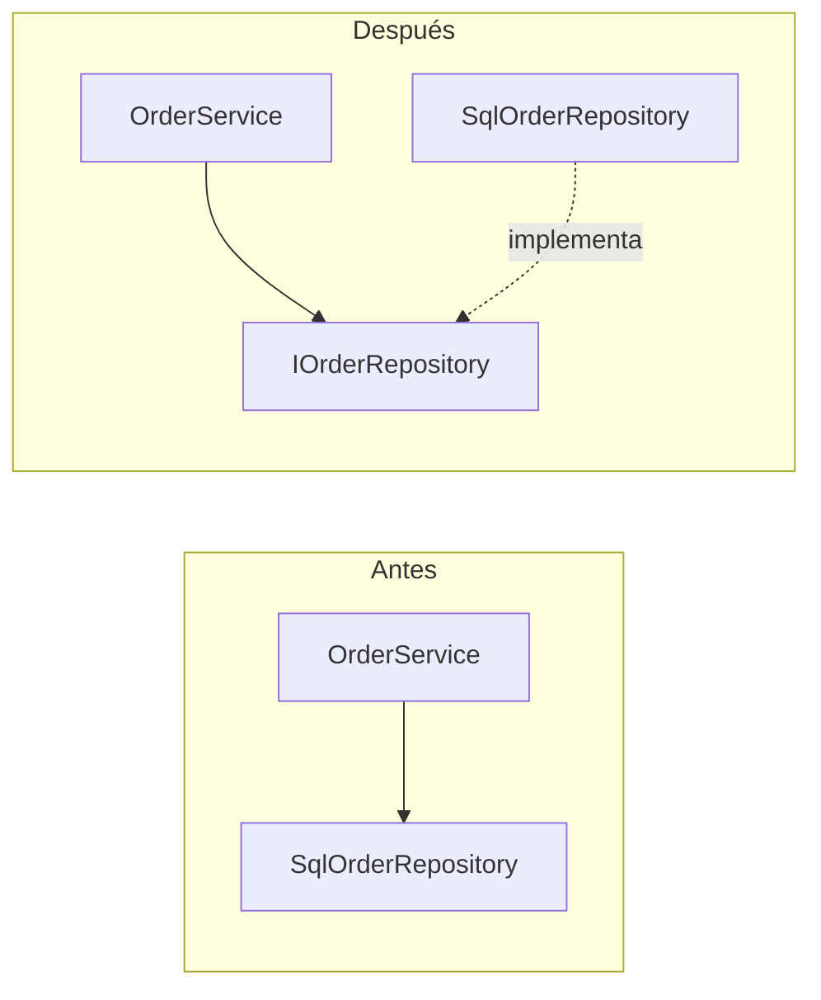

# 1.1 Fundamentos: SOLID, DRY, KISS, YAGNI y composición

[⬅ Índice](../README.md) · [Plan](../00-plan-de-estudio.md) · [Siguiente: Creacionales ➡](02-patrones-creacionales.md)

## 🎯 Objetivos
- Explicar cada principio SOLID con un ejemplo en C#.
- Detectar *code smells* que indican violaciones.
- Entender por qué los patrones de diseño son **consecuencia** de estos principios.

---

## 🧠 ¿Por qué empezar aquí?

Los patrones de diseño no son recetas para memorizar: son soluciones repetidas que aparecen cuando aplicas bien unos pocos principios. Si entiendes SOLID, la mitad de los patrones "se te ocurren solos".

> **Regla de oro:** el objetivo de todo esto es **facilitar el cambio**. Un código está bien diseñado si cambiarlo es barato y seguro.

---

## S — Single Responsibility Principle (SRP)

> *Una clase debe tener una sola razón para cambiar.*

"Razón para cambiar" = un actor o área del negocio que puede pedir cambios.

### ❌ Antes
```csharp
public class OrderService
{
    public void PlaceOrder(Order order)
    {
        // 1. Validar
        if (order.Items.Count == 0) throw new Exception("Sin items");
        // 2. Calcular impuestos
        order.Tax = order.Subtotal * 0.19m;
        // 3. Guardar
        using var conn = new SqlConnection("Server=...;Password=123");
        // ... INSERT ...
        // 4. Enviar email
        var smtp = new SmtpClient("smtp.empresa.com");
        smtp.Send("ventas@empresa.com", order.CustomerEmail, "Pedido", "Gracias");
    }
}
```
Cuatro razones para cambiar: reglas de validación, normativa tributaria, motor de base de datos, proveedor de email.

### ✅ Después
```csharp
public sealed class PlaceOrderHandler(
    IOrderValidator validator,
    ITaxCalculator taxCalculator,
    IOrderRepository repository,
    INotificationSender notifications)
{
    public async Task HandleAsync(Order order, CancellationToken ct)
    {
        validator.Validate(order);
        order.ApplyTax(taxCalculator.Calculate(order));
        await repository.AddAsync(order, ct);
        await notifications.OrderPlacedAsync(order, ct);
    }
}
```
> Nota: usamos *primary constructors* de C# 12+, muy cómodos para DI.

**Smell que delata SRP roto:** clases de +500 líneas, nombres como `Manager`, `Helper`, `Utils`, muchos `using` de áreas distintas.

---

## O — Open/Closed Principle (OCP)

> *Abierto a extensión, cerrado a modificación.*

Agregar comportamiento nuevo **sin tocar** código probado.

### ❌ Antes
```csharp
public decimal CalculateShipping(Order order) => order.ShippingType switch
{
    "standard" => 5m,
    "express"  => 15m,
    "same-day" => 30m,   // cada tipo nuevo = modificar este método
    _ => throw new NotSupportedException()
};
```

### ✅ Después (esto es el patrón **Strategy**)
```csharp
public interface IShippingStrategy
{
    string Type { get; }
    decimal Calculate(Order order);
}

public sealed class ExpressShipping : IShippingStrategy
{
    public string Type => "express";
    public decimal Calculate(Order order) => 15m + order.WeightKg * 0.5m;
}

public sealed class ShippingCalculator(IEnumerable<IShippingStrategy> strategies)
{
    private readonly Dictionary<string, IShippingStrategy> _map =
        strategies.ToDictionary(s => s.Type);

    public decimal Calculate(Order order) =>
        _map.TryGetValue(order.ShippingType, out var s)
            ? s.Calculate(order)
            : throw new NotSupportedException(order.ShippingType);
}

// Registro: agregar un tipo nuevo = agregar una clase + una línea
builder.Services.AddSingleton<IShippingStrategy, StandardShipping>();
builder.Services.AddSingleton<IShippingStrategy, ExpressShipping>();
builder.Services.AddSingleton<ShippingCalculator>();
```

> ⚖️ **Trade-off:** un `switch` con 3 casos que nunca cambian está bien. Aplica OCP donde **sabes** que habrá variación.

---

## L — Liskov Substitution Principle (LSP)

> *Si `B` hereda de `A`, debes poder usar `B` donde esperas `A` sin sorpresas.*

### ❌ Violación clásica
```csharp
public class FileStorage
{
    public virtual void Save(string path, byte[] data) { /* ... */ }
}

public class ReadOnlyStorage : FileStorage
{
    public override void Save(string path, byte[] data)
        => throw new NotSupportedException(); // ¡sorpresa!
}
```

### ✅ Solución: modelar capacidades por separado
```csharp
public interface IReadableStorage { byte[] Read(string path); }
public interface IWritableStorage { void Save(string path, byte[] data); }
```

**Señales de LSP roto:** `NotImplementedException`/`NotSupportedException` en overrides, `if (x is TipoConcreto)` en el código cliente.

---

## I — Interface Segregation Principle (ISP)

> *Ningún cliente debe depender de métodos que no usa.*

```csharp
// ❌ Interfaz "gorda"
public interface IOrderRepository
{
    Task<Order?> GetAsync(Guid id);
    Task AddAsync(Order o);
    Task<IReadOnlyList<OrderSummary>> SearchAsync(OrderFilter f);
    Task<byte[]> ExportToExcelAsync();   // ¿qué hace esto aquí?
    Task PurgeOldOrdersAsync();
}

// ✅ Interfaces por rol
public interface IOrderRepository { Task<Order?> GetAsync(Guid id); Task AddAsync(Order o); }
public interface IOrderQueries    { Task<IReadOnlyList<OrderSummary>> SearchAsync(OrderFilter f); }
public interface IOrderExporter   { Task<byte[]> ExportToExcelAsync(); }
```

---

## D — Dependency Inversion Principle (DIP)

> *Los módulos de alto nivel no dependen de los de bajo nivel; ambos dependen de abstracciones.*



La **interfaz pertenece al que la usa** (el dominio/aplicación), no al que la implementa. Esta idea es el corazón de Clean Architecture y Hexagonal ([módulo 2.1](../modulo-02-arquitectura/01-estilos-arquitectonicos.md)).

### DI en .NET — lifetimes
| Lifetime | Se crea… | Úsalo para |
|----------|----------|------------|
| `Transient` | Cada vez que se pide | Servicios ligeros sin estado |
| `Scoped` | Una vez por request HTTP | `DbContext`, unit of work, servicios que usan DbContext |
| `Singleton` | Una vez por aplicación | Caches, configuración, clientes thread-safe |

> ⚠️ **Captive dependency:** un Singleton que recibe un Scoped "captura" esa instancia para siempre (ej. un `DbContext` compartido entre hilos → errores aleatorios). .NET lo detecta en Development con `ValidateScopes`.

```csharp
builder.Host.UseDefaultServiceProvider(o =>
{
    o.ValidateScopes = true;
    o.ValidateOnBuild = true; // detecta registros faltantes al arrancar
});
```

---

## Otros principios esenciales

| Principio | En una frase | Señal de alerta |
|-----------|--------------|-----------------|
| **DRY** | No dupliques *conocimiento* (no solo código) | Misma regla de negocio en 3 lugares |
| **KISS** | La solución más simple que funcione | Necesitas un diagrama para explicar un CRUD |
| **YAGNI** | No construyas lo que no necesitas hoy | "Por si algún día cambiamos de base de datos…" |
| **Composición sobre herencia** | Combina objetos pequeños en vez de jerarquías profundas | Herencia de más de 2 niveles |
| **Ley de Demeter** | Habla solo con tus amigos cercanos | `order.Customer.Address.City.Name` |
| **Tell, Don't Ask** | Pide al objeto que haga algo, no le saques datos para decidir tú | `if (order.Status == Paid) order.Status = Shipped;` fuera de `Order` |

> ⚠️ **DRY mal aplicado:** dos fragmentos de código iguales que representan reglas **distintas** de negocio NO deben unificarse. Si mañana una cambia y la otra no, la abstracción compartida te va a doler. "Duplicación es más barata que la abstracción equivocada".

---

## ⚠️ Antipatrones frecuentes en proyectos .NET
- **God Class / God Service**: `UtilService`, `CommonManager` con 3000 líneas.
- **Service Locator**: inyectar `IServiceProvider` y pedir dependencias a mano (oculta dependencias).
- **Interfaces 1:1 por reflejo**: `IFoo`/`Foo` para todo, incluso para clases que nunca tendrán otra implementación ni se mockean. Crea la interfaz cuando haya una razón (frontera arquitectónica, test, variación).
- **Primitive obsession**: `string email`, `decimal amount` sin validación → usa Value Objects ([2.2](../modulo-02-arquitectura/02-domain-driven-design.md)).

---

## ✅ Checklist
- [ ] Puedo explicar SOLID sin mirar, con ejemplos propios.
- [ ] Sé qué es una *captive dependency* y cómo detectarla.
- [ ] Sé diferenciar duplicación accidental de duplicación de conocimiento.
- [ ] Identifiqué al menos 3 violaciones de SOLID en código de mi trabajo.

## 🏋️ Ejercicio (OrderFlow)
1. Crea el proyecto `OrderFlow.Domain` con la clase `Order` (Id, CustomerId, Items, Status, Total).
2. Implementa el cálculo de envío con Strategy (3 tipos).
3. Escribe tests con xUnit que demuestren que agregar un cuarto tipo no requiere modificar `ShippingCalculator`.

## 📚 Profundiza
- *Clean Code* y *Clean Architecture* — Robert C. Martin.
- *A Philosophy of Software Design* — John Ousterhout (excelente contrapeso a Clean Code).
- Docs: [Dependency injection in .NET](https://learn.microsoft.com/dotnet/core/extensions/dependency-injection).
