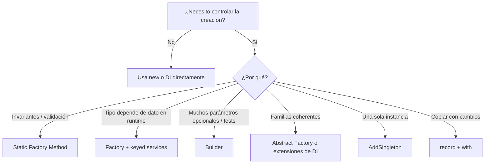

# 1.2 Patrones creacionales (Creational Patterns)

[⬅ Anterior: SOLID](01-fundamentos-solid.md) · [Índice](../README.md) · [Siguiente: Estructurales ➡](03-patrones-estructurales.md)

## 🎯 Objetivos
- Saber **cuándo** encapsular la creación de objetos.
- Aplicar Factory Method, Abstract Factory, Builder, Singleton y Prototype en C# moderno.
- Entender cómo el contenedor de DI de .NET reemplaza varios de estos patrones.

---

## 🧠 La idea central

Los patrones creacionales responden a: **¿quién crea los objetos y cómo?** Cuando usas `new` en todos lados, acoplas tu código a clases concretas y dispersas reglas de construcción.

| Patrón | Problema que resuelve | En .NET lo ves en… |
|--------|-----------------------|--------------------|
| Factory Method | Crear objetos válidos con una regla centralizada | `IHttpClientFactory.CreateClient()`, `ILoggerFactory.CreateLogger()` |
| Abstract Factory | Crear familias de objetos relacionados | `DbProviderFactory` |
| Builder | Construir objetos complejos paso a paso | `WebApplication.CreateBuilder()`, `StringBuilder`, `UriBuilder` |
| Singleton | Una sola instancia | `services.AddSingleton<T>()` |
| Prototype | Clonar en lugar de construir | `record` con expresión `with` |

---

## 1. Factory Method (y Static Factory)

### Problema
Crear un `Order` requiere reglas: debe tener cliente, al menos un item, estado inicial `Pending`. Si cualquiera puede hacer `new Order { ... }`, tendrás pedidos inválidos.

### Solución: constructor privado + método de fábrica
```csharp
public sealed class Order
{
    private readonly List<OrderItem> _items = [];
    public Guid Id { get; }
    public Guid CustomerId { get; }
    public OrderStatus Status { get; private set; }
    public IReadOnlyList<OrderItem> Items => _items;

    private Order(Guid id, Guid customerId)
    {
        Id = id;
        CustomerId = customerId;
        Status = OrderStatus.Pending;
    }

    public static Result<Order> Create(Guid customerId, IEnumerable<OrderItem> items)
    {
        if (customerId == Guid.Empty)
            return Result.Failure<Order>(OrderErrors.CustomerRequired);

        var list = items.ToList();
        if (list.Count == 0)
            return Result.Failure<Order>(OrderErrors.EmptyOrder);

        var order = new Order(Guid.CreateVersion7(), customerId);
        order._items.AddRange(list);
        return Result.Success(order);
    }
}
```
> `Guid.CreateVersion7()` (desde .NET 9) genera GUIDs ordenables por tiempo: mucho mejor para índices de base de datos que `Guid.NewGuid()`.
> `Result<T>` se explica en [1.5](05-patrones-empresariales.md#1-result-pattern).

### Factory Method "clásico" (GoF) con DI
Cuando la clase concreta depende de un dato en tiempo de ejecución:

```csharp
public interface IPaymentGateway { Task<PaymentResult> ChargeAsync(Money amount, CancellationToken ct); }

public interface IPaymentGatewayFactory { IPaymentGateway Create(PaymentMethod method); }

public sealed class PaymentGatewayFactory(IServiceProvider sp) : IPaymentGatewayFactory
{
    public IPaymentGateway Create(PaymentMethod method) => method switch
    {
        PaymentMethod.Card => sp.GetRequiredKeyedService<IPaymentGateway>("card"),
        PaymentMethod.Pse  => sp.GetRequiredKeyedService<IPaymentGateway>("pse"),
        _ => throw new NotSupportedException(method.ToString())
    };
}

// Keyed services (desde .NET 8)
builder.Services.AddKeyedScoped<IPaymentGateway, CardGateway>("card");
builder.Services.AddKeyedScoped<IPaymentGateway, PseGateway>("pse");
builder.Services.AddScoped<IPaymentGatewayFactory, PaymentGatewayFactory>();
```
> Aquí usar `IServiceProvider` dentro de una **fábrica** es aceptable: está acotado a un solo lugar de infraestructura (no es Service Locator disperso).

---

## 2. Abstract Factory

Crea **familias** de objetos que deben ser coherentes entre sí.

Ejemplo: tu sistema soporta despliegue en Azure y on-premise; cada entorno necesita un almacenamiento de archivos y una cola compatibles.

```csharp
public interface IInfrastructureFactory
{
    IFileStorage CreateFileStorage();
    IMessageQueue CreateQueue();
}

public sealed class AzureInfrastructureFactory(IConfiguration cfg) : IInfrastructureFactory
{
    public IFileStorage CreateFileStorage() => new BlobFileStorage(cfg["Blob:Endpoint"]!);
    public IMessageQueue CreateQueue()      => new ServiceBusQueue(cfg["ServiceBus:Namespace"]!);
}

public sealed class OnPremInfrastructureFactory(IConfiguration cfg) : IInfrastructureFactory
{
    public IFileStorage CreateFileStorage() => new NetworkShareStorage(cfg["Share:Path"]!);
    public IMessageQueue CreateQueue()      => new RabbitMqQueue(cfg["Rabbit:Host"]!);
}
```
> 💡 En aplicaciones modernas, esto casi siempre se resuelve **en el registro de DI** (un método de extensión `AddAzureInfrastructure()` vs `AddOnPremInfrastructure()`) sin necesidad de una clase factory explícita.

---

## 3. Builder

### Uso 1: objetos con muchos parámetros opcionales
```csharp
var report = new ReportBuilder()
    .WithTitle("Ventas Q4")
    .ForDateRange(new(2026, 10, 1), new(2026, 12, 31))
    .IncludeChart(ChartType.Bar)
    .Build();
```

### Uso 2 (el más valioso en el día a día): **Test Data Builders**
```csharp
public sealed class OrderBuilder
{
    private Guid _customerId = Guid.NewGuid();
    private readonly List<OrderItem> _items = [new("SKU-1", 1, Money.Cop(10_000))];

    public OrderBuilder ForCustomer(Guid id) { _customerId = id; return this; }
    public OrderBuilder WithItem(string sku, int qty, decimal price)
    {
        _items.Add(new(sku, qty, Money.Cop(price)));
        return this;
    }
    public OrderBuilder WithoutItems() { _items.Clear(); return this; }

    public Order Build() => Order.Create(_customerId, _items).Value;
    public Result<Order> TryBuild() => Order.Create(_customerId, _items);
}

// En el test: solo especificas lo que importa para ESE test
[Fact]
public void Order_without_items_fails()
{
    var result = new OrderBuilder().WithoutItems().TryBuild();
    Assert.True(result.IsFailure);
}
```

### Builder en el propio framework
```csharp
var builder = WebApplication.CreateBuilder(args); // Builder
builder.Services.AddControllers();                // configuras paso a paso
var app = builder.Build();                         // producto final
```

---

## 4. Singleton

### ❌ Singleton clásico (evítalo en apps .NET modernas)
```csharp
public sealed class Config
{
    private static readonly Lazy<Config> _instance = new(() => new Config());
    public static Config Instance => _instance.Value;
    private Config() { }
}
```
Problemas: estado global, imposible de mockear, dependencia oculta.

### ✅ Singleton vía DI
```csharp
builder.Services.AddSingleton<IExchangeRateCache, ExchangeRateCache>();
```
Mismo efecto (una instancia), pero inyectable y testeable.

> ⚠️ Todo Singleton debe ser **thread-safe**: usa `ConcurrentDictionary`, `Lock` (C# 13+) o inmutabilidad.

---

## 5. Prototype

Crear objetos copiando uno existente. En C# moderno: **records** + `with`.

```csharp
public sealed record ShippingQuote(string Carrier, decimal Price, int Days);

var baseQuote = new ShippingQuote("Servientrega", 12_000, 3);
var express   = baseQuote with { Price = 25_000, Days = 1 }; // copia modificada
```

> ⚠️ `with` hace copia **superficial** (shallow): si el record contiene una `List<T>`, ambas copias comparten la misma lista. Prefiere colecciones inmutables (`ImmutableArray<T>`, `IReadOnlyList<T>`).

---

## 🧭 ¿Cuál uso?



## ✅ Checklist
- [ ] Sé por qué un constructor privado + `Create()` protege invariantes.
- [ ] Uso Test Data Builders en mis tests.
- [ ] Nunca escribo un Singleton estático: uso DI.
- [ ] Conozco keyed services de .NET.

## 🏋️ Ejercicio (OrderFlow)
1. Haz que `Order` solo se pueda crear vía `Order.Create(...)` devolviendo `Result<Order>`.
2. Crea `OrderBuilder` en el proyecto de tests y reescribe tus tests con él.
3. Implementa `IPaymentGatewayFactory` con dos gateways falsos usando keyed services.

## 📚 Profundiza
- *Design Patterns* (GoF) — Gamma, Helm, Johnson, Vlissides.
- [refactoring.guru/design-patterns](https://refactoring.guru/es/design-patterns) — excelente, en español y con ejemplos en C#.
