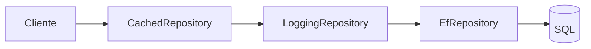

# 1.3 Patrones estructurales (Structural Patterns)

[⬅ Anterior: Creacionales](02-patrones-creacionales.md) · [Índice](../README.md) · [Siguiente: Comportamiento ➡](04-patrones-comportamiento.md)

## 🎯 Objetivos
- Componer objetos para añadir comportamiento sin modificar código existente.
- Aplicar Adapter, Decorator, Facade, Proxy y Composite en escenarios .NET reales.

---

## 🧠 La idea central
Los patrones estructurales responden a: **¿cómo encajo piezas que no fueron diseñadas para estar juntas, o cómo les agrego capacidades sin tocarlas?**

| Patrón | En una frase | Ejemplo .NET |
|--------|--------------|--------------|
| Adapter | Traduce una interfaz a otra | Envolver un SDK de terceros |
| Decorator | Envuelve para añadir comportamiento | `DelegatingHandler` de `HttpClient` |
| Facade | Simplifica un subsistema | `WebApplication` |
| Proxy | Controla acceso a un objeto | Lazy loading de EF Core |
| Composite | Árbol tratado de forma uniforme | `IConfiguration` (secciones anidadas) |

---

## 1. Adapter

### Problema
Usas un SDK de mensajería SMS de un proveedor (`AcmeSmsClient`) con una API rara. No quieres que tu código de aplicación dependa de él (si cambias de proveedor, cambias todo).

```csharp
// Tu abstracción (la define TU aplicación — DIP)
public interface ISmsSender
{
    Task SendAsync(PhoneNumber to, string message, CancellationToken ct);
}

// Adapter: traduce tu interfaz a la del SDK
public sealed class AcmeSmsAdapter(AcmeSmsClient client, ILogger<AcmeSmsAdapter> logger) : ISmsSender
{
    public async Task SendAsync(PhoneNumber to, string message, CancellationToken ct)
    {
        var response = await client.SubmitMessageAsync(new AcmeRequest
        {
            Msisdn = to.ToE164(),   // el SDK usa otro formato
            Body = message,
            Priority = AcmePriority.Normal
        });

        if (response.StatusCode != 0)
            throw new SmsDeliveryException($"Acme error {response.StatusCode}");
    }
}
```
> Este es exactamente el "adapter" de la **Arquitectura Hexagonal** (Ports & Adapters).

---

## 2. Decorator ⭐ (el más útil del módulo)

### Problema
Tienes `IProductRepository`. Quieres agregar caché, logging y métricas **sin modificar** la implementación con EF Core.

```csharp
public interface IProductRepository
{
    Task<Product?> GetByIdAsync(Guid id, CancellationToken ct);
}

public sealed class EfProductRepository(CatalogDbContext db) : IProductRepository
{
    public Task<Product?> GetByIdAsync(Guid id, CancellationToken ct) =>
        db.Products.AsNoTracking().FirstOrDefaultAsync(p => p.Id == id, ct);
}

// Decorator de caché
public sealed class CachedProductRepository(
    IProductRepository inner,
    HybridCache cache) : IProductRepository
{
    public async Task<Product?> GetByIdAsync(Guid id, CancellationToken ct) =>
        await cache.GetOrCreateAsync(
            $"product:{id}",
            async token => await inner.GetByIdAsync(id, token),
            cancellationToken: ct);
}
```

### Registro con Scrutor (librería popular)
```csharp
builder.Services.AddScoped<IProductRepository, EfProductRepository>();
builder.Services.Decorate<IProductRepository, CachedProductRepository>();
```

### Registro manual (sin librerías)
```csharp
builder.Services.AddScoped<EfProductRepository>();
builder.Services.AddScoped<IProductRepository>(sp =>
    new CachedProductRepository(
        sp.GetRequiredService<EfProductRepository>(),
        sp.GetRequiredService<HybridCache>()));
```

### Decorator en el framework: `DelegatingHandler`
```csharp
public sealed class CorrelationHandler(IHttpContextAccessor accessor) : DelegatingHandler
{
    protected override Task<HttpResponseMessage> SendAsync(
        HttpRequestMessage request, CancellationToken ct)
    {
        var tenant = accessor.HttpContext?.Request.Headers["X-Tenant-Id"].ToString();
        if (!string.IsNullOrEmpty(tenant))
            request.Headers.TryAddWithoutValidation("X-Tenant-Id", tenant);
        return base.SendAsync(request, ct); // llama al siguiente "envoltorio"
    }
}

builder.Services.AddTransient<CorrelationHandler>();
builder.Services.AddHttpClient<IPaymentsApi, PaymentsApi>()
    .AddHttpMessageHandler<CorrelationHandler>();
```



> 💡 Decorator vs herencia: con decorators puedes **combinar** comportamientos en el orden que quieras y activarlos por configuración.

---

## 3. Facade

### Problema
Para hacer checkout necesitas coordinar inventario, precios, pagos y envío. Los controladores no deberían conocer los 4 subsistemas.

```csharp
public sealed class CheckoutFacade(
    IInventoryService inventory,
    IPricingService pricing,
    IPaymentGatewayFactory payments,
    IShippingService shipping)
{
    public async Task<Result<CheckoutReceipt>> CheckoutAsync(Cart cart, CancellationToken ct)
    {
        var reservation = await inventory.ReserveAsync(cart.Items, ct);
        if (reservation.IsFailure) return reservation.Error;

        var total = pricing.Calculate(cart);
        var payment = await payments.Create(cart.PaymentMethod).ChargeAsync(total, ct);
        if (!payment.Succeeded)
        {
            await inventory.ReleaseAsync(reservation.Value, ct);
            return CheckoutErrors.PaymentDeclined;
        }

        var tracking = await shipping.ScheduleAsync(cart, ct);
        return new CheckoutReceipt(payment.TransactionId, tracking);
    }
}
```
> ⚠️ Una Facade que crece sin control se vuelve un God Service. Si pasa de ~5 dependencias, divide.
> En arquitecturas modernas, un **Application Service / Command Handler** cumple el rol de Facade.

---

## 4. Proxy

Objeto que se hace pasar por otro para **controlar el acceso**: lazy loading, seguridad, caché remota, llamadas remotas.

```csharp
// Proxy de protección: verifica permisos antes de delegar
public sealed class AuthorizedReportService(
    IReportService inner,
    ICurrentUser user) : IReportService
{
    public Task<Report> GenerateAsync(ReportRequest req, CancellationToken ct)
    {
        if (!user.HasPermission("reports.generate"))
            throw new UnauthorizedAccessException();
        return inner.GenerateAsync(req, ct);
    }
}
```

Ejemplos que ya usas: los proxies de **lazy loading** de EF Core, los clientes generados de **gRPC** o **Refit** (proxy remoto: parece una llamada local pero es HTTP).

> Decorator vs Proxy: estructuralmente iguales. La diferencia es la **intención**: Decorator añade comportamiento; Proxy controla acceso.

---

## 5. Composite

Tratar un elemento individual y un grupo de elementos con la misma interfaz.

```csharp
public interface IPriceRule { decimal Apply(decimal price, Order order); }

public sealed class PercentageDiscount(decimal pct) : IPriceRule
{
    public decimal Apply(decimal price, Order order) => price * (1 - pct);
}

public sealed class CompositePriceRule(IEnumerable<IPriceRule> rules) : IPriceRule
{
    public decimal Apply(decimal price, Order order) =>
        rules.Aggregate(price, (current, rule) => rule.Apply(current, order));
}

// Un "combo" de reglas es en sí mismo una regla
var blackFriday = new CompositePriceRule([
    new PercentageDiscount(0.20m),
    new CompositePriceRule([ new FreeShippingRule(), new LoyaltyRule() ])
]);
```

---

## 6. Bonus: Flyweight y Bridge (mención)
- **Flyweight:** compartir objetos inmutables para ahorrar memoria (ej. `string.Intern`, `FrozenDictionary`, caches de objetos inmutables).
- **Bridge:** separar abstracción de implementación para que varíen independientemente (ej. `ILogger` (abstracción) + providers Console/Seq/OTel (implementación)).

---

## ✅ Checklist
- [ ] Puedo añadir caché a un repositorio sin modificarlo (Decorator).
- [ ] Envuelvo SDKs de terceros detrás de mis propias interfaces (Adapter).
- [ ] Sé crear un `DelegatingHandler`.
- [ ] Distingo Decorator de Proxy por su intención.

## 🏋️ Ejercicio (OrderFlow)
1. Crea `IProductRepository` + `EfProductRepository` + `CachedProductRepository` (HybridCache).
2. Crea un `LoggingProductRepository` y encadena: Logging → Cached → EF.
3. Envuelve un cliente HTTP "falso" de pagos en un Adapter.
