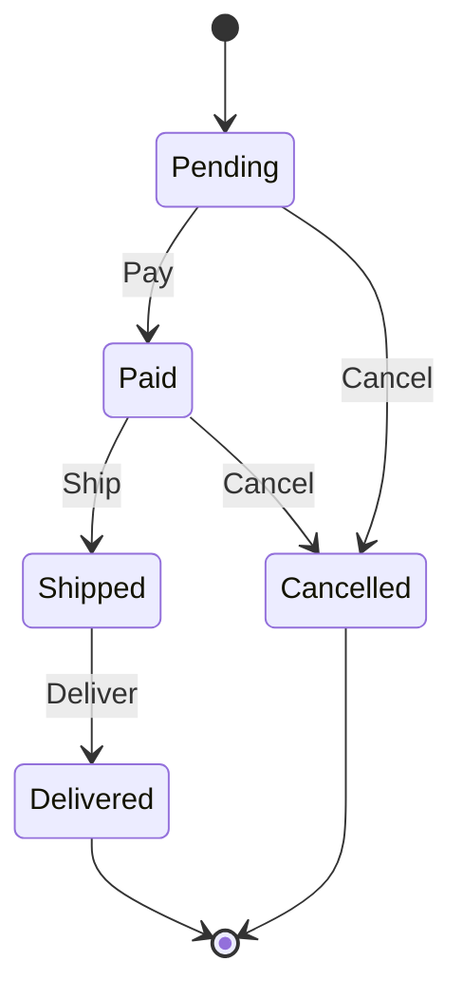

# 1.4 Patrones de comportamiento (Behavioral Patterns)

[⬅ Anterior: Estructurales](03-patrones-estructurales.md) · [Índice](../README.md) · [Siguiente: Empresariales ➡](05-patrones-empresariales.md)

## 🎯 Objetivos
- Distribuir responsabilidades y algoritmos entre objetos de forma flexible.
- Aplicar Strategy, State, Chain of Responsibility, Observer, Command, Template Method y Mediator.
- Reconocer estos patrones dentro de ASP.NET Core.

---

## 🧠 La idea central
Los patrones de comportamiento responden a: **¿cómo se comunican los objetos y quién decide qué?**

| Patrón | Úsalo cuando… | En ASP.NET Core |
|--------|---------------|-----------------|
| Strategy | Hay varias formas de hacer lo mismo | `IPasswordHasher`, `IAuthenticationHandler` |
| State | El comportamiento depende del estado | — |
| Chain of Responsibility | Una petición pasa por varios filtros | Middleware pipeline |
| Observer | Varios interesados reaccionan a un evento | `IOptionsMonitor.OnChange`, `IObservable<T>` |
| Command | Quieres tratar una acción como objeto | Mensajes CQRS |
| Template Method | El algoritmo es fijo pero algunos pasos varían | `BackgroundService.ExecuteAsync` |
| Mediator | Muchos objetos se hablan entre sí | Dispatchers de commands/queries |

---

## 1. Strategy
Ya lo viste en [1.1 (OCP)](01-fundamentos-solid.md#o--openclosed-principle-ocp). Variante con selección dinámica:

```csharp
public interface IDiscountStrategy
{
    bool AppliesTo(Order order);
    decimal Calculate(Order order);
}

public sealed class FirstPurchaseDiscount : IDiscountStrategy
{
    public bool AppliesTo(Order o) => o.IsFirstPurchase;
    public decimal Calculate(Order o) => o.Subtotal * 0.10m;
}

public sealed class VolumeDiscount : IDiscountStrategy
{
    public bool AppliesTo(Order o) => o.Items.Sum(i => i.Quantity) >= 10;
    public decimal Calculate(Order o) => o.Subtotal * 0.05m;
}

public sealed class DiscountEngine(IEnumerable<IDiscountStrategy> strategies)
{
    // Regla de negocio: se aplica el mayor descuento
    public decimal BestDiscount(Order order) =>
        strategies.Where(s => s.AppliesTo(order))
                  .Select(s => s.Calculate(order))
                  .DefaultIfEmpty(0m)
                  .Max();
}
```

> 💡 Strategy "ligero": a veces basta un `Func<Order, decimal>`. No crees interfaces si una lambda es suficiente.

---

## 2. State ⭐

### Problema
Un pedido pasa por `Pending → Paid → Shipped → Delivered` y puede `Cancelled` solo antes de enviarse. Los `if/switch` sobre el estado se esparcen por todo el código.

### Opción A: máquina de estados explícita dentro del aggregate (recomendada para la mayoría de casos)
```csharp
public sealed partial class Order
{
    private static readonly Dictionary<OrderStatus, OrderStatus[]> AllowedTransitions = new()
    {
        [OrderStatus.Pending]   = [OrderStatus.Paid, OrderStatus.Cancelled],
        [OrderStatus.Paid]      = [OrderStatus.Shipped, OrderStatus.Cancelled],
        [OrderStatus.Shipped]   = [OrderStatus.Delivered],
        [OrderStatus.Delivered] = [],
        [OrderStatus.Cancelled] = []
    };

    private Result TransitionTo(OrderStatus next)
    {
        if (!AllowedTransitions[Status].Contains(next))
            return OrderErrors.InvalidTransition(Status, next);
        Status = next;
        return Result.Success();
    }

    public Result MarkAsPaid(string transactionId)
    {
        var r = TransitionTo(OrderStatus.Paid);
        if (r.IsSuccess) Raise(new OrderPaid(Id, transactionId));
        return r;
    }

    public Result Cancel(string reason) => TransitionTo(OrderStatus.Cancelled);
}
```

### Opción B: patrón State GoF (cuando cada estado tiene MUCHO comportamiento distinto)
```csharp
public abstract class OrderState
{
    public virtual OrderState Pay()    => throw Invalid(nameof(Pay));
    public virtual OrderState Ship()   => throw Invalid(nameof(Ship));
    public virtual OrderState Cancel() => throw Invalid(nameof(Cancel));
    protected InvalidOperationException Invalid(string op) => new($"{op} no permitido en {GetType().Name}");
}

public sealed class PendingState : OrderState
{
    public override OrderState Pay()    => new PaidState();
    public override OrderState Cancel() => new CancelledState();
}
public sealed class PaidState : OrderState
{
    public override OrderState Ship()   => new ShippedState();
    public override OrderState Cancel() => new CancelledState();
}
// ...
```



> Para flujos complejos y de larga duración (días), considera librerías como **Stateless** o una saga (ver [2.4](../modulo-02-arquitectura/04-resiliencia.md)).

---

## 3. Chain of Responsibility

### En el framework: middleware
```csharp
app.Use(async (context, next) =>
{
    var sw = Stopwatch.StartNew();
    await next(context);                       // pasa al siguiente eslabón
    context.Response.Headers["X-Elapsed-Ms"] = sw.ElapsedMilliseconds.ToString();
});
```

### En tu código: pipeline de validaciones
```csharp
public interface IOrderRule
{
    Result Check(Order order);
}

public sealed class OrderValidationPipeline(IEnumerable<IOrderRule> rules)
{
    public Result Validate(Order order)
    {
        foreach (var rule in rules)
        {
            var result = rule.Check(order);
            if (result.IsFailure) return result; // corta la cadena
        }
        return Result.Success();
    }
}
```

---

## 4. Observer

### En .NET: eventos, `IObservable<T>`, y — lo más común en apps empresariales — **domain events**.

```csharp
// Eventos de dominio (Observer desacoplado)
public interface IDomainEvent;
public sealed record OrderPaid(Guid OrderId, string TransactionId) : IDomainEvent;

public interface IDomainEventHandler<in TEvent> where TEvent : IDomainEvent
{
    Task HandleAsync(TEvent @event, CancellationToken ct);
}

public sealed class SendReceiptOnOrderPaid(IEmailSender email) : IDomainEventHandler<OrderPaid>
{
    public Task HandleAsync(OrderPaid e, CancellationToken ct) =>
        email.SendReceiptAsync(e.OrderId, ct);
}

public sealed class UpdateLoyaltyOnOrderPaid(ILoyaltyService loyalty) : IDomainEventHandler<OrderPaid>
{
    public Task HandleAsync(OrderPaid e, CancellationToken ct) =>
        loyalty.AddPointsAsync(e.OrderId, ct);
}
```
Un dispatcher busca todos los `IDomainEventHandler<OrderPaid>` registrados y los invoca. Ver implementación en [1.5](05-patrones-empresariales.md#4-dispatcher-de-domain-events).

> ⚠️ Observer con eventos C# (`event EventHandler`) en objetos de vida larga es fuente clásica de **memory leaks** si no te desuscribes.

---

## 5. Command

Encapsular una petición como objeto → se puede encolar, registrar, reintentar, deshacer.

```csharp
public sealed record PlaceOrderCommand(Guid CustomerId, IReadOnlyList<OrderLineDto> Lines);

public interface ICommandHandler<in TCommand, TResult>
{
    Task<TResult> HandleAsync(TCommand command, CancellationToken ct);
}
```
Es la base de CQRS ([1.5](05-patrones-empresariales.md#3-cqrs-ligero)) y de la mensajería (un mensaje en una cola es un Command o un Event serializado).

---

## 6. Template Method

Algoritmo fijo en la clase base, pasos variables en subclases.

```csharp
public abstract class ImportJob<TRecord>
{
    public async Task RunAsync(Stream file, CancellationToken ct)
    {
        var records = await ParseAsync(file, ct);          // varía
        var valid = records.Where(Validate).ToList();      // varía
        await SaveAsync(valid, ct);                        // varía
        await NotifyAsync(valid.Count, records.Count - valid.Count, ct); // fijo
    }

    protected abstract Task<IReadOnlyList<TRecord>> ParseAsync(Stream file, CancellationToken ct);
    protected abstract bool Validate(TRecord record);
    protected abstract Task SaveAsync(IReadOnlyList<TRecord> records, CancellationToken ct);
    protected virtual Task NotifyAsync(int ok, int failed, CancellationToken ct) => Task.CompletedTask;
}
```
En el framework: `BackgroundService` (tú implementas `ExecuteAsync`, la base maneja el ciclo de vida).

> Prefiere composición (Strategy) si la jerarquía empieza a crecer.

---

## 7. Mediator

Un objeto central que enruta mensajes para que los emisores no conozcan a los receptores.

> ⚠️ **Nota importante de licenciamiento (2025):** **MediatR** (y AutoMapper) pasaron a **licencia comercial** a partir de MediatR v13; hay una edición gratuita para organizaciones pequeñas. Verifica la licencia antes de adoptarlo en tu empresa. Alternativas: escribir tu propio dispatcher (≈ 40 líneas, ver [1.5](05-patrones-empresariales.md#3-cqrs-ligero)), **Wolverine**, o librerías con source generators como **Mediator** (martinothamar).

> 🤔 **Opinión de ingeniería:** el patrón Mediator para comandos *in-process* añade indirección. Su valor real son los *pipeline behaviors* (logging, validación, transacciones transversales). Si no los usas, inyectar el handler directamente es más simple y más fácil de navegar.

---

## 8. Otros que vale la pena conocer
- **Iterator:** `IEnumerable<T>` + `yield return`; `IAsyncEnumerable<T>` para streams.
- **Visitor:** recorrer árboles heterogéneos (Roslyn, expression trees de LINQ). Con C# 15 union types y *pattern matching*, muchos Visitors se reemplazan por `switch` exhaustivos.
- **Memento:** guardar/restaurar estado (undo).
- **Null Object:** `NullLogger.Instance` evita `if (logger != null)`.

---

## ✅ Checklist
- [ ] Reconozco Chain of Responsibility en el middleware y Template Method en `BackgroundService`.
- [ ] Modelé un ciclo de vida con State/máquina de estados.
- [ ] Sé implementar domain events con handlers desacoplados.
- [ ] Conozco el cambio de licencia de MediatR y sus alternativas.

## 🏋️ Ejercicio (OrderFlow)
1. Implementa la máquina de estados del pedido con tests para **todas** las transiciones inválidas.
2. Motor de descuentos con 3 estrategias (mejor descuento gana).
3. Publica `OrderPaid` y crea dos handlers (email falso + puntos de lealtad).
