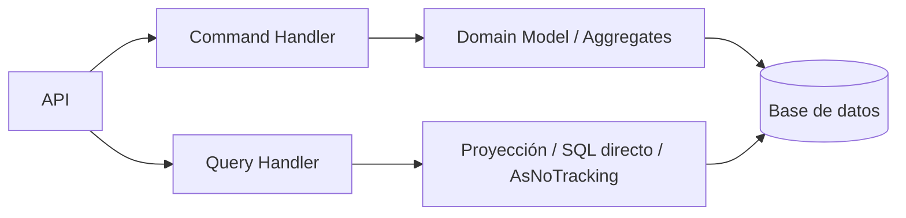

# 1.5 Patrones empresariales en .NET

[⬅ Anterior: Comportamiento](04-patrones-comportamiento.md) · [Índice](../README.md) · [Siguiente módulo: Arquitectura ➡](../modulo-02-arquitectura/01-estilos-arquitectonicos.md)

## 🎯 Objetivos
- Aplicar los patrones que más aparecen en APIs y sistemas empresariales .NET.
- Decidir con criterio cuándo un patrón aporta y cuándo es ceremonia.

**Temas:** Result · Options · CQRS ligero · Domain events dispatcher · Repository y Unit of Work · Specification · Outbox (intro) · Pipeline behaviors

---

## 1. Result pattern

### Problema
Usar excepciones para errores **esperados** (validación, "no encontrado", "saldo insuficiente") es caro, oculta el flujo y obliga a `try/catch` por todos lados.

> **Regla:** excepciones para lo **excepcional** (BD caída, bug). `Result` para lo **esperado** (reglas de negocio).

```csharp
public sealed record Error(string Code, string Message, ErrorType Type = ErrorType.Failure)
{
    public static readonly Error None = new(string.Empty, string.Empty);
    public static Error NotFound(string code, string msg)   => new(code, msg, ErrorType.NotFound);
    public static Error Validation(string code, string msg) => new(code, msg, ErrorType.Validation);
    public static Error Conflict(string code, string msg)   => new(code, msg, ErrorType.Conflict);
}

public enum ErrorType { Failure, Validation, NotFound, Conflict }

public class Result
{
    protected Result(bool isSuccess, Error error) { IsSuccess = isSuccess; Error = error; }
    public bool IsSuccess { get; }
    public bool IsFailure => !IsSuccess;
    public Error Error { get; }

    public static Result Success() => new(true, Error.None);
    public static Result Failure(Error error) => new(false, error);
    public static Result<T> Success<T>(T value) => new(value, true, Error.None);
    public static Result<T> Failure<T>(Error error) => new(default, false, error);

    public static implicit operator Result(Error error) => Failure(error);
}

public sealed class Result<T> : Result
{
    private readonly T? _value;
    internal Result(T? value, bool ok, Error error) : base(ok, error) => _value = value;

    public T Value => IsSuccess
        ? _value!
        : throw new InvalidOperationException("No se puede leer Value de un resultado fallido");

    public static implicit operator Result<T>(T value) => Success(value);
    public static implicit operator Result<T>(Error error) => Failure<T>(error);
}

// Errores del dominio, centralizados y con código estable (útil para el frontend y la observabilidad)
public static class OrderErrors
{
    public static readonly Error EmptyOrder = Error.Validation("Order.Empty", "El pedido debe tener al menos un ítem");
    public static readonly Error CustomerRequired = Error.Validation("Order.CustomerRequired", "Cliente requerido");
    public static Error NotFound(Guid id) => Error.NotFound("Order.NotFound", $"Pedido {id} no existe");
    public static Error InvalidTransition(OrderStatus from, OrderStatus to) =>
        Error.Conflict("Order.InvalidTransition", $"No se puede pasar de {from} a {to}");
}
```

### Mapear Result → HTTP (ProblemDetails, RFC 9457)
```csharp
public static class ResultExtensions
{
    public static IResult ToProblem(this Result result) => result.Error.Type switch
    {
        ErrorType.Validation => TypedResults.Problem(result.Error.Message, statusCode: 400, title: result.Error.Code),
        ErrorType.NotFound   => TypedResults.Problem(result.Error.Message, statusCode: 404, title: result.Error.Code),
        ErrorType.Conflict   => TypedResults.Problem(result.Error.Message, statusCode: 409, title: result.Error.Code),
        _                    => TypedResults.Problem(result.Error.Message, statusCode: 500, title: result.Error.Code)
    };
}

app.MapPost("/orders/{id:guid}/pay", async (Guid id, PayOrderHandler handler, CancellationToken ct) =>
{
    var result = await handler.HandleAsync(new PayOrderCommand(id), ct);
    return result.IsSuccess ? Results.NoContent() : result.ToProblem();
});
```
> Librerías alternativas: **ErrorOr**, **FluentResults**, **OneOf**. Con **C# 15 union types** (.NET 11) este patrón se volverá más natural en el lenguaje.

---

## 2. Options pattern

Configuración fuertemente tipada **y validada al arrancar** (fail fast).

```csharp
public sealed class PaymentsOptions
{
    public const string Section = "Payments";

    [Required, Url] public string BaseUrl { get; init; } = default!;
    [Range(1, 60)]  public int TimeoutSeconds { get; init; } = 10;
    [Required]      public string MerchantId { get; init; } = default!;
}

builder.Services.AddOptions<PaymentsOptions>()
    .BindConfiguration(PaymentsOptions.Section)
    .ValidateDataAnnotations()
    .ValidateOnStart();   // si falta config, la app NO arranca (mejor que fallar a las 3am)
```

| Interfaz | Cuándo |
|----------|--------|
| `IOptions<T>` | Valor fijo durante toda la vida de la app (Singleton) |
| `IOptionsSnapshot<T>` | Se recalcula por request (Scoped) |
| `IOptionsMonitor<T>` | Cambios en caliente + notificación `OnChange` (Singleton) |

> Para validación compleja: `IValidateOptions<T>` o el source generator `[OptionsValidator]` (compatible con AOT).

---

## 3. CQRS ligero

**CQRS = separar escritura (commands) de lectura (queries).** No implica necesariamente dos bases de datos ni Event Sourcing.



- **Commands**: pasan por el modelo de dominio (reglas, invariantes). Devuelven poco (Id o `Result`).
- **Queries**: van directo a los datos con lo mínimo (`AsNoTracking`, `Select` a DTO, Dapper). No tocan el dominio.

### Abstracciones mínimas (sin librerías)
```csharp
public interface ICommand<TResponse>;
public interface IQuery<TResponse>;

public interface ICommandHandler<in TCommand, TResponse> where TCommand : ICommand<TResponse>
{
    Task<TResponse> HandleAsync(TCommand command, CancellationToken ct);
}

public interface IQueryHandler<in TQuery, TResponse> where TQuery : IQuery<TResponse>
{
    Task<TResponse> HandleAsync(TQuery query, CancellationToken ct);
}
```

### Command
```csharp
public sealed record PlaceOrderCommand(Guid CustomerId, IReadOnlyList<OrderLineDto> Lines) : ICommand<Result<Guid>>;

internal sealed class PlaceOrderHandler(OrderingDbContext db, TimeProvider clock)
    : ICommandHandler<PlaceOrderCommand, Result<Guid>>
{
    public async Task<Result<Guid>> HandleAsync(PlaceOrderCommand cmd, CancellationToken ct)
    {
        var items = cmd.Lines.Select(l => new OrderItem(l.Sku, l.Quantity, Money.Cop(l.UnitPrice)));
        var orderResult = Order.Create(cmd.CustomerId, items);
        if (orderResult.IsFailure) return orderResult.Error;

        db.Orders.Add(orderResult.Value);
        await db.SaveChangesAsync(ct);
        return orderResult.Value.Id;
    }
}
```

### Query
```csharp
public sealed record GetOrderSummaryQuery(Guid OrderId) : IQuery<OrderSummaryDto?>;

internal sealed class GetOrderSummaryHandler(OrderingDbContext db)
    : IQueryHandler<GetOrderSummaryQuery, OrderSummaryDto?>
{
    public Task<OrderSummaryDto?> HandleAsync(GetOrderSummaryQuery q, CancellationToken ct) =>
        db.Orders.AsNoTracking()
          .Where(o => o.Id == q.OrderId)
          .Select(o => new OrderSummaryDto(o.Id, o.Status.ToString(), o.Items.Sum(i => i.Quantity * i.UnitPrice.Amount)))
          .FirstOrDefaultAsync(ct);
}
```

### Registro automático con Scrutor
```csharp
builder.Services.Scan(s => s.FromAssemblyOf<PlaceOrderHandler>()
    .AddClasses(c => c.AssignableToAny(typeof(ICommandHandler<,>), typeof(IQueryHandler<,>)), publicOnly: false)
    .AsImplementedInterfaces()
    .WithScopedLifetime());
```

### Cross-cutting sin Mediator: decorators (pipeline behaviors "a mano")
```csharp
internal sealed class LoggingCommandHandler<TCommand, TResponse>(
    ICommandHandler<TCommand, TResponse> inner,
    ILogger<LoggingCommandHandler<TCommand, TResponse>> logger)
    : ICommandHandler<TCommand, TResponse> where TCommand : ICommand<TResponse>
{
    public async Task<TResponse> HandleAsync(TCommand command, CancellationToken ct)
    {
        logger.LogInformation("Ejecutando {Command}", typeof(TCommand).Name);
        var sw = Stopwatch.StartNew();
        var response = await inner.HandleAsync(command, ct);
        logger.LogInformation("{Command} terminó en {ElapsedMs} ms", typeof(TCommand).Name, sw.ElapsedMilliseconds);
        return response;
    }
}

builder.Services.Decorate(typeof(ICommandHandler<,>), typeof(LoggingCommandHandler<,>));
```

---

## 4. Dispatcher de domain events

Los aggregates **registran** eventos; se despachan al guardar.

```csharp
public abstract class Entity
{
    private readonly List<IDomainEvent> _events = [];
    public IReadOnlyList<IDomainEvent> DomainEvents => _events;
    protected void Raise(IDomainEvent e) => _events.Add(e);
    public void ClearDomainEvents() => _events.Clear();
}

// Interceptor de EF Core: después de guardar, publica los eventos
public sealed class DispatchDomainEventsInterceptor(IServiceProvider sp) : SaveChangesInterceptor
{
    public override async ValueTask<int> SavedChangesAsync(
        SaveChangesCompletedEventData data, int result, CancellationToken ct = default)
    {
        var entities = data.Context!.ChangeTracker.Entries<Entity>()
            .Select(e => e.Entity).Where(e => e.DomainEvents.Count > 0).ToList();

        var events = entities.SelectMany(e => e.DomainEvents).ToList();
        entities.ForEach(e => e.ClearDomainEvents());

        foreach (var domainEvent in events)
        {
            var handlerType = typeof(IDomainEventHandler<>).MakeGenericType(domainEvent.GetType());
            foreach (dynamic handler in sp.GetServices(handlerType))
                await handler.HandleAsync((dynamic)domainEvent, ct);
        }
        return result;
    }
}
```
> ⚠️ Despachar **después** de `SaveChanges` significa que si un handler falla, los datos ya se guardaron. Para efectos externos (emails, otros servicios) usa el **Outbox pattern** ([2.4](../modulo-02-arquitectura/04-resiliencia.md#4-outbox-pattern)), que es la solución robusta.

---

## 5. Repository y Unit of Work

### El debate honesto
`DbContext` **ya es** un Unit of Work y `DbSet<T>` **ya es** un Repository. Envolverlos en `IRepository<T>` genérico con `GetAll()`, `Find(Expression)`... suele ser una abstracción que filtra (leaky) y no aporta.

| Enfoque | Cuándo |
|---------|--------|
| Usar `DbContext` directamente en handlers | Apps CRUD, vertical slices, equipos pequeños |
| **Repository por aggregate** (no genérico) | DDD: quieres que solo se pueda cargar/guardar el aggregate completo |
| Repository genérico `IRepository<T>` | Casi nunca — es el antipatrón más común |

### Repository por aggregate (estilo DDD)
```csharp
public interface IOrderRepository
{
    Task<Order?> GetByIdAsync(Guid id, CancellationToken ct);
    void Add(Order order);
}

public interface IUnitOfWork
{
    Task<int> SaveChangesAsync(CancellationToken ct);
}

internal sealed class OrderRepository(OrderingDbContext db) : IOrderRepository
{
    public Task<Order?> GetByIdAsync(Guid id, CancellationToken ct) =>
        db.Orders.Include(o => o.Items).FirstOrDefaultAsync(o => o.Id == id, ct);

    public void Add(Order order) => db.Orders.Add(order);
}

// OrderingDbContext : DbContext, IUnitOfWork
```
Esto mantiene el **dominio y la capa de aplicación libres de EF Core**, que es el objetivo en Clean Architecture.

---

## 6. Specification

Encapsula un criterio reutilizable y testeable.

```csharp
public abstract class Specification<T>
{
    public abstract Expression<Func<T, bool>> ToExpression();
    public bool IsSatisfiedBy(T entity) => ToExpression().Compile()(entity);
}

public sealed class OverdueOrdersSpec(DateTimeOffset now) : Specification<Order>
{
    public override Expression<Func<Order, bool>> ToExpression() =>
        o => o.Status == OrderStatus.Paid && o.PaidAt < now.AddDays(-3);
}

// Uso con EF Core (se traduce a SQL)
var overdue = await db.Orders.Where(new OverdueOrdersSpec(clock.GetUtcNow()).ToExpression()).ToListAsync(ct);
```
> Librería popular: **Ardalis.Specification**. Úsalo cuando el mismo criterio aparece en varias consultas; si no, un método de extensión `IQueryable<Order>.Overdue(now)` es más simple.

---

## 7. Otros patrones empresariales útiles
- **TimeProvider** (.NET 8+): abstracción del reloj → tests deterministas (`FakeTimeProvider`). Nunca uses `DateTime.Now` en el dominio.
- **Strongly-typed IDs**: `readonly record struct OrderId(Guid Value)` evita pasar un `CustomerId` donde va un `OrderId`.
- **Guard clauses**: `ArgumentException.ThrowIfNullOrWhiteSpace(name)`, `ArgumentOutOfRangeException.ThrowIfNegative(qty)`.
- **Mapping**: escribe mappers manuales o usa **Mapperly** (source generator, gratis). AutoMapper ahora es comercial y oculta errores en runtime.

---

## ✅ Checklist
- [ ] Mis errores de negocio son `Result`, no excepciones.
- [ ] Mi config se valida al arrancar (`ValidateOnStart`).
- [ ] Separo commands (dominio) de queries (proyecciones `AsNoTracking`).
- [ ] Sé argumentar a favor y en contra del Repository sobre EF Core.
- [ ] Uso `TimeProvider` en vez de `DateTime.Now`.

## 🏋️ Ejercicio (OrderFlow)
1. Implementa `Result`/`Error` y `OrderErrors`. Mapea a ProblemDetails.
2. Crea `PlaceOrder`, `PayOrder` (commands) y `GetOrderSummary`, `ListOrders` (queries con paginación).
3. Agrega `LoggingCommandHandler` como decorator.
4. Configura `PaymentsOptions` con `ValidateOnStart` y comprueba que la app no arranca sin config.

## 📚 Profundiza
- *Patterns of Enterprise Application Architecture* — Martin Fowler.
- [Microsoft: Design a DDD-oriented microservice](https://learn.microsoft.com/dotnet/architecture/microservices/microservice-ddd-cqrs-patterns/).
- [Options pattern in .NET](https://learn.microsoft.com/dotnet/core/extensions/options).
