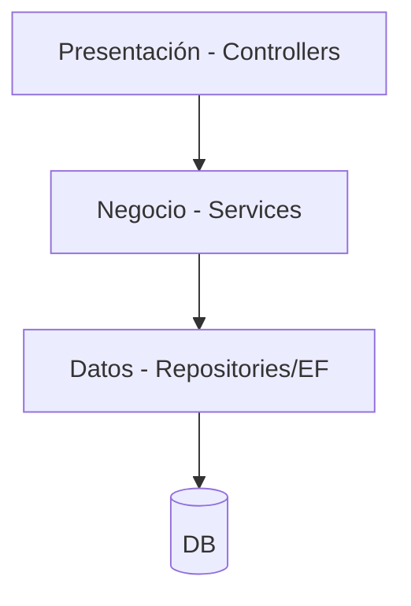
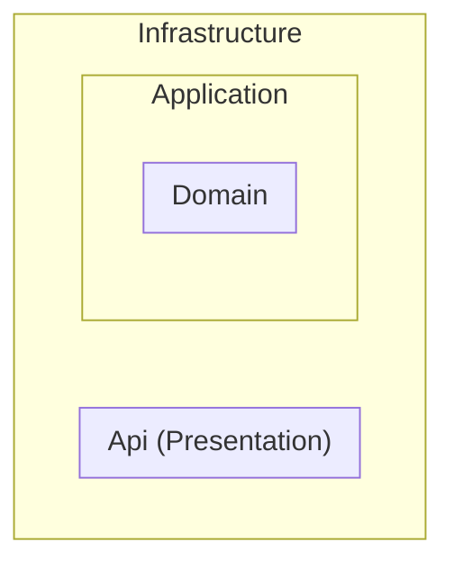
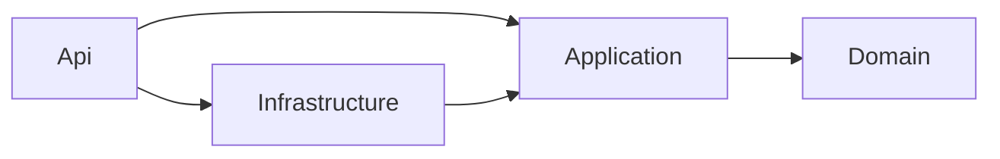
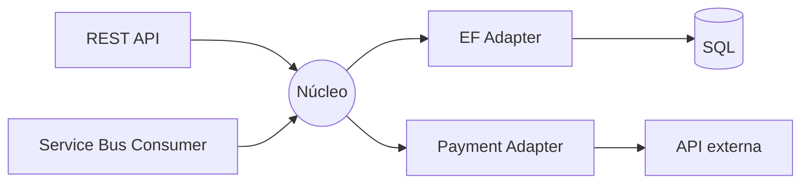
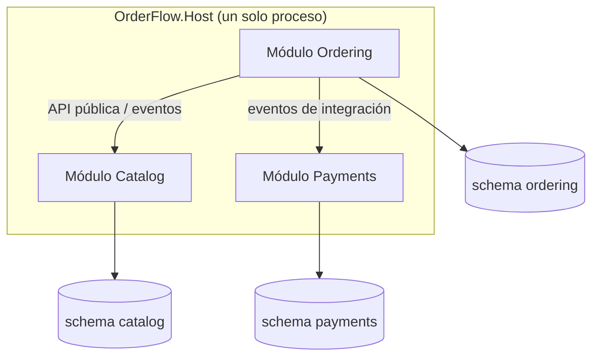
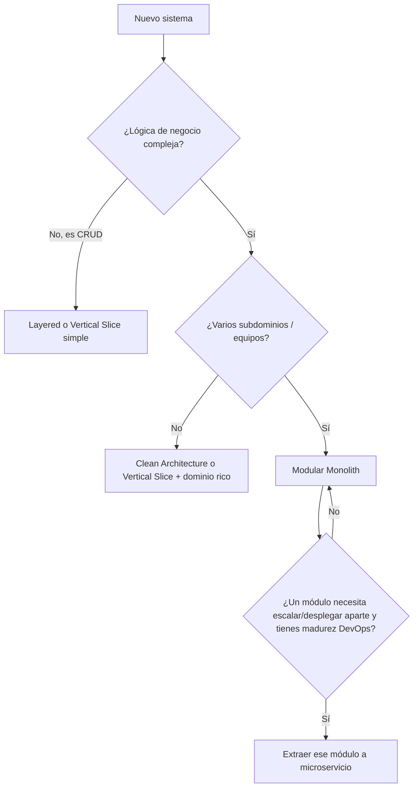

# 2.1 Estilos arquitectónicos

[⬅ Módulo anterior](../modulo-01-patrones-diseno/05-patrones-empresariales.md) · [Índice](../README.md) · [Siguiente: DDD ➡](02-domain-driven-design.md)

## 🎯 Objetivos
- Conocer los estilos más usados en .NET y sus trade-offs.
- Elegir el estilo adecuado según equipo, dominio y escala.
- Estructurar una solución .NET en Clean Architecture y en Modular Monolith.

---

## 🧠 Primero: ¿qué es arquitectura?

> "Arquitectura son las decisiones que son caras de cambiar." — Martin Fowler (parafraseado)

No existe "la mejor arquitectura". Existe la que mejor equilibra **atributos de calidad** para tu contexto:

| Atributo | Pregunta |
|----------|----------|
| Escalabilidad | ¿Aguanta 10× más carga? |
| Mantenibilidad | ¿Cambiar algo es barato? |
| Disponibilidad | ¿Qué pasa si se cae una pieza? |
| Desplegabilidad | ¿Puedo desplegar seguido y sin miedo? |
| Testabilidad | ¿Puedo probar la lógica sin infraestructura? |
| Simplicidad / costo | ¿El equipo puede operarla? |

---

## 1. Layered Architecture (N-capas)


- ✅ Simple, conocida por todos.
- ❌ El negocio depende de los datos → la base de datos dicta el diseño; tiende a "modelo anémico" y servicios gigantes.
- **Úsala:** CRUDs simples, apps internas pequeñas.

---

## 2. Clean Architecture / Onion ⭐

**Regla de dependencias:** el código fuente solo apunta **hacia adentro**. El dominio no conoce nada de afuera.





| Proyecto | Contiene | Depende de |
|----------|----------|------------|
| `OrderFlow.Domain` | Entities, Value Objects, Domain Events, errores, interfaces de repositorio | Nada (ni EF, ni ASP.NET) |
| `OrderFlow.Application` | Commands/Queries + handlers, interfaces de servicios externos (`IEmailSender`), DTOs | Domain |
| `OrderFlow.Infrastructure` | EF Core, repositorios, clientes HTTP, mensajería, email | Application, Domain |
| `OrderFlow.Api` | Endpoints, middleware, composición (DI) | Application, Infrastructure |

### Estructura de carpetas
```text
src/
├── OrderFlow.Domain/
│   ├── Orders/  (Order.cs, OrderItem.cs, OrderStatus.cs, OrderErrors.cs, Events/)
│   └── Common/  (Entity.cs, Result.cs, Money.cs)
├── OrderFlow.Application/
│   ├── Orders/
│   │   ├── PlaceOrder/  (PlaceOrderCommand.cs, PlaceOrderHandler.cs, PlaceOrderValidator.cs)
│   │   └── GetOrder/    (GetOrderQuery.cs, GetOrderHandler.cs, OrderDto.cs)
│   └── Abstractions/  (IEmailSender.cs, IUnitOfWork.cs)
├── OrderFlow.Infrastructure/
│   ├── Persistence/  (OrderingDbContext.cs, Configurations/, Migrations/)
│   ├── Email/
│   └── DependencyInjection.cs
└── OrderFlow.Api/
    ├── Endpoints/
    └── Program.cs
tests/
├── OrderFlow.Domain.Tests/
├── OrderFlow.Application.Tests/
├── OrderFlow.Api.IntegrationTests/   (WebApplicationFactory + Testcontainers)
└── OrderFlow.ArchitectureTests/      (NetArchTest — ver módulo 4.1)
```

### Composición en `Program.cs`
```csharp
var builder = WebApplication.CreateBuilder(args);
builder.Services
    .AddApplication()                         // handlers, validadores
    .AddInfrastructure(builder.Configuration); // EF, email, mensajería

var app = builder.Build();
app.MapOrderEndpoints();
app.Run();
```

- ✅ Dominio testeable sin infraestructura; cambiar EF por Dapper no toca el negocio.
- ❌ Más proyectos y archivos; puede ser ceremonia para CRUDs.

---

## 3. Hexagonal Architecture (Ports & Adapters)

Misma idea que Clean, otro vocabulario:
- **Port** = interfaz que define el núcleo (ej. `IPaymentGateway`, `IOrderRepository`).
- **Adapter** = implementación concreta (ej. `StripePaymentAdapter`, `EfOrderRepository`).
- **Driving adapters** (entrada): API REST, consumer de mensajes, CLI.
- **Driven adapters** (salida): BD, colas, APIs externas.



---

## 4. Vertical Slice Architecture

Organiza por **funcionalidad**, no por capa técnica. Cada "slice" contiene todo lo necesario para un caso de uso.

```text
Features/
├── Orders/
│   ├── PlaceOrder.cs      ← endpoint + command + handler + validator en un archivo
│   ├── GetOrder.cs
│   └── CancelOrder.cs
└── Catalog/
    └── SearchProducts.cs
```

```csharp
public static class PlaceOrder
{
    public sealed record Request(Guid CustomerId, List<Line> Lines);
    public sealed record Line(string Sku, int Quantity);
    public sealed record Response(Guid OrderId);

    public static void Map(IEndpointRouteBuilder app) =>
        app.MapPost("/orders", Handle).WithName("PlaceOrder").RequireAuthorization();

    private static async Task<Results<Created<Response>, ProblemHttpResult>> Handle(
        Request req, OrderingDbContext db, CancellationToken ct)
    {
        var result = Order.Create(req.CustomerId, req.Lines.Select(l => new OrderItem(l.Sku, l.Quantity)));
        if (result.IsFailure) return TypedResults.Problem(result.Error.Message, statusCode: 400);

        db.Orders.Add(result.Value);
        await db.SaveChangesAsync(ct);
        return TypedResults.Created($"/orders/{result.Value.Id}", new Response(result.Value.Id));
    }
}
```
- ✅ Alta cohesión: cambiar una feature toca una carpeta. Poca ceremonia.
- ❌ Riesgo de duplicar lógica de dominio entre slices → combínalo con un dominio rico.
- 💡 **Combinación muy popular hoy:** Vertical Slices **dentro** de cada módulo + dominio rico (DDD).

---

## 5. Modular Monolith ⭐ (el punto de partida recomendado)

Un solo despliegue, pero dividido en **módulos con fronteras estrictas**, alineados a bounded contexts ([2.2](02-domain-driven-design.md)).



### Reglas que hacen que funcione
1. **Cada módulo es dueño de sus datos** (schema propio; nunca hagas JOIN entre schemas de otros módulos).
2. Los módulos se comunican solo vía **contratos públicos** (`Ordering.Contracts`) o **eventos de integración**.
3. Las clases internas son `internal`; solo se expone el proyecto `*.Contracts`.
4. Las reglas se verifican con **tests de arquitectura** ([4.1](../modulo-04-gobernabilidad/01-gobernanza-codigo-arquitectura.md)).

```text
src/
├── Host/OrderFlow.Host/
├── Modules/
│   ├── Ordering/
│   │   ├── Ordering.Domain/
│   │   ├── Ordering.Application/
│   │   ├── Ordering.Infrastructure/
│   │   └── Ordering.Contracts/      ← lo único que otros módulos pueden referenciar
│   ├── Catalog/ ...
│   └── Payments/ ...
└── Shared/ (BuildingBlocks: Result, Entity, abstracciones de mensajería)
```

```csharp
// Cada módulo se registra solo
public static class OrderingModule
{
    public static IServiceCollection AddOrderingModule(this IServiceCollection services, IConfiguration cfg)
    {
        services.AddDbContext<OrderingDbContext>(o =>
            o.UseSqlServer(cfg.GetConnectionString("OrderFlow"),
                sql => sql.MigrationsHistoryTable("__EFMigrationsHistory", "ordering")));
        // handlers, repositorios...
        return services;
    }
}
```

- ✅ Simplicidad operativa de un monolito + fronteras que permiten extraer microservicios **después**, si hace falta.
- ✅ Transacciones locales, debugging sencillo, un solo pipeline.
- ❌ Requiere disciplina (sin tests de arquitectura, se degrada a "big ball of mud").

---

## 6. Microservices

Servicios pequeños, **desplegables independientemente**, cada uno dueño de sus datos.

| ✅ Beneficios | ❌ Costos |
|--------------|----------|
| Escalado independiente | Complejidad de red (latencia, fallos parciales) |
| Equipos autónomos | Consistencia eventual, sagas |
| Tecnología heterogénea | Observabilidad distribuida obligatoria |
| Despliegue independiente | Más pipelines, más infraestructura, más costo |

### ¿Cuándo SÍ?
- Varios equipos que se bloquean entre sí en el mismo código.
- Partes con necesidades de escala o disponibilidad **muy** distintas.
- Ya tienes CI/CD maduro, observabilidad y cultura DevOps.

### ¿Cuándo NO?
- Equipo de < 10 personas.
- Dominio aún poco entendido (las fronteras van a cambiar).
- "Porque Netflix lo hace."

> ⚠️ **Distributed monolith:** microservicios que deben desplegarse juntos o que se llaman síncronamente en cadena. Lo peor de ambos mundos.

---

## 7. Event-Driven Architecture (EDA)

Los componentes se comunican publicando **eventos** ("algo pasó") en lugar de llamarse directamente.

| Tipo de mensaje | Semántica | Ejemplo |
|-----------------|-----------|---------|
| **Command** | "Haz esto" (1 destinatario) | `ChargePayment` |
| **Event** | "Esto pasó" (0..N suscriptores) | `OrderPlaced` |
| **Query** | "Dime esto" (respuesta) | `GetStock` |

- **Choreography:** cada servicio reacciona a eventos (sin coordinador). Simple con pocos pasos; difícil de seguir con muchos.
- **Orchestration:** un orquestador (saga) dirige el proceso. Más visible y controlable.

Más en [2.3 Escalabilidad](03-escalabilidad.md#3-mensajería-asíncrona) y [2.4 Resiliencia](04-resiliencia.md).

---

## 🧭 Guía de decisión



## ✅ Checklist
- [ ] Dibujo de memoria la regla de dependencias de Clean Architecture.
- [ ] Explico la diferencia entre Clean, Hexagonal y Vertical Slice.
- [ ] Sé por qué empezar con Modular Monolith y qué reglas lo mantienen sano.
- [ ] Identifico un "distributed monolith".

## 🏋️ Ejercicio (OrderFlow)
1. Reestructura OrderFlow en Clean Architecture (4 proyectos + tests).
2. Luego conviértelo en Modular Monolith con `Ordering`, `Catalog`, `Payments`, cada uno con su schema.
3. Escribe un ADR (ver [4.1](../modulo-04-gobernabilidad/01-gobernanza-codigo-arquitectura.md#1-architecture-decision-records-adr)) justificando por qué no empiezas con microservicios.

## 📚 Profundiza
- *Fundamentals of Software Architecture* — Mark Richards & Neal Ford.
- *Software Architecture: The Hard Parts* — Ford, Richards, Sadalage, Dehghani.
- [.NET Architecture Guides (eBooks gratuitos)](https://dotnet.microsoft.com/learn/dotnet/architecture-guides).
- Repos de referencia: `jasontaylordev/CleanArchitecture`, `ardalis/CleanArchitecture`, `kgrzybek/modular-monolith-with-ddd`.
