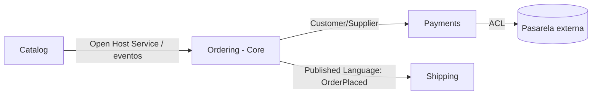

# 2.2 Domain-Driven Design (DDD) práctico

[⬅ Anterior: Estilos](01-estilos-arquitectonicos.md) · [Índice](../README.md) · [Siguiente: Escalabilidad ➡](03-escalabilidad.md)

## 🎯 Objetivos
- Usar DDD **estratégico** para dividir un sistema en bounded contexts.
- Usar DDD **táctico** (Entities, Value Objects, Aggregates, Domain Events) en C# con EF Core.
- Saber cuándo DDD vale la pena (y cuándo no).

---

## 🧠 La idea en 30 segundos
DDD propone que **el software refleje el modelo mental del negocio**. Desarrolladores y expertos del negocio comparten un lenguaje (*Ubiquitous Language*) y el código usa exactamente esas palabras.

> Si el negocio dice "despachar un pedido" y tu código dice `UpdateOrderStatus(3)`, hay una brecha que genera bugs.

**¿Cuándo vale la pena?** Cuando la complejidad está en las **reglas de negocio**, no en la tecnología. Para un CRUD, DDD táctico es sobreingeniería (pero el DDD estratégico casi siempre ayuda).

---

## Parte 1 — DDD estratégico

### Subdominios
| Tipo | Qué es | Estrategia | OrderFlow |
|------|--------|-----------|-----------|
| **Core** | Lo que te diferencia | Invierte aquí, mejor equipo, DDD táctico | Pedidos y precios dinámicos |
| **Supporting** | Necesario, no diferenciador | Hazlo simple | Catálogo |
| **Generic** | Problema resuelto por otros | Compra / SaaS | Pagos (pasarela), identidad (Entra), email |

### Bounded Context
Frontera donde un término tiene **un solo significado**. "Producto" en Catálogo (descripción, fotos, SEO) ≠ "Producto" en Inventario (SKU, bodega, cantidad) ≠ "Producto" en Facturación (código tributario, IVA).

> ❌ Error clásico: una sola clase `Product` gigante compartida por todo el sistema.
> ✅ Cada contexto tiene su propio modelo de `Product` con solo lo que necesita.

### Context Map


| Relación | Significado |
|----------|-------------|
| **Customer/Supplier** | El de arriba (upstream) atiende necesidades del de abajo |
| **Conformist** | El de abajo acepta el modelo del de arriba tal cual |
| **Anti-Corruption Layer (ACL)** | Traduces el modelo externo para proteger el tuyo |
| **Open Host Service / Published Language** | API/eventos públicos bien documentados |
| **Shared Kernel** | Pequeño modelo compartido (úsalo con mucho cuidado) |

### Event Storming (técnica de descubrimiento)
Taller con post-its: eventos de dominio en naranja (`Pedido Realizado`, `Pago Aprobado`), comandos en azul, actores en amarillo, políticas en lila. Al agrupar, emergen los bounded contexts. Herramientas: Miro, o un Whiteboard.

---

## Parte 2 — DDD táctico en C#

### 1. Value Object
Definido por sus valores, **inmutable**, se valida a sí mismo.

```csharp
public sealed record Money
{
    public decimal Amount { get; }
    public string Currency { get; }

    private Money(decimal amount, string currency) { Amount = amount; Currency = currency; }

    public static Money Of(decimal amount, string currency)
    {
        ArgumentOutOfRangeException.ThrowIfNegative(amount);
        ArgumentException.ThrowIfNullOrWhiteSpace(currency);
        return new Money(decimal.Round(amount, 2), currency.ToUpperInvariant());
    }

    public static Money Cop(decimal amount) => Of(amount, "COP");
    public static Money Zero(string currency) => new(0, currency);

    public static Money operator +(Money a, Money b)
    {
        if (a.Currency != b.Currency) throw new InvalidOperationException("Monedas distintas");
        return new Money(a.Amount + b.Amount, a.Currency);
    }

    public Money Multiply(int qty) => new(Amount * qty, Currency);
    public override string ToString() => $"{Amount:N2} {Currency}";
}

public sealed record Email
{
    public string Value { get; }
    private Email(string value) => Value = value;

    public static Result<Email> Create(string? raw)
    {
        if (string.IsNullOrWhiteSpace(raw) || !raw.Contains('@'))
            return Error.Validation("Email.Invalid", "Email inválido");
        return new Email(raw.Trim().ToLowerInvariant());
    }
}
```
> `record` da igualdad por valor gratis. Value Objects eliminan *primitive obsession*: un método `Charge(Money amount)` no acepta por error un `decimal` en otra moneda.

### 2. Entity
Tiene **identidad** que persiste aunque cambien sus atributos.

```csharp
public sealed class OrderItem : Entity
{
    public Guid Id { get; private set; }
    public string Sku { get; private set; } = default!;
    public int Quantity { get; private set; }
    public Money UnitPrice { get; private set; } = default!;
    public Money LineTotal => UnitPrice.Multiply(Quantity);

    private OrderItem() { } // EF Core
    internal OrderItem(string sku, int quantity, Money unitPrice)
    {
        ArgumentOutOfRangeException.ThrowIfNegativeOrZero(quantity);
        Id = Guid.CreateVersion7(); Sku = sku; Quantity = quantity; UnitPrice = unitPrice;
    }

    internal void IncreaseQuantity(int qty) => Quantity += qty;
}
```

### 3. Aggregate y Aggregate Root ⭐
Un **aggregate** es un grupo de objetos que deben ser consistentes **juntos**. Solo se accede por la **raíz**.

**Reglas de oro:**
1. Modifica **un solo aggregate por transacción**.
2. Referencia otros aggregates **por Id**, no por navegación (`CustomerId`, no `Customer`).
3. Mantén aggregates **pequeños**.
4. Las invariantes se protegen dentro del aggregate (nada de setters públicos).

```csharp
public sealed class Order : Entity
{
    private const int MaxItems = 50;
    private readonly List<OrderItem> _items = [];

    public Guid Id { get; private set; }
    public Guid CustomerId { get; private set; }   // referencia por Id a otro aggregate
    public OrderStatus Status { get; private set; }
    public IReadOnlyCollection<OrderItem> Items => _items.AsReadOnly();
    public Money Total => _items.Aggregate(Money.Zero("COP"), (acc, i) => acc + i.LineTotal);

    private Order() { } // EF Core

    public static Result<Order> Create(Guid customerId)
    {
        if (customerId == Guid.Empty) return OrderErrors.CustomerRequired;
        var order = new Order { Id = Guid.CreateVersion7(), CustomerId = customerId, Status = OrderStatus.Pending };
        order.Raise(new OrderCreated(order.Id, customerId));
        return order;
    }

    public Result AddItem(string sku, int qty, Money unitPrice)
    {
        if (Status != OrderStatus.Pending) return OrderErrors.NotEditable;
        var existing = _items.FirstOrDefault(i => i.Sku == sku);
        if (existing is not null) { existing.IncreaseQuantity(qty); return Result.Success(); }
        if (_items.Count >= MaxItems) return OrderErrors.TooManyItems;     // invariante
        _items.Add(new OrderItem(sku, qty, unitPrice));
        return Result.Success();
    }

    public Result Place()
    {
        if (_items.Count == 0) return OrderErrors.EmptyOrder;               // invariante
        Status = OrderStatus.Placed;
        Raise(new OrderPlaced(Id, CustomerId, Total.Amount, Total.Currency));
        return Result.Success();
    }
}
```

### 4. Domain Events
Ver implementación del dispatcher en [1.5](../modulo-01-patrones-diseno/05-patrones-empresariales.md#4-dispatcher-de-domain-events).

| Domain Event | Integration Event |
|--------------|-------------------|
| Dentro del bounded context | Entre bounded contexts / servicios |
| In-process, misma transacción (o justo después) | Vía broker (Service Bus, RabbitMQ), vía Outbox |
| Puede usar tipos del dominio | Contrato estable, versionado, solo primitivos/DTOs |

### 5. Domain Service
Lógica de dominio que no pertenece naturalmente a una entidad (ej. calcular precio usando varias reglas y aggregates). **Sin estado** y sin dependencias de infraestructura.

### 6. Mapeo con EF Core (dominio limpio)
```csharp
internal sealed class OrderConfiguration : IEntityTypeConfiguration<Order>
{
    public void Configure(EntityTypeBuilder<Order> b)
    {
        b.ToTable("Orders", "ordering");
        b.HasKey(o => o.Id);
        b.Property(o => o.Status).HasConversion<string>().HasMaxLength(20);

        b.HasMany(o => o.Items).WithOne().HasForeignKey("OrderId");
        b.Navigation(o => o.Items).UsePropertyAccessMode(PropertyAccessMode.Field); // usa _items

        b.Ignore(o => o.Total);
        b.Ignore(o => o.DomainEvents);
    }
}

internal sealed class OrderItemConfiguration : IEntityTypeConfiguration<OrderItem>
{
    public void Configure(EntityTypeBuilder<OrderItem> b)
    {
        b.ToTable("OrderItems", "ordering");
        b.ComplexProperty(i => i.UnitPrice, m =>   // complex types (EF Core 8+) para Value Objects
        {
            m.Property(p => p.Amount).HasColumnName("UnitPrice").HasPrecision(18, 2);
            m.Property(p => p.Currency).HasColumnName("Currency").HasMaxLength(3);
        });
    }
}
```

### 7. Concurrencia optimista
Dos usuarios editan el mismo pedido: sin control, el último gana silenciosamente.
```csharp
b.Property<byte[]>("RowVersion").IsRowVersion(); // SQL Server
// EF lanza DbUpdateConcurrencyException → devuelve 409 Conflict
```

---

## ⚠️ Antipatrones
- **Modelo anémico:** entidades con `{ get; set; }` y toda la lógica en servicios.
- **Aggregates gigantes:** `Customer` que carga todos sus pedidos históricos.
- **Navegaciones entre aggregates:** `order.Customer.Address.City` → acoplamiento y cargas enormes.
- **DDD en todo:** aplicar aggregates y value objects a un módulo de "configuración de parámetros".

## ✅ Checklist
- [ ] Distingo subdominio core / supporting / generic.
- [ ] Puedo dibujar el context map de mi sistema actual.
- [ ] Mis Value Objects son inmutables y se autovalidan.
- [ ] Mis aggregates no tienen setters públicos y referencian otros por Id.
- [ ] Sé la diferencia entre domain events e integration events.

## 🏋️ Ejercicio (OrderFlow)
1. Haz un mini Event Storming del flujo de compra (en papel o Whiteboard).
2. Implementa `Money`, `Email`, `Address` como Value Objects con tests.
3. Refactoriza `Order` como aggregate root; mapea con `ComplexProperty` y concurrencia optimista.
4. Dibuja el context map de OrderFlow.

## 📚 Profundiza
- *Domain-Driven Design Distilled* — Vaughn Vernon (empieza aquí, es corto).
- *Learning Domain-Driven Design* — Vlad Khononov (muy práctico).
- *Domain-Driven Design* — Eric Evans (el original, denso).
