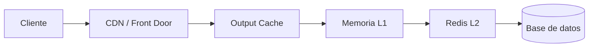
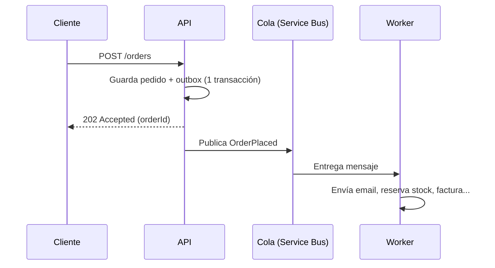

# 2.3 Escalabilidad

[⬅ Anterior: DDD](02-domain-driven-design.md) · [Índice](../README.md) · [Siguiente: Resiliencia ➡](04-resiliencia.md)

## 🎯 Objetivos
- Diseñar servicios **stateless** que escalen horizontalmente.
- Aplicar caching, mensajería asíncrona, paginación eficiente y rate limiting en .NET.
- Identificar y eliminar cuellos de botella comunes (async, base de datos, conexiones).

---

## 🧠 Conceptos base

| Concepto | Explicación |
|----------|-------------|
| **Scale up (vertical)** | Máquina más grande. Fácil, pero tiene techo y es punto único de falla. |
| **Scale out (horizontal)** | Más instancias. Requiere que la app sea **stateless**. |
| **Throughput** | Peticiones por segundo que atiendes. |
| **Latency** | Cuánto tarda una petición. Mide **percentiles** (p50, p95, p99), nunca solo el promedio. |
| **Bottleneck** | El recurso que se satura primero (CPU, BD, red, un lock). |

> 📐 **Ley de Little:** `Concurrencia = Throughput × Latencia`. Si atiendes 200 req/s con 0,5 s de latencia, tienes ~100 peticiones simultáneas en vuelo → necesitas conexiones/hilos para eso.

### Checklist de una app stateless (Twelve-Factor)
- [ ] Sin sesión en memoria (usa tokens o caché distribuida).
- [ ] Sin archivos en disco local (usa Blob Storage).
- [ ] Configuración por variables de entorno / App Configuration / Key Vault.
- [ ] Cualquier instancia puede atender cualquier request.
- [ ] Arranque rápido y apagado limpio (graceful shutdown con `CancellationToken`).

---

## 1. Async correcto (la escalabilidad empieza aquí)

En ASP.NET Core, bloquear hilos (`.Result`, `.Wait()`, `Thread.Sleep`) causa **thread pool starvation**: la app se congela bajo carga aunque la CPU esté baja.

```csharp
// ❌ Bloqueante
var order = _repo.GetAsync(id).Result;

// ✅ Async de punta a punta, propagando CancellationToken
app.MapGet("/orders/{id:guid}", async (Guid id, IOrderQueries q, CancellationToken ct) =>
    await q.GetAsync(id, ct) is { } dto ? Results.Ok(dto) : Results.NotFound());
```

| Regla | Por qué |
|-------|---------|
| Nunca `async void` (salvo event handlers) | Las excepciones tumban el proceso |
| Propaga `CancellationToken` | Si el cliente se va, dejas de gastar recursos |
| `Task.WhenAll` para I/O independiente | Paraleliza llamadas |
| `IAsyncEnumerable<T>` para streams grandes | No cargas todo en memoria |
| `ConfigureAwait(false)` en librerías | En ASP.NET Core no hace falta en código de app |

---

## 2. Caching ⭐

### Niveles


### HybridCache (recomendado, .NET 9+)
Combina memoria local (L1) + distribuida (L2, ej. Redis) y protege contra **cache stampede** (mil requests pidiendo la misma clave expirada a la vez → solo una va a la BD).

```csharp
builder.Services.AddStackExchangeRedisCache(o =>
    o.Configuration = builder.Configuration.GetConnectionString("redis"));

builder.Services.AddHybridCache(o =>
{
    o.DefaultEntryOptions = new HybridCacheEntryOptions
    {
        Expiration = TimeSpan.FromMinutes(10),          // L2
        LocalCacheExpiration = TimeSpan.FromMinutes(1)  // L1
    };
});

public sealed class ProductQueries(CatalogDbContext db, HybridCache cache)
{
    public ValueTask<ProductDto?> GetAsync(Guid id, CancellationToken ct) =>
        cache.GetOrCreateAsync(
            $"product:{id}",
            async token => await db.Products.AsNoTracking()
                .Where(p => p.Id == id)
                .Select(p => new ProductDto(p.Id, p.Name, p.Price))
                .FirstOrDefaultAsync(token),
            tags: ["products"],
            cancellationToken: ct);

    public ValueTask InvalidateAsync(Guid id, CancellationToken ct) =>
        cache.RemoveAsync($"product:{id}", ct);
}
```

### Output caching (respuestas HTTP completas)
```csharp
builder.Services.AddOutputCache(o =>
    o.AddPolicy("catalog", p => p.Expire(TimeSpan.FromSeconds(60)).Tag("products")));
app.UseOutputCache();
app.MapGet("/products", ...).CacheOutput("catalog");
// Invalidar: await outputCacheStore.EvictByTagAsync("products", ct);
```

### Estrategias e invalidación
| Estrategia | Descripción |
|------------|-------------|
| Cache-aside | La app lee caché → si falta, lee BD y guarda (lo de arriba) |
| Write-through | Escribe en caché y BD a la vez |
| TTL | Expiración por tiempo — simple, tolera datos un poco viejos |
| Invalidación por evento | Al recibir `ProductPriceChanged`, borra la clave |

> "Solo hay dos cosas difíciles en computación: invalidar caché y nombrar cosas." Pregunta siempre: **¿cuánto tiempo puede estar desactualizado este dato sin causar daño?**

---

## 3. Mensajería asíncrona

Mueve trabajo lento o no crítico **fuera** del request HTTP.



### Beneficios
- **Queue-based load leveling:** la cola absorbe picos; los workers procesan a su ritmo.
- **Desacople temporal:** si el servicio de email está caído, los mensajes esperan.
- **Escalado independiente:** más workers si la cola crece (KEDA / autoscale por longitud de cola).

### Azure Service Bus — consumidor básico
```csharp
builder.Services.AddAzureClients(c =>
{
    c.AddServiceBusClientWithNamespace(builder.Configuration["ServiceBus:Namespace"]);
    c.UseCredential(new DefaultAzureCredential()); // sin connection string (ver módulo 6.3)
});

public sealed class OrderPlacedConsumer(ServiceBusClient client, IServiceScopeFactory scopes,
    ILogger<OrderPlacedConsumer> logger) : BackgroundService
{
    protected override async Task ExecuteAsync(CancellationToken stoppingToken)
    {
        await using var processor = client.CreateProcessor("orders", "billing",
            new ServiceBusProcessorOptions { MaxConcurrentCalls = 8, AutoCompleteMessages = false });

        processor.ProcessMessageAsync += async args =>
        {
            var evt = args.Message.Body.ToObjectFromJson<OrderPlacedIntegrationEvent>();
            await using var scope = scopes.CreateAsyncScope();
            var handler = scope.ServiceProvider.GetRequiredService<CreateInvoiceHandler>();
            await handler.HandleAsync(evt!, args.CancellationToken); // DEBE ser idempotente
            await args.CompleteMessageAsync(args.Message);
        };
        processor.ProcessErrorAsync += args =>
        {
            logger.LogError(args.Exception, "Error procesando mensaje");
            return Task.CompletedTask; // tras MaxDeliveryCount reintentos → Dead Letter Queue
        };

        await processor.StartProcessingAsync(stoppingToken);
        await Task.Delay(Timeout.Infinite, stoppingToken).ContinueWith(_ => { });
        await processor.StopProcessingAsync();
    }
}
```

> Frameworks que abstraen esto (retries, outbox, sagas): **MassTransit** (v9 es comercial), **Wolverine**, **NServiceBus** (comercial), **Rebus**. Evalúa licencias.

| Broker | Úsalo para |
|--------|-----------|
| **Azure Service Bus** | Mensajería empresarial: colas, topics, sesiones (orden), DLQ, transacciones |
| **Azure Event Hubs / Kafka** | Streaming de alto volumen (telemetría, eventos masivos), replay |
| **Azure Event Grid** | Eventos reactivos ligeros (ej. "se subió un blob") |
| **RabbitMQ** | On-premise / multicloud, enrutamiento flexible |

---

## 4. Base de datos: el cuello de botella habitual

| Técnica | Detalle |
|---------|---------|
| **Índices correctos** | Revisa planes de ejecución; índices que cubran tus `WHERE` + `ORDER BY` |
| **Evita N+1** | `Include` o proyecciones; habilita logging de SQL en dev |
| **Proyecta** | `Select` solo columnas necesarias; `AsNoTracking()` en lecturas |
| **Compiled queries** | `EF.CompileAsyncQuery` para consultas muy calientes |
| **Bulk ops** | `ExecuteUpdateAsync` / `ExecuteDeleteAsync` (EF Core 7+) en vez de cargar y modificar |
| **Read replicas** | Queries a réplica de solo lectura (CQRS natural) |
| **Particionamiento / sharding** | Divide por tenant, región o fecha cuando una BD ya no basta |
| **Connection pooling** | Viene por defecto; no abras conexiones manuales sin `using` |

### Paginación por cursor (keyset) vs offset
```csharp
// ❌ Offset: con página 10.000 la BD lee y descarta 200.000 filas
db.Orders.OrderBy(o => o.Id).Skip(page * 20).Take(20);

// ✅ Cursor: usa el índice, tiempo constante
public async Task<PagedResult<OrderDto>> ListAsync(Guid? after, int size, CancellationToken ct)
{
    var query = db.Orders.AsNoTracking().OrderBy(o => o.Id).AsQueryable();
    if (after is not null) query = query.Where(o => o.Id > after);   // Guid v7 → ordenable
    var items = await query.Take(size + 1).Select(o => new OrderDto(o.Id, o.Status)).ToListAsync(ct);
    var hasMore = items.Count > size;
    return new(items.Take(size).ToList(), hasMore ? items[size - 1].Id : null);
}
```

---

## 5. Rate limiting (protegerte de ti mismo y de otros)

```csharp
builder.Services.AddRateLimiter(o =>
{
    o.RejectionStatusCode = StatusCodes.Status429TooManyRequests;

    // Por usuario/cliente: 100 req/min con ventana deslizante
    o.AddPolicy("per-client", ctx =>
        RateLimitPartition.GetSlidingWindowLimiter(
            partitionKey: ctx.User.FindFirst("oid")?.Value ?? ctx.Connection.RemoteIpAddress?.ToString() ?? "anon",
            factory: _ => new SlidingWindowRateLimiterOptions
            {
                PermitLimit = 100, Window = TimeSpan.FromMinutes(1), SegmentsPerWindow = 6
            }));

    // Protege un endpoint caro: máximo 10 concurrentes
    o.AddConcurrencyLimiter("reports", c => { c.PermitLimit = 10; c.QueueLimit = 20; });
});

app.UseRateLimiter();
app.MapPost("/orders", ...).RequireRateLimiting("per-client");
app.MapGet("/reports/sales", ...).RequireRateLimiting("reports");
```
> En producción, combina con rate limiting en el borde (**Azure API Management**, **Front Door WAF**).

---

## 6. Otros patrones de escalabilidad (Azure Architecture Center)
- **CQRS con read models:** proyecciones desnormalizadas para lecturas rápidas.
- **Competing consumers:** N workers leyendo la misma cola.
- **Static content hosting:** sirve estáticos desde Blob + CDN.
- **Valet key:** el cliente sube archivos directo a Blob con un SAS de corta duración (tu API no transporta los bytes).
- **Async Request-Reply:** `202 Accepted` + endpoint de estado para operaciones largas.

## 🔬 Mide antes de optimizar
- **Load testing:** k6, NBomber (.NET), Azure Load Testing.
- **Profiling:** `dotnet-counters`, `dotnet-trace`, BenchmarkDotNet para micro-benchmarks.
- Define la meta antes: "p95 < 300 ms con 500 req/s".

## ✅ Checklist
- [ ] Mi API es stateless y propaga `CancellationToken`.
- [ ] Sé configurar HybridCache y decidir TTL según tolerancia de negocio.
- [ ] Muevo trabajo lento a una cola y respondo `202`.
- [ ] Uso paginación por cursor en listas grandes.
- [ ] Tengo rate limiting por cliente.

## 🏋️ Ejercicio (OrderFlow)
1. HybridCache en consultas del catálogo + invalidación al cambiar precio.
2. Paginación por cursor en `GET /orders`.
3. Rate limiting por cliente en `POST /orders`.
4. Publica `OrderPlaced` a una cola y crea un worker que "facture".
5. Prueba de carga con k6 o NBomber; anota p95 antes y después del caché.

## 📚 Profundiza
- *Designing Data-Intensive Applications* — Martin Kleppmann (**el** libro de sistemas distribuidos).
- [Azure Architecture Center — Cloud design patterns](https://learn.microsoft.com/azure/architecture/patterns/).
- [HybridCache library in ASP.NET Core](https://learn.microsoft.com/aspnet/core/performance/caching/hybrid).
