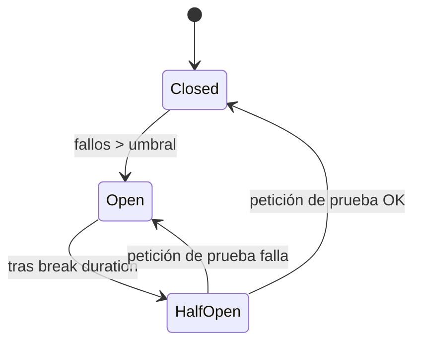
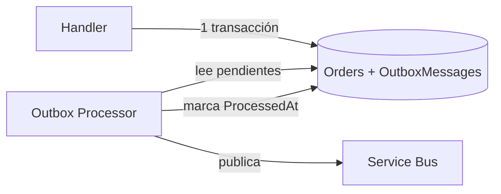
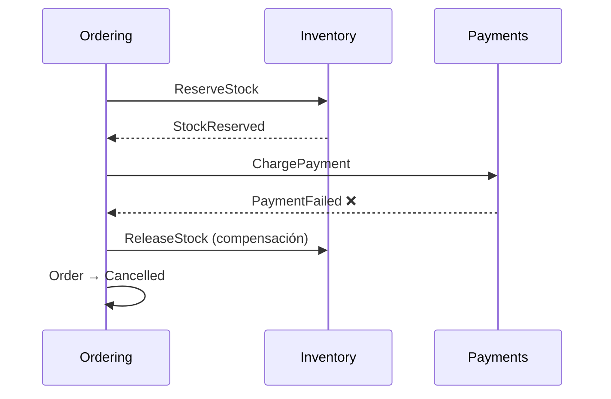

# 2.4 Resiliencia

[⬅ Anterior: Escalabilidad](03-escalabilidad.md) · [Índice](../README.md) · [Siguiente: Cloud-native con Aspire ➡](05-cloud-native-aspire.md)

## 🎯 Objetivos
- Diseñar asumiendo que **todo falla** (red, BD, APIs externas).
- Aplicar timeouts, retries, circuit breakers y hedging con `Microsoft.Extensions.Http.Resilience` (Polly v8).
- Garantizar consistencia con idempotencia, Outbox y Sagas.

---

## 🧠 Las 8 falacias de la computación distribuida
1. La red es confiable. 2. La latencia es cero. 3. El ancho de banda es infinito. 4. La red es segura. 5. La topología no cambia. 6. Hay un solo administrador. 7. El costo de transporte es cero. 8. La red es homogénea.

> Cada llamada remota puede: tardar mucho, fallar, o **tener éxito pero no enterarte** (timeout después de que el servidor procesó). Diseña para los tres casos.

---

## 1. Las estrategias de resiliencia

| Estrategia | Protege contra | Regla práctica |
|------------|---------------|----------------|
| **Timeout** | Esperas infinitas | **Siempre**. Sin timeout no hay resiliencia. |
| **Retry** (backoff exponencial + jitter) | Fallos transitorios (503, 429, timeouts) | Solo si la operación es **idempotente** |
| **Circuit Breaker** | Martillar un servicio caído | Abre tras X % de fallos; prueba de nuevo tras un tiempo |
| **Rate limiter / Bulkhead** | Agotar recursos propios | Limita concurrencia hacia una dependencia |
| **Hedging** | Latencia de cola (p99) | Lanza una segunda petición si la primera tarda |
| **Fallback** | Dependencia no disponible | Respuesta degradada (caché, valor por defecto) |



---

## 2. Resiliencia HTTP en .NET (la forma recomendada)

### Standard resilience handler (una línea, buenas prácticas incluidas)
```csharp
builder.Services.AddHttpClient<IPaymentsApi, PaymentsApi>(c =>
        c.BaseAddress = new Uri(builder.Configuration["Payments:BaseUrl"]!))
    .AddStandardResilienceHandler();
```
Incluye, en este orden: rate limiter → timeout total → retry → circuit breaker → timeout por intento.

### Personalizarlo
```csharp
builder.Services.AddHttpClient<IPaymentsApi, PaymentsApi>(...)
    .AddStandardResilienceHandler(o =>
    {
        o.AttemptTimeout.Timeout = TimeSpan.FromSeconds(3);
        o.TotalRequestTimeout.Timeout = TimeSpan.FromSeconds(15);
        o.Retry.MaxRetryAttempts = 3;
        o.Retry.UseJitter = true;
        o.Retry.DisableForUnsafeHttpMethods(); // no reintenta POST/PUT/DELETE/PATCH automáticamente
        o.CircuitBreaker.FailureRatio = 0.5;
        o.CircuitBreaker.SamplingDuration = TimeSpan.FromSeconds(30);
        o.CircuitBreaker.BreakDuration = TimeSpan.FromSeconds(15);
    });
```
> ⚠️ `DisableForUnsafeHttpMethods()` es clave: reintentar un `POST /charges` sin idempotencia puede **cobrar dos veces**.

### Hedging (para lecturas sensibles a latencia)
```csharp
builder.Services.AddHttpClient<ICatalogApi, CatalogApi>()
    .AddStandardHedgingHandler(o => o.Hedging.MaxHedgedAttempts = 2);
```

### Resiliencia fuera de HTTP (Polly v8 pipelines)
```csharp
builder.Services.AddResiliencePipeline("db-retry", p => p
    .AddRetry(new RetryStrategyOptions
    {
        ShouldHandle = new PredicateBuilder().Handle<SqlException>(ex => ex.IsTransient),
        MaxRetryAttempts = 3,
        BackoffType = DelayBackoffType.Exponential,
        UseJitter = true
    })
    .AddTimeout(TimeSpan.FromSeconds(5)));

public sealed class ReportService(ResiliencePipelineProvider<string> pipelines)
{
    public async Task<Report> BuildAsync(CancellationToken ct)
    {
        var pipeline = pipelines.GetPipeline("db-retry");
        return await pipeline.ExecuteAsync(async token => await LoadAsync(token), ct);
    }
}
```
> EF Core ya trae retry para SQL Server: `UseSqlServer(cs, o => o.EnableRetryOnFailure())`. Ojo: no es compatible con transacciones iniciadas manualmente sin `CreateExecutionStrategy()`.

---

## 3. Idempotencia ⭐

> Una operación es idempotente si ejecutarla N veces produce el mismo resultado que 1 vez.

`GET`, `PUT`, `DELETE` deberían serlo por diseño. `POST` normalmente **no**. Con mensajería *at-least-once*, **todos** tus consumidores deben ser idempotentes.

### Idempotency-Key en la API
```csharp
app.MapPost("/payments", async (
    [FromHeader(Name = "Idempotency-Key")] string? key,
    ChargeRequest req, PaymentsDbContext db, IPaymentGateway gateway, CancellationToken ct) =>
{
    if (string.IsNullOrWhiteSpace(key)) return Results.BadRequest("Idempotency-Key requerido");

    var existing = await db.IdempotencyRecords.FindAsync([key], ct);
    if (existing is not null)
        return Results.Json(existing.ResponseBody, statusCode: existing.StatusCode); // misma respuesta

    var result = await gateway.ChargeAsync(req.Amount, idempotencyKey: key, ct); // propaga la key al proveedor
    db.IdempotencyRecords.Add(new(key, 201, result));
    await db.SaveChangesAsync(ct); // PK única sobre key → si hay carrera, una falla con conflicto
    return Results.Created($"/payments/{result.Id}", result);
});
```

### Consumidor idempotente (inbox / deduplicación)
```csharp
public async Task HandleAsync(OrderPlacedIntegrationEvent evt, CancellationToken ct)
{
    if (await db.ProcessedMessages.AnyAsync(m => m.MessageId == evt.EventId, ct))
        return; // ya procesado

    db.Invoices.Add(Invoice.For(evt.OrderId, evt.Amount));
    db.ProcessedMessages.Add(new ProcessedMessage(evt.EventId, DateTimeOffset.UtcNow));
    await db.SaveChangesAsync(ct); // ambos en la misma transacción
}
```

---

## 4. Outbox pattern ⭐

### El problema del "dual write"
```csharp
await db.SaveChangesAsync();          // ✅ guardado
await bus.PublishAsync(orderPlaced);  // 💥 falla → el pedido existe pero nadie se entera
```
Si inviertes el orden, puedes publicar un evento de algo que nunca se guardó.

### La solución
1. En la **misma transacción** guardas el pedido y una fila en la tabla `OutboxMessages`.
2. Un proceso en segundo plano lee el outbox y publica al broker, marcando como enviado.



```csharp
public sealed class OutboxMessage
{
    public Guid Id { get; init; } = Guid.CreateVersion7();
    public required string Type { get; init; }
    public required string Payload { get; init; }
    public DateTimeOffset OccurredAt { get; init; }
    public DateTimeOffset? ProcessedAt { get; set; }
    public string? Error { get; set; }
}

// Interceptor: convierte domain events en mensajes de outbox ANTES de guardar
public sealed class OutboxInterceptor(TimeProvider clock) : SaveChangesInterceptor
{
    public override ValueTask<InterceptionResult<int>> SavingChangesAsync(
        DbContextEventData data, InterceptionResult<int> result, CancellationToken ct = default)
    {
        var ctx = data.Context!;
        var messages = ctx.ChangeTracker.Entries<Entity>()
            .SelectMany(e => { var evts = e.Entity.DomainEvents.ToList(); e.Entity.ClearDomainEvents(); return evts; })
            .Select(e => new OutboxMessage
            {
                Type = e.GetType().FullName!,
                Payload = JsonSerializer.Serialize(e, e.GetType()),
                OccurredAt = clock.GetUtcNow()
            });
        ctx.Set<OutboxMessage>().AddRange(messages);
        return base.SavingChangesAsync(data, result, ct);
    }
}

// Procesador
public sealed class OutboxProcessor(IServiceScopeFactory scopes, ILogger<OutboxProcessor> logger) : BackgroundService
{
    protected override async Task ExecuteAsync(CancellationToken ct)
    {
        using var timer = new PeriodicTimer(TimeSpan.FromSeconds(2));
        while (await timer.WaitForNextTickAsync(ct))
        {
            await using var scope = scopes.CreateAsyncScope();
            var db = scope.ServiceProvider.GetRequiredService<OrderingDbContext>();
            var publisher = scope.ServiceProvider.GetRequiredService<IEventPublisher>();

            var batch = await db.Set<OutboxMessage>()
                .Where(m => m.ProcessedAt == null).OrderBy(m => m.OccurredAt).Take(50).ToListAsync(ct);

            foreach (var msg in batch)
            {
                try { await publisher.PublishAsync(msg.Type, msg.Payload, messageId: msg.Id, ct); msg.ProcessedAt = DateTimeOffset.UtcNow; }
                catch (Exception ex) { msg.Error = ex.Message; logger.LogError(ex, "Outbox {Id} falló", msg.Id); }
            }
            await db.SaveChangesAsync(ct);
        }
    }
}
```
> El outbox garantiza **at-least-once** (si el proceso cae tras publicar y antes de marcar, se publica de nuevo) → consumidores idempotentes, usando `messageId` para deduplicar (Service Bus tiene *duplicate detection* nativo).
> En producción con múltiples instancias, evita que dos procesadores tomen el mismo lote (`UPDLOCK, READPAST` en SQL Server, o una sola instancia líder). Wolverine y MassTransit traen outbox listo.

---

## 5. Sagas (transacciones distribuidas)

No existen transacciones ACID entre servicios. Una **saga** es una secuencia de transacciones locales con **acciones compensatorias**.



| Tipo | Ventaja | Desventaja |
|------|---------|-----------|
| **Choreography** (eventos) | Sin punto central | Difícil ver el flujo completo |
| **Orchestration** (orquestador) | Flujo explícito, fácil de monitorear | Componente adicional |

Herramientas: **Azure Durable Functions** (orquestaciones como código), MassTransit/Wolverine/NServiceBus sagas, **Dapr Workflows**.

---

## 6. Degradación elegante y otros patrones
- **Fallback:** si recomendaciones falla, muestra "más vendidos" desde caché.
- **Graceful shutdown:** respeta el `CancellationToken` de `BackgroundService`; termina el mensaje en curso.
- **Health endpoint monitoring:** ver [3.4](../modulo-03-observabilidad/04-health-checks-azure-monitor.md).
- **Chaos engineering:** inyecta fallos a propósito (Polly Chaos strategies, **Azure Chaos Studio**).

```csharp
// Polly chaos: inyecta 10 % de fallos solo en entornos de prueba
.AddResilienceHandler("chaos", (b, ctx) =>
{
    var env = ctx.ServiceProvider.GetRequiredService<IHostEnvironment>();
    b.AddChaosFault(env.IsEnvironment("Chaos") ? 0.1 : 0, () => new HttpRequestException("Chaos!"));
});
```

## ⚠️ Antipatrones
- Retries sin backoff (*retry storm* que tumba al servicio que intentaba recuperarse).
- Retries anidados en varias capas (3 × 3 × 3 = 27 intentos).
- Timeout del cliente mayor que el del servidor.
- Publicar eventos fuera de la transacción (dual write).
- Llamadas síncronas en cadena entre 5 servicios (la disponibilidad se multiplica: 0,99⁵ ≈ 95 %).

## ✅ Checklist
- [ ] Todos mis `HttpClient` tienen timeout y resiliencia.
- [ ] No reintento operaciones no idempotentes.
- [ ] Mis consumidores de mensajes son idempotentes.
- [ ] Sé explicar el problema del dual write y cómo lo resuelve el Outbox.
- [ ] Puedo diseñar una saga con compensaciones.

## 🏋️ Ejercicio (OrderFlow)
1. `AddStandardResilienceHandler()` en el cliente de pagos; simula fallos con un servicio fake que devuelve 503 aleatorio.
2. Implementa `Idempotency-Key` en `POST /payments`.
3. Implementa Outbox en el módulo Ordering.
4. Diseña (diagrama) la saga de checkout con compensación.

## 📚 Profundiza
- *Release It!* — Michael Nygard (patrones de estabilidad, imprescindible).
- [Build resilient HTTP apps (.NET)](https://learn.microsoft.com/dotnet/core/resilience/http-resilience).
- [Polly docs](https://www.pollydocs.org/).
