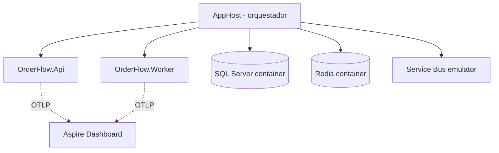
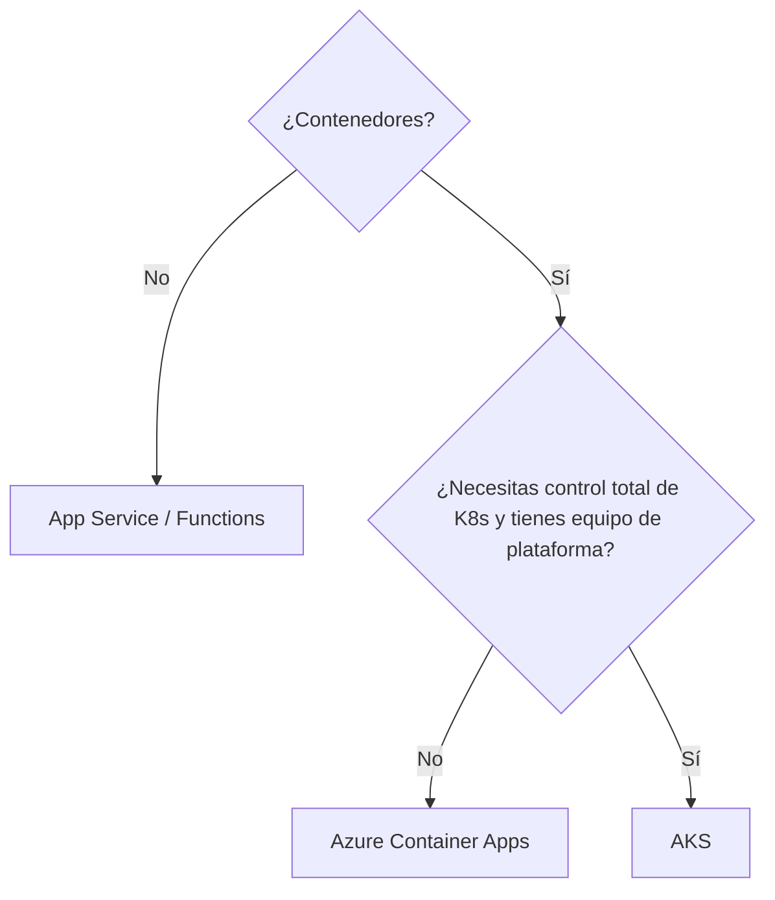

# 2.5 Cloud-native con Aspire y contenedores

[⬅ Anterior: Resiliencia](04-resiliencia.md) · [Índice](../README.md) · [Siguiente módulo: Redes ➡](../modulo-07-redes/01-fundamentos-redes.md)

## 🎯 Objetivos
- Contenerizar una app .NET correctamente.
- Orquestar el entorno local completo con **Aspire** (AppHost, ServiceDefaults, integraciones).
- Conocer las opciones de hosting en Azure y cuándo usar cada una.

---

## 1. Contenedores con .NET

### Opción A: sin Dockerfile (SDK container support)
```bash
dotnet publish src/OrderFlow.Api -c Release /t:PublishContainer \
  -p:ContainerRepository=orderflow-api -p:ContainerImageTag=1.0.0
```

### Opción B: Dockerfile multi-stage
```dockerfile
FROM mcr.microsoft.com/dotnet/sdk:10.0 AS build
WORKDIR /src
COPY Directory.Packages.props Directory.Build.props ./
COPY src/OrderFlow.Api/OrderFlow.Api.csproj src/OrderFlow.Api/
RUN dotnet restore src/OrderFlow.Api/OrderFlow.Api.csproj
COPY . .
RUN dotnet publish src/OrderFlow.Api -c Release -o /app --no-restore

FROM mcr.microsoft.com/dotnet/aspnet:10.0 AS final
WORKDIR /app
COPY --from=build /app .
USER $APP_UID                # no ejecutar como root
EXPOSE 8080                  # puerto por defecto desde .NET 8
ENTRYPOINT ["dotnet", "OrderFlow.Api.dll"]
```

| Buena práctica | Por qué |
|----------------|---------|
| Imágenes oficiales `aspnet`/`runtime-deps` (o *chiseled*) | Menos superficie de ataque |
| Usuario no-root (`$APP_UID`) | Seguridad |
| Copiar `.csproj` y restaurar primero | Cache de capas → builds rápidos |
| Tag inmutable (versión o SHA del commit), no `latest` | Despliegues reproducibles |
| Escanear imágenes (Defender for Containers, Trivy) | Vulnerabilidades |

---

## 2. Aspire ⭐

> Desde la versión 13 ya no se llama ".NET Aspire" sino **Aspire**, y soporta también Python y JavaScript. Requiere el SDK de .NET 10 o superior.

### ¿Qué resuelve?
Levantar localmente API + BD + Redis + broker + worker con configuración, *service discovery*, telemetría y health checks **ya cableados**, con un dashboard de observabilidad incluido.



### Piezas
| Pieza | Qué es |
|-------|--------|
| **AppHost** | Proyecto que describe en C# los recursos y sus relaciones |
| **ServiceDefaults** | Proyecto compartido: OpenTelemetry, health checks, resiliencia, service discovery |
| **Integrations** | Paquetes NuGet para Redis, SQL, Service Bus, PostgreSQL, etc. (cliente + hosting) |
| **Dashboard** | UI local de logs, trazas y métricas (también usable de forma independiente) |
| **CLI** (`aspire`) | `aspire new`, `aspire run`, `aspire deploy`, `aspire update` |

### AppHost
```csharp
var builder = DistributedApplication.CreateBuilder(args);

var sql = builder.AddSqlServer("sql").WithDataVolume().AddDatabase("orderflow");
var redis = builder.AddRedis("redis");
var bus = builder.AddAzureServiceBus("messaging").RunAsEmulator();
bus.AddServiceBusQueue("orders");

var api = builder.AddProject<Projects.OrderFlow_Api>("api")
    .WithReference(sql).WaitFor(sql)
    .WithReference(redis)
    .WithReference(bus)
    .WithExternalHttpEndpoints();

builder.AddProject<Projects.OrderFlow_Worker>("worker")
    .WithReference(sql).WithReference(bus).WaitFor(bus);

builder.Build().Run();
```

### En la API
```csharp
var builder = WebApplication.CreateBuilder(args);
builder.AddServiceDefaults();                          // OTel, health, resiliencia, discovery
builder.AddSqlServerDbContext<OrderingDbContext>("orderflow"); // connection string inyectada por el AppHost
builder.AddRedisDistributedCache("redis");
builder.AddAzureServiceBusClient("messaging");

var app = builder.Build();
app.MapDefaultEndpoints();                             // /health y /alive
app.Run();
```

### ServiceDefaults (extracto — vale la pena leer el generado)
```csharp
public static TBuilder AddServiceDefaults<TBuilder>(this TBuilder builder) where TBuilder : IHostApplicationBuilder
{
    builder.ConfigureOpenTelemetry();
    builder.AddDefaultHealthChecks();
    builder.Services.AddServiceDiscovery();
    builder.Services.ConfigureHttpClientDefaults(http =>
    {
        http.AddStandardResilienceHandler();
        http.AddServiceDiscovery();   // "https+http://api" se resuelve automáticamente
    });
    return builder;
}
```

### Despliegue
Aspire puede generar artefactos de despliegue (Azure Container Apps vía `azd` / `aspire deploy`, Kubernetes, Docker Compose). En empresas con Azure DevOps, lo habitual es usar Aspire **para el desarrollo local y la observabilidad**, y desplegar con Bicep + pipelines ([módulo 5](../modulo-05-cicd-azure-devops/04-iac-bicep-despliegues.md)).

> Aspire evoluciona rápido (13.x salen cada pocos meses). Usa `aspire update` y revisa los *breaking changes* en [aspire.dev](https://aspire.dev).

---

## 3. ¿Dónde hospedar en Azure?

| Servicio | Ideal para | Te encargas de |
|----------|-----------|----------------|
| **App Service** | APIs/web clásicas, equipos que inician en cloud | Muy poco. Slots, autoscale, easy auth |
| **Azure Container Apps** | Microservicios y workers en contenedores, escalado a cero, KEDA, Dapr | Poco. Serverless de contenedores |
| **Azure Functions** | Event-driven, tareas cortas, integración | Muy poco; límites de ejecución |
| **AKS (Kubernetes)** | Plataformas grandes, control total, multi-equipo | Mucho: cluster, upgrades, red, seguridad |



> Recomendación pragmática: **App Service** o **Container Apps** cubren el 80 % de casos. AKS solo con justificación (y un ADR).

## ✅ Checklist
- [ ] Construyo imágenes non-root con tags inmutables.
- [ ] Levanto todo el sistema local con `aspire run`.
- [ ] Entiendo qué hace `AddServiceDefaults()` línea a línea.
- [ ] Sé elegir entre App Service, Container Apps, Functions y AKS.

## 🏋️ Ejercicio (OrderFlow)
1. Crea AppHost + ServiceDefaults; levanta API, Worker, SQL, Redis y Service Bus emulator.
2. Verifica en el dashboard una traza que cruce API → cola → Worker.
3. Construye la imagen de la API con `PublishContainer`.

## 📚 Profundiza
- [aspire.dev](https://aspire.dev) — documentación oficial.
- [.NET containers](https://learn.microsoft.com/dotnet/core/containers/overview).
- [Choose an Azure compute service](https://learn.microsoft.com/azure/architecture/guide/technology-choices/compute-decision-tree).
