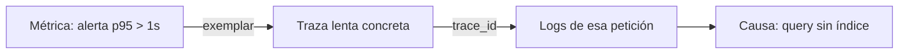

# 3.1 Fundamentos de observabilidad

[⬅ Módulo anterior: Redes](../modulo-07-redes/04-redes-en-azure.md) · [Índice](../README.md) · [Siguiente: Logging estructurado ➡](02-logging-estructurado.md)

## 🎯 Objetivos
- Diferenciar monitoreo de observabilidad.
- Entender los tres pilares (logs, métricas, trazas) y cuándo usar cada uno.
- Definir SLIs, SLOs y error budgets para un servicio real.

---

## 🧠 Monitoreo vs observabilidad

| Monitoreo | Observabilidad |
|-----------|----------------|
| "¿Está funcionando?" | "¿**Por qué** no está funcionando?" |
| Preguntas conocidas de antemano (dashboards fijos) | Preguntas nuevas que no anticipaste |
| Detecta síntomas | Permite encontrar causas |

> Un sistema es observable si puedes entender **cualquier** estado interno a partir de sus salidas, sin desplegar código nuevo para investigar.

---

## Los tres pilares (+1)

| Señal | Qué es | Responde | Costo | Ejemplo |
|-------|--------|----------|-------|---------|
| **Logs** | Eventos discretos con contexto | ¿Qué pasó exactamente? | Alto en volumen | `Pago rechazado para pedido 123: fondos insuficientes` |
| **Métricas** | Números agregados en el tiempo | ¿Cuánto? ¿Con qué tendencia? | Bajo (agregados) | `http.server.request.duration p95 = 340ms` |
| **Trazas** | Recorrido de una petición entre componentes | ¿Dónde se fue el tiempo? ¿Qué falló en la cadena? | Medio (con sampling) | API (20ms) → SQL (300ms) → Service Bus (5ms) |
| **Profiles** (4º, emergente) | Uso de CPU/memoria por función | ¿Qué código consume recursos? | Variable | Hot path en serialización |


**La magia está en correlacionarlos**: una alerta de métrica te lleva a una traza ejemplo, y la traza a sus logs (mismo `TraceId`). OpenTelemetry hace esto posible ([3.3](03-opentelemetry-dotnet.md)).

---

## Qué medir: marcos de referencia

### Golden Signals (Google SRE) — para servicios
1. **Latency** — tiempo de respuesta (separa éxitos de errores; un error rápido distorsiona).
2. **Traffic** — demanda (req/s, mensajes/s).
3. **Errors** — tasa de fallos (5xx, excepciones, respuestas incorrectas).
4. **Saturation** — qué tan "lleno" está (CPU, memoria, pool de conexiones, longitud de cola).

### RED (para cada endpoint/servicio)
**R**ate, **E**rrors, **D**uration.

### USE (para recursos: CPU, disco, pools)
**U**tilization, **S**aturation, **E**rrors.

### Métricas de negocio (¡no las olvides!)
`orders.placed`, `payments.declined.rate`, `checkout.abandoned`, `revenue.per.minute`. Muchas veces el primer síntoma de un bug es una caída en una métrica de negocio, no un error técnico.

---

## SLI, SLO, SLA y error budget ⭐

| Término | Definición | Ejemplo OrderFlow |
|---------|-----------|-------------------|
| **SLI** (Indicator) | Medición cuantitativa de la experiencia del usuario | % de `POST /orders` que responden 2xx en < 500 ms |
| **SLO** (Objective) | Meta interna para el SLI en una ventana | 99,5 % en 30 días |
| **SLA** (Agreement) | Compromiso contractual con penalidades | 99 % mensual (siempre más laxo que el SLO) |
| **Error budget** | 100 % − SLO | 0,5 % ≈ 3 h 36 min/mes de "mala experiencia" |

### ¿Qué significa cada "nueve"? (ventana de 30 días)
| Disponibilidad | Indisponibilidad permitida |
|----------------|---------------------------|
| 99 % | 7 h 12 min |
| 99,5 % | 3 h 36 min |
| 99,9 % | 43 min |
| 99,95 % | 21 min |
| 99,99 % | 4 min 19 s |

> 💡 Cada nueve adicional cuesta aproximadamente 10× más. 100 % no es una meta válida.

### Cómo usar el error budget
- Budget sano → se puede desplegar rápido, experimentar.
- Budget agotado → se congelan features y se prioriza confiabilidad.
- Convierte discusiones de opinión ("¿estamos listos para desplegar?") en decisiones basadas en datos.

### Plantilla de SLO
```markdown
**Servicio:** OrderFlow API — Checkout
**SLI:** proporción de requests `POST /orders` con status < 500 y duración < 500 ms,
         medidas en el servidor (http.server.request.duration).
**SLO:** 99,5 % en ventana móvil de 30 días.
**Exclusiones:** requests con 4xx (error del cliente), tráfico de pruebas sintéticas.
**Alertas:** burn rate 14,4× en 1 h (página al on-call) / 6× en 6 h (ticket).
**Dueño:** equipo Ordering.
```

### Alertas por burn rate (en lugar de umbrales fijos)
*Burn rate* = qué tan rápido consumes el error budget. Un burn rate de 1 lo agota justo al final de la ventana; 14,4 lo agota en ~2 días → urgente. Reduce falsas alarmas frente a "alerta si errores > 1 % durante 5 min".

---

## Principios de una buena alerta
- **Accionable:** si suena, alguien sabe qué hacer (enlaza un runbook).
- **Basada en síntomas** del usuario, no en causas ("CPU 80 %" no es alerta si los usuarios están bien).
- **Pocas y confiables:** la fatiga de alertas hace que se ignoren las importantes.
- **Con contexto:** enlaces a dashboard, traza ejemplo, último despliegue.

---

## Costos y cardinalidad
- Logs: el mayor costo. Usa niveles adecuados, no loguees bodies completos, define retención.
- Métricas: cuidado con **alta cardinalidad** (no uses `userId` u `orderId` como etiqueta).
- Trazas: usa **sampling** (ej. 10 % del tráfico normal + 100 % de errores).

## ✅ Checklist
- [ ] Explico la diferencia entre logs, métricas y trazas, y cuándo usar cada uno.
- [ ] Conozco golden signals, RED y USE.
- [ ] Puedo escribir un SLO con SLI medible y calcular su error budget.
- [ ] Sé qué es burn rate y por qué es mejor que umbrales fijos.

## 🏋️ Ejercicio (OrderFlow)
1. Escribe 2 SLOs (checkout y consulta de pedidos) con la plantilla.
2. Lista las 5 métricas de negocio más importantes de OrderFlow.
3. Diseña en papel el dashboard principal (qué paneles, qué orden).

## 📚 Profundiza
- *Site Reliability Engineering* y *The SRE Workbook* — Google (gratis en sre.google).
- *Observability Engineering* — Majors, Fong-Jones, Miranda.
