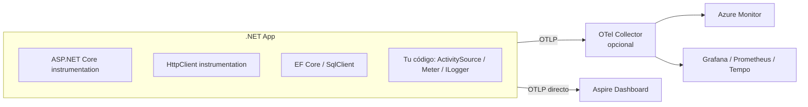

# 3.3 OpenTelemetry en .NET

[⬅ Anterior: Logging](02-logging-estructurado.md) · [Índice](../README.md) · [Siguiente: Health checks y Azure Monitor ➡](04-health-checks-azure-monitor.md)

## 🎯 Objetivos
- Configurar OpenTelemetry (trazas, métricas y logs) en una app ASP.NET Core.
- Crear spans y métricas personalizadas con `ActivitySource` y `Meter`.
- Propagar contexto a través de HTTP y mensajería.
- Exportar a Aspire Dashboard, Azure Monitor u otro backend OTLP.

---

## 🧠 ¿Qué es OpenTelemetry?

Un **estándar abierto** (CNCF) para generar, recolectar y exportar telemetría. Instrumentas **una vez** y envías a cualquier backend (Application Insights, Grafana, Datadog, Elastic, Jaeger…) cambiando solo el *exporter*.



### Mapeo de conceptos OTel ↔ .NET
| OpenTelemetry | .NET |
|---------------|------|
| Tracer | `ActivitySource` |
| Span | `Activity` |
| Meter | `System.Diagnostics.Metrics.Meter` |
| Counter / Histogram / Gauge | `Counter<T>`, `Histogram<T>`, `ObservableGauge<T>`, `Gauge<T>` |
| Logger | `ILogger` |
| Context propagation | W3C `traceparent` (automático en HttpClient/ASP.NET Core) |

> .NET implementa las APIs de OTel **en el propio runtime** (`System.Diagnostics`). Por eso las librerías pueden emitir telemetría sin depender de paquetes de OpenTelemetry.

---

## 1. Configuración base

```bash
dotnet add package OpenTelemetry.Extensions.Hosting
dotnet add package OpenTelemetry.Instrumentation.AspNetCore
dotnet add package OpenTelemetry.Instrumentation.Http
dotnet add package OpenTelemetry.Instrumentation.Runtime
dotnet add package OpenTelemetry.Exporter.OpenTelemetryProtocol
```

```csharp
var builder = WebApplication.CreateBuilder(args);

builder.Logging.AddOpenTelemetry(o =>
{
    o.IncludeFormattedMessage = true;
    o.IncludeScopes = true;
});

builder.Services.AddOpenTelemetry()
    .ConfigureResource(r => r
        .AddService(serviceName: "orderflow-api", serviceVersion: "1.4.0")
        .AddAttributes([new("deployment.environment.name", builder.Environment.EnvironmentName)]))
    .WithTracing(t => t
        .AddAspNetCoreInstrumentation(o => o.Filter = ctx => !ctx.Request.Path.StartsWithSegments("/health"))
        .AddHttpClientInstrumentation()
        .AddSource("Azure.*")                          // SDKs de Azure (Service Bus, Storage…)
        .AddSource(OrderingTelemetry.ActivitySourceName)) // tus spans
    .WithMetrics(m => m
        .AddAspNetCoreInstrumentation()
        .AddHttpClientInstrumentation()
        .AddRuntimeInstrumentation()
        .AddMeter("System.Net.Http", "System.Net.NameResolution")
        .AddMeter(OrderingTelemetry.MeterName))
    .UseOtlpExporter();   // lee OTEL_EXPORTER_OTLP_ENDPOINT (Aspire lo configura solo)
```
> Si usas **Aspire**, `AddServiceDefaults()` ya hace casi todo esto ([2.5](../modulo-02-arquitectura/05-cloud-native-aspire.md)). Vale la pena entenderlo igual.

### EF Core / SQL
- `Microsoft.Data.SqlClient` y EF Core emiten actividades; agrega la instrumentación correspondiente (`OpenTelemetry.Instrumentation.SqlClient` o `.EntityFrameworkCore`) y revisa que no capture parámetros sensibles.

---

## 2. Trazas personalizadas

```csharp
public static class OrderingTelemetry
{
    public const string ActivitySourceName = "OrderFlow.Ordering";
    public const string MeterName = "OrderFlow.Ordering";
    public static readonly ActivitySource Source = new(ActivitySourceName);
}

internal sealed class PlaceOrderHandler(...) : ICommandHandler<PlaceOrderCommand, Result<Guid>>
{
    public async Task<Result<Guid>> HandleAsync(PlaceOrderCommand cmd, CancellationToken ct)
    {
        using var activity = OrderingTelemetry.Source.StartActivity("PlaceOrder");
        activity?.SetTag("orderflow.customer.id", cmd.CustomerId);
        activity?.SetTag("orderflow.order.line_count", cmd.Lines.Count);

        var result = await ProcessAsync(cmd, ct);

        if (result.IsFailure)
        {
            activity?.SetStatus(ActivityStatusCode.Error, result.Error.Code);
            activity?.SetTag("orderflow.error.code", result.Error.Code);
        }
        else
        {
            activity?.SetTag("orderflow.order.id", result.Value);
        }
        return result;
    }
}
```
- `StartActivity` devuelve `null` si nadie escucha → por eso `?.` (costo casi cero si no hay listener).
- Para excepciones: `activity?.AddException(ex)` (.NET 9+) y `SetStatus(Error)`.
- **Nombres de spans de baja cardinalidad:** `"PlaceOrder"`, no `"PlaceOrder 0193f2a1..."`.
- Sigue las **semantic conventions** de OTel para atributos estándar (`http.request.method`, `db.system.name`, `messaging.system`…). Para los propios, usa un prefijo (`orderflow.`).

---

## 3. Métricas personalizadas

```csharp
public sealed class OrderingMetrics
{
    private readonly Counter<long> _ordersPlaced;
    private readonly Histogram<double> _orderAmount;
    private readonly UpDownCounter<int> _ordersInProgress;

    public OrderingMetrics(IMeterFactory meterFactory)
    {
        var meter = meterFactory.Create(OrderingTelemetry.MeterName);
        _ordersPlaced = meter.CreateCounter<long>("orderflow.orders.placed", unit: "{order}",
            description: "Pedidos realizados");
        _orderAmount = meter.CreateHistogram<double>("orderflow.orders.amount", unit: "COP",
            description: "Monto de pedidos");
        _ordersInProgress = meter.CreateUpDownCounter<int>("orderflow.orders.in_progress", unit: "{order}");
    }

    public void OrderPlaced(string channel, decimal amount)
    {
        var tags = new TagList { { "orderflow.channel", channel } }; // baja cardinalidad: web, app, pos
        _ordersPlaced.Add(1, tags);
        _orderAmount.Record((double)amount, tags);
    }
}

builder.Services.AddSingleton<OrderingMetrics>();
```

| Instrumento | Para | Ejemplo |
|-------------|------|---------|
| `Counter<T>` | Solo sube | pedidos creados, errores |
| `UpDownCounter<T>` | Sube y baja | items en cola, conexiones activas |
| `Histogram<T>` | Distribución (percentiles) | duración, montos, tamaño de payload |
| `ObservableGauge<T>` / `Gauge<T>` | Valor actual leído bajo demanda | uso de caché, temperatura |

> ⚠️ **Cardinalidad:** cada combinación única de tags es una serie temporal. `channel` (3 valores) ✅. `customerId` (1M valores) ❌ — eso va en trazas/logs, no en métricas.

---

## 4. Propagación de contexto en mensajería

HTTP propaga `traceparent` automáticamente. En colas debes hacerlo tú (o usar un SDK que lo haga; el SDK de Azure Service Bus ya agrega `Diagnostic-Id`).

```csharp
// Productor: inyecta el contexto en las propiedades del mensaje
var message = new ServiceBusMessage(BinaryData.FromObjectAsJson(evt));
Propagators.DefaultTextMapPropagator.Inject(
    new PropagationContext(Activity.Current?.Context ?? default, Baggage.Current),
    message.ApplicationProperties,
    (props, key, value) => props[key] = value);

// Consumidor: extrae el contexto y crea un span hijo
var parent = Propagators.DefaultTextMapPropagator.Extract(default, args.Message.ApplicationProperties,
    (props, key) => props.TryGetValue(key, out var v) ? [v?.ToString() ?? ""] : []);

using var activity = OrderingTelemetry.Source.StartActivity(
    "process orders", ActivityKind.Consumer, parent.ActivityContext);
activity?.SetTag("messaging.system", "servicebus");
activity?.SetTag("messaging.destination.name", "orders");
```
Resultado: una sola traza muestra **API → publicación → consumo en el worker → SQL**.

---

## 5. Sampling

```csharp
.WithTracing(t => t.SetSampler(new ParentBasedSampler(new TraceIdRatioBasedSampler(0.1)))) // 10 %
```
- `ParentBased`: respeta la decisión del servicio que inició la traza (trazas completas, no a pedazos).
- **Tail-based sampling** (decidir *después* de ver la traza completa, ej. conservar todos los errores) se hace en el **OpenTelemetry Collector**.

---

## 6. Exportar a Azure Monitor (Application Insights)

```bash
dotnet add package Azure.Monitor.OpenTelemetry.AspNetCore
```
```csharp
builder.Services.AddOpenTelemetry()
    .UseAzureMonitor()          // lee APPLICATIONINSIGHTS_CONNECTION_STRING
    .WithTracing(t => t.AddSource(OrderingTelemetry.ActivitySourceName))
    .WithMetrics(m => m.AddMeter(OrderingTelemetry.MeterName));
```
> Esta "Azure Monitor OpenTelemetry Distro" es el camino recomendado por Microsoft frente al SDK clásico de Application Insights. Autentica la ingesta con Entra ID (Managed Identity) para no depender solo de la connection string.

### Collector (opción vendor-neutral para empresas)
App → OTLP → **OpenTelemetry Collector** (procesa, filtra PII, sampling, enruta) → uno o varios backends. Permite cambiar de proveedor sin redeploy de apps.

---

## ⚠️ Errores comunes
- Olvidar `AddSource(...)`/`AddMeter(...)` para tus nombres → tus spans/métricas no aparecen.
- Spans con nombres de alta cardinalidad (IDs en el nombre).
- Crear `ActivitySource`/`Meter` por request (deben ser estáticos o vía `IMeterFactory`).
- Capturar SQL con parámetros o bodies con PII.
- No filtrar `/health` → ruido y costo.

## ✅ Checklist
- [ ] Mi app exporta trazas, métricas y logs por OTLP.
- [ ] Tengo spans personalizados en casos de uso críticos.
- [ ] Tengo métricas de negocio con tags de baja cardinalidad.
- [ ] Veo una traza completa API → cola → worker.
- [ ] Sé configurar sampling.

## 🏋️ Ejercicio (OrderFlow)
1. Configura OTel completo (o verifica el de ServiceDefaults) y revisa el Aspire Dashboard.
2. Agrega spans a `PlaceOrder` y `PayOrder` con tags y status de error.
3. Crea `orderflow.orders.placed` y `orderflow.orders.amount`.
4. Propaga contexto en el Outbox → Service Bus → Worker y verifica la traza end-to-end.

## 📚 Profundiza
- [opentelemetry.io/docs/languages/dotnet](https://opentelemetry.io/docs/languages/dotnet/).
- [.NET observability with OpenTelemetry](https://learn.microsoft.com/dotnet/core/diagnostics/observability-with-otel).
- [Semantic conventions](https://opentelemetry.io/docs/specs/semconv/).
