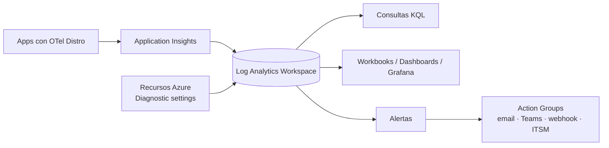

# 3.4 Health checks, Azure Monitor y alertas

[⬅ Anterior: OpenTelemetry](03-opentelemetry-dotnet.md) · [Índice](../README.md) · [Siguiente módulo: Gobernabilidad ➡](../modulo-04-gobernabilidad/01-gobernanza-codigo-arquitectura.md)

## 🎯 Objetivos
- Implementar health checks de liveness y readiness correctos.
- Consultar telemetría con KQL en Application Insights / Log Analytics.
- Crear dashboards y alertas accionables; escribir runbooks.

---

## 1. Health checks

| Tipo | Pregunta | Si falla… | Debe incluir dependencias? |
|------|---------|-----------|----------------------------|
| **Liveness** (`/alive`) | ¿El proceso está vivo y no colgado? | El orquestador **reinicia** la instancia | ❌ No (si la BD cae, reiniciar la app no ayuda y causa cascada) |
| **Readiness** (`/health/ready`) | ¿Puede atender tráfico ahora? | El balanceador **deja de enviarle** tráfico | ✅ Sí (BD, caché críticos) |
| **Startup** | ¿Terminó de arrancar (migraciones, warm-up)? | Se espera antes de evaluar liveness | Opcional |

```csharp
builder.Services.AddHealthChecks()
    .AddCheck("self", () => HealthCheckResult.Healthy(), tags: ["live"])
    .AddDbContextCheck<OrderingDbContext>("sql", tags: ["ready"])
    .AddRedis(builder.Configuration.GetConnectionString("redis")!, name: "redis", tags: ["ready"]) // AspNetCore.HealthChecks.Redis
    .AddCheck<PaymentsGatewayHealthCheck>("payments", failureStatus: HealthStatus.Degraded, tags: ["ready"]);

app.MapHealthChecks("/alive", new() { Predicate = r => r.Tags.Contains("live") });
app.MapHealthChecks("/health/ready", new()
{
    Predicate = r => r.Tags.Contains("ready"),
    ResponseWriter = UIResponseWriter.WriteHealthCheckUIResponse // JSON detallado (AspNetCore.HealthChecks.UI.Client)
}).RequireHost("*:8081"); // opcional: expón detalles solo en un puerto interno

public sealed class PaymentsGatewayHealthCheck(IHttpClientFactory f) : IHealthCheck
{
    public async Task<HealthCheckResult> CheckHealthAsync(HealthCheckContext ctx, CancellationToken ct = default)
    {
        try
        {
            var r = await f.CreateClient("payments").GetAsync("health", ct);
            return r.IsSuccessStatusCode ? HealthCheckResult.Healthy() : HealthCheckResult.Degraded($"Status {r.StatusCode}");
        }
        catch (Exception ex) { return HealthCheckResult.Degraded("No responde", ex); }
    }
}
```
> 💡 Una dependencia **no crítica** (pagos tiene fallback) debe reportar `Degraded`, no `Unhealthy`, para no sacar la instancia del balanceo.
> ⚠️ No expongas detalles internos de health públicamente (versiones, hosts). Usa un puerto interno o autorización.

### En Azure
- **App Service:** Health check path → saca instancias no sanas del balanceo y las reemplaza.
- **Container Apps / AKS:** probes de liveness, readiness y startup en la definición del contenedor.
- **Front Door / App Gateway:** health probes hacia el backend.

---

## 2. Azure Monitor: el mapa



| Componente | Para qué |
|------------|----------|
| **Application Insights** | APM: requests, dependencias, excepciones, trazas, mapa de aplicación |
| **Log Analytics workspace** | Almacén central de logs; consultas KQL |
| **Azure Monitor Metrics** | Métricas de plataforma de baja latencia |
| **Diagnostic settings** | Envía logs de recursos (SQL, Key Vault, App Service) al workspace |
| **Workbooks / Azure Managed Grafana** | Dashboards |
| **Alert rules + Action Groups** | Notificaciones y automatización |

> Las tablas de Application Insights basado en workspace: `AppRequests`, `AppDependencies`, `AppExceptions`, `AppTraces`, `AppMetrics`.

---

## 3. KQL esencial ⭐

```kusto
// 1) Golden signals por endpoint (última hora)
AppRequests
| where TimeGenerated > ago(1h)
| summarize
    requests = count(),
    errorRate = round(100.0 * countif(Success == false) / count(), 2),
    p50 = percentile(DurationMs, 50),
    p95 = percentile(DurationMs, 95),
    p99 = percentile(DurationMs, 99)
  by Name
| order by requests desc
```

```kusto
// 2) Dependencias más lentas (¿la BD? ¿un API externo?)
AppDependencies
| where TimeGenerated > ago(1h)
| summarize calls = count(), p95 = percentile(DurationMs, 95), failures = countif(Success == false)
  by Target, DependencyType
| order by p95 desc
```

```kusto
// 3) Todo lo que pasó en una petición (el traceId que devolvió el ProblemDetails)
union AppRequests, AppDependencies, AppTraces, AppExceptions
| where OperationId == "4bf92f3577b34da6a3ce929d0e0e4736"
| project TimeGenerated, Type, Name, Message, DurationMs, Success, SeverityLevel
| order by TimeGenerated asc
```

```kusto
// 4) Excepciones nuevas tras el último despliegue
AppExceptions
| where TimeGenerated > ago(24h)
| summarize count(), firstSeen = min(TimeGenerated) by ProblemId, AppRoleName
| where firstSeen > ago(2h)
```

```kusto
// 5) SLI de checkout: % de POST /orders exitosos y < 500 ms (ventana 30 días)
AppRequests
| where TimeGenerated > ago(30d) and Name == "POST /orders"
| summarize good = countif(toint(ResultCode) < 500 and DurationMs < 500), total = count()
| extend sli = round(100.0 * good / total, 3)
```

```kusto
// 6) Métrica de negocio personalizada
AppMetrics
| where Name == "orderflow.orders.placed" and TimeGenerated > ago(1d)
| summarize orders = sum(Sum) by bin(TimeGenerated, 15m)
| render timechart
```

---

## 4. Dashboards que sirven

**Dashboard de servicio (una pantalla):**
1. Fila 1 — SLO actual y error budget restante.
2. Fila 2 — Golden signals: tráfico, tasa de errores, p95/p99, saturación (CPU, memoria, pool de conexiones, longitud de cola).
3. Fila 3 — Dependencias: latencia y errores por destino.
4. Fila 4 — Métricas de negocio.
5. Anotaciones de **despliegues** (¿empezó el problema tras un release?).

---

## 5. Alertas accionables

| Alerta | Tipo | Severidad | Acción |
|--------|------|-----------|--------|
| Burn rate checkout > 14,4× en 1 h | Log alert (KQL) | Sev 1 → página on-call | Runbook "checkout degradado" |
| Mensajes en DLQ > 0 | Métrica Service Bus | Sev 3 → ticket | Revisar mensajes envenenados |
| Health check fallando en > 50 % instancias | Métrica App Service | Sev 2 | Revisar dependencia |
| Excepción nueva (nunca vista) | Smart detection / KQL | Sev 3 | Triage |
| Certificado expira en < 30 días | Key Vault event / alerta | Sev 3 | Renovar |

### Plantilla de runbook
```markdown
# Runbook: Checkout degradado (burn rate alto)
**Impacto:** usuarios no pueden completar pedidos.
**Dashboard:** <enlace>  ·  **Consulta KQL:** <enlace>
## Diagnóstico (en orden)
1. ¿Hubo despliegue en la última hora? → si sí, evaluar rollback (swap de slot).
2. ¿Qué dependencia tiene errores/latencia? (consulta #2)
3. ¿Circuit breaker de pagos abierto? → revisar estado del proveedor.
4. ¿Saturación? (CPU, pool SQL, DTU/vCore) → escalar.
## Mitigación
- Rollback: pipeline "OrderFlow-Release" → stage Prod → swap back.
- Escalar: `az appservice plan update --number-of-workers 6 ...`
## Escalamiento
On-call de plataforma: <contacto>. Proveedor de pagos: <contacto>.
```

---

## 6. Infraestructura de observabilidad como código
```bicep
resource law 'Microsoft.OperationalInsights/workspaces@2023-09-01' = {
  name: 'log-orderflow-${env}'
  location: location
  properties: { retentionInDays: 30, sku: { name: 'PerGB2018' } }
}

resource appi 'Microsoft.Insights/components@2020-02-02' = {
  name: 'appi-orderflow-${env}'
  location: location
  kind: 'web'
  properties: {
    Application_Type: 'web'
    WorkspaceResourceId: law.id
    DisableLocalAuth: true   // ingesta solo con Entra ID
  }
}
```

## ✅ Checklist
- [ ] Separo liveness (sin dependencias) de readiness (con dependencias críticas).
- [ ] Escribo KQL para golden signals, dependencias y seguimiento por traceId.
- [ ] Mi dashboard muestra SLO, golden signals, dependencias, negocio y despliegues.
- [ ] Cada alerta tiene severidad, dueño y runbook.

## 🏋️ Ejercicio (OrderFlow)
1. Implementa `/alive` y `/health/ready` con SQL, Redis y pagos (degraded).
2. Despliega Application Insights + Log Analytics con Bicep y conecta la API.
3. Crea un Workbook con las consultas 1, 2, 5 y 6.
4. Crea una alerta de burn rate y su runbook.

## 📚 Profundiza
- [Health checks in ASP.NET Core](https://learn.microsoft.com/aspnet/core/host-and-deploy/health-checks).
- [Azure Monitor OpenTelemetry Distro](https://learn.microsoft.com/azure/azure-monitor/app/opentelemetry-enable).
- [KQL quick reference](https://learn.microsoft.com/kusto/query/kql-quick-reference).
