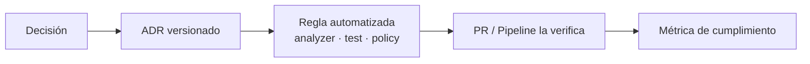

# 4.1 Gobernanza de código y arquitectura

[⬅ Módulo anterior](../modulo-03-observabilidad/04-health-checks-azure-monitor.md) · [Índice](../README.md) · [Siguiente: Gobernanza de APIs ➡](02-gobernanza-apis.md)

## 🎯 Objetivos
- Entender la gobernanza como **guardarraíles automáticos**, no como burocracia.
- Registrar decisiones con ADRs.
- Imponer estándares con `Directory.Build.props`, `.editorconfig`, analyzers y Central Package Management.
- Verificar reglas de arquitectura con tests (fitness functions).
- Gobernar dependencias: vulnerabilidades y licencias.

---

## 🧠 ¿Qué es gobernabilidad para un equipo de desarrollo?

> **Gobernanza = asegurar que las decisiones importantes se toman bien, se documentan y se cumplen, sin depender de la memoria ni de la buena voluntad de nadie.**

| Gobernanza mala 🚫 | Gobernanza buena ✅ |
|--------------------|---------------------|
| Wiki de 80 páginas que nadie lee | Reglas en el código que rompen el build |
| Comité que aprueba cada cambio | Guardarraíles automáticos + revisión en PR |
| "Siempre lo hemos hecho así" | ADR con contexto y alternativas |
| Se descubre el problema en producción | Se descubre en el PR |



---

## 1. Architecture Decision Records (ADR)

Documento **corto** (1 página) que vive en el repo (`docs/adr/`).

```markdown
# ADR-0003: Usar Modular Monolith en lugar de microservicios

- **Estado:** Aceptado
- **Fecha:** 2026-12-01
- **Decisores:** Equipo OrderFlow

## Contexto
Equipo de 4 desarrolladores, dominio en descubrimiento, un solo cliente inicial.
Necesitamos entregar el MVP en 3 meses y operar con un equipo pequeño.

## Decisión
Construiremos un monolito modular con 3 módulos (Ordering, Catalog, Payments),
cada uno con su schema de BD, comunicándose vía contratos públicos y eventos in-process.
Las fronteras se verificarán con tests de arquitectura.

## Alternativas consideradas
- **Microservicios:** autonomía de despliegue, pero costo operativo y de observabilidad
  desproporcionado para el tamaño del equipo.
- **Monolito en capas sin módulos:** más rápido al inicio, pero sin fronteras para evolucionar.

## Consecuencias
- ✅ Un pipeline, una BD, debugging simple.
- ✅ Posibilidad de extraer un módulo a servicio si se justifica.
- ⚠️ Requiere disciplina: tests de arquitectura obligatorios en CI.
- ⚠️ Escalado conjunto de todos los módulos.
```

**Reglas:** numerados, inmutables (si cambia la decisión, se crea un ADR nuevo que "reemplaza" al anterior), revisados en PR como el código. Herramientas: `adr-tools`, `dotnet-adr`, o plantillas MADR.

---

## 2. Estándares en el build

### `Directory.Build.props` (raíz del repo — aplica a todos los proyectos)
```xml
<Project>
  <PropertyGroup>
    <TargetFramework>net10.0</TargetFramework>
    <LangVersion>latest</LangVersion>
    <Nullable>enable</Nullable>
    <ImplicitUsings>enable</ImplicitUsings>

    <TreatWarningsAsErrors>true</TreatWarningsAsErrors>
    <AnalysisLevel>latest-recommended</AnalysisLevel>
    <EnforceCodeStyleInBuild>true</EnforceCodeStyleInBuild>
    <GenerateDocumentationFile>true</GenerateDocumentationFile>
    <NoWarn>$(NoWarn);CS1591</NoWarn> <!-- no exigir XML docs en todo -->

    <!-- Seguridad de dependencias -->
    <NuGetAudit>true</NuGetAudit>
    <NuGetAuditMode>all</NuGetAuditMode>      <!-- incluye dependencias transitivas -->
    <NuGetAuditLevel>moderate</NuGetAuditLevel>

    <!-- Builds reproducibles -->
    <Deterministic>true</Deterministic>
    <ContinuousIntegrationBuild Condition="'$(TF_BUILD)' == 'true'">true</ContinuousIntegrationBuild>
  </PropertyGroup>
</Project>
```

### Central Package Management — `Directory.Packages.props`
```xml
<Project>
  <PropertyGroup>
    <ManagePackageVersionsCentrally>true</ManagePackageVersionsCentrally>
    <CentralPackageTransitivePinningEnabled>true</CentralPackageTransitivePinningEnabled>
  </PropertyGroup>
  <ItemGroup>
    <PackageVersion Include="Microsoft.EntityFrameworkCore.SqlServer" Version="10.0.0" />
    <PackageVersion Include="Microsoft.Identity.Web" Version="4.0.0" />
    <PackageVersion Include="OpenTelemetry.Extensions.Hosting" Version="1.14.0" />
    <PackageVersion Include="xunit.v3" Version="3.1.0" />
  </ItemGroup>
</Project>
```
En cada `.csproj`: `<PackageReference Include="Microsoft.Identity.Web" />` (sin versión). Una sola fuente de verdad; adiós a "cada proyecto con una versión distinta".
> Las versiones mostradas son ilustrativas; usa las actuales de NuGet. Automatiza actualizaciones con **Dependabot** (disponible para Azure Repos vía extensiones/pipelines) o **Renovate**.

### `.editorconfig` (estilo + severidad de reglas)
```ini
root = true

[*.cs]
indent_style = space
indent_size = 4
csharp_style_namespace_declarations = file_scoped:error
csharp_style_var_for_built_in_types = true:suggestion
dotnet_style_require_accessibility_modifiers = always:warning

# Reglas de calidad elevadas a error
dotnet_diagnostic.CA2007.severity = none      # ConfigureAwait: no aplica en apps ASP.NET Core
dotnet_diagnostic.CA2254.severity = error     # templates de log constantes (sin interpolación)
dotnet_diagnostic.CA1848.severity = warning   # usar LoggerMessage
dotnet_diagnostic.CA2016.severity = error     # propagar CancellationToken
dotnet_diagnostic.CA1062.severity = none
dotnet_diagnostic.IDE0005.severity = warning  # usings innecesarios

# Nomenclatura: campos privados con _
dotnet_naming_rule.private_fields_underscore.symbols = private_fields
dotnet_naming_rule.private_fields_underscore.style = underscore_prefix
dotnet_naming_rule.private_fields_underscore.severity = warning
dotnet_naming_symbols.private_fields.applicable_kinds = field
dotnet_naming_symbols.private_fields.applicable_accessibilities = private
dotnet_naming_style.underscore_prefix.required_prefix = _
dotnet_naming_style.underscore_prefix.capitalization = camel_case
```

### Analyzers adicionales recomendados
| Paquete | Aporta |
|---------|--------|
| Analizadores .NET (incluidos) | Calidad, rendimiento, seguridad, confiabilidad (CA*) |
| **SonarAnalyzer.CSharp** | Bugs, code smells, seguridad (también SonarQube/SonarCloud en el pipeline) |
| **Meziantou.Analyzer** | Buenas prácticas muy útiles |
| **Roslynator** | Refactorings y reglas de estilo |

> Formatea en CI: `dotnet format --verify-no-changes` falla si alguien no respetó el estilo.

---

## 3. Fitness functions: tests de arquitectura ⭐

```bash
dotnet add tests/OrderFlow.ArchitectureTests package NetArchTest.Rules
```

```csharp
public sealed class ArchitectureTests
{
    private static readonly Assembly Domain = typeof(Order).Assembly;
    private static readonly Assembly Application = typeof(PlaceOrderCommand).Assembly;
    private static readonly Assembly Infrastructure = typeof(OrderingDbContext).Assembly;

    [Fact]
    public void Domain_no_depende_de_ninguna_otra_capa_ni_de_EF()
    {
        var result = Types.InAssembly(Domain)
            .ShouldNot().HaveDependencyOnAny(
                "OrderFlow.Application", "OrderFlow.Infrastructure", "OrderFlow.Api",
                "Microsoft.EntityFrameworkCore", "Microsoft.AspNetCore")
            .GetResult();

        Assert.True(result.IsSuccessful, Describe(result));
    }

    [Fact]
    public void Application_no_depende_de_Infrastructure()
    {
        var result = Types.InAssembly(Application)
            .ShouldNot().HaveDependencyOn("OrderFlow.Infrastructure")
            .GetResult();
        Assert.True(result.IsSuccessful, Describe(result));
    }

    [Fact]
    public void Handlers_deben_ser_sealed_e_internal()
    {
        var result = Types.InAssembly(Application)
            .That().ImplementInterface(typeof(ICommandHandler<,>))
            .Should().BeSealed().And().NotBePublic()
            .GetResult();
        Assert.True(result.IsSuccessful, Describe(result));
    }

    [Fact]
    public void Modulo_Ordering_solo_conoce_Contracts_de_otros_modulos()
    {
        var result = Types.InNamespace("OrderFlow.Modules.Ordering")
            .ShouldNot().HaveDependencyOnAny(
                "OrderFlow.Modules.Catalog.Domain", "OrderFlow.Modules.Catalog.Infrastructure",
                "OrderFlow.Modules.Payments.Domain", "OrderFlow.Modules.Payments.Infrastructure")
            .GetResult();
        Assert.True(result.IsSuccessful, Describe(result));
    }

    private static string Describe(TestResult r) =>
        string.Join(Environment.NewLine, r.FailingTypeNames ?? []);
}
```
> Alternativa más expresiva: **ArchUnitNET**. Otras fitness functions: umbral de cobertura, tiempo de build, tamaño de imagen, presupuesto de latencia en pruebas de carga.

---

## 4. Gobernanza de dependencias

### Vulnerabilidades
- `NuGetAudit` (arriba) advierte/falla en `restore`.
- `dotnet list package --vulnerable --include-transitive` en el pipeline.
- **GitHub Advanced Security for Azure DevOps**: dependency scanning, secret scanning, code scanning (CodeQL).

### Licencias ⚠️ (tema caliente 2025–2026)
Varias librerías populares de .NET pasaron a licencia comercial o dual:
| Librería | Cambio | Alternativas |
|----------|--------|--------------|
| MediatR, AutoMapper | Comerciales desde 2025 (con edición community para organizaciones pequeñas) | Dispatcher propio, Wolverine, *Mediator* (source gen); Mapperly / mapeo manual |
| MassTransit v9 | Comercial (v8 sigue open source) | Wolverine, Rebus, SDK nativo |
| FluentAssertions v8 | Licencia comercial para uso comercial | **Shouldly**, **AwesomeAssertions** (fork), asserts de xUnit |

**Proceso recomendado:** lista de paquetes aprobados, revisión de licencia en PR al agregar dependencias nuevas, y un escaneo de licencias en CI (ej. `dotnet-project-licenses`, Mend/Snyk, Sonatype).

### SBOM
Genera un *Software Bill of Materials* en cada build (`Microsoft.Sbom.DotNetTool` / `sbom-tool`) — cada vez más exigido por clientes y reguladores.

---

## 5. Gobernanza del proceso (en Azure Repos)
- **Branch policies** en `main`: mínimo 1–2 revisores, build validation obligatorio, comentarios resueltos, work item vinculado.
- **CODEOWNERS** (o *Automatically included reviewers* en Azure Repos) por carpeta: `/src/Modules/Payments/` → equipo de pagos.
- **Plantilla de PR** (`.azuredevops/pull_request_template.md`) con checklist: tests, ADR si aplica, impacto en observabilidad, migraciones.
- **Conventional Commits** para changelogs y versionado semántico automático.
- **Definition of Done** que incluya: tests, telemetría, documentación, sin warnings.

## 6. Métricas de salud de ingeniería
| Métrica | Fuente |
|---------|--------|
| **DORA**: frecuencia de despliegue, lead time, change failure rate, MTTR | Azure DevOps (Analytics) |
| Cobertura de tests en código nuevo | SonarQube / ReportGenerator |
| Deuda técnica, duplicación, complejidad | SonarQube |
| Vulnerabilidades abiertas por severidad | Advanced Security / Defender for DevOps |
| Edad de dependencias | Renovate / Dependabot dashboards |

## ✅ Checklist
- [ ] Mis decisiones importantes tienen ADR.
- [ ] Un repo nuevo hereda estándares vía `Directory.Build.props` y `.editorconfig`.
- [ ] Uso Central Package Management.
- [ ] Una violación de capas rompe el build.
- [ ] Conozco el estado de licencias de mis dependencias críticas.

## 🏋️ Ejercicio (OrderFlow)
1. Escribe 3 ADRs (estilo arquitectónico, broker de mensajería, estrategia de autenticación).
2. Agrega `Directory.Build.props`, `Directory.Packages.props` y `.editorconfig`; corrige todos los warnings.
3. Crea el proyecto `OrderFlow.ArchitectureTests` con las 4 reglas de arriba.
4. Audita licencias de tus dependencias; si usas MediatR/AutoMapper/FluentAssertions, documenta en un ADR si migras o licencias.

## 📚 Profundiza
- *Building Evolutionary Architectures* — Ford, Parsons, Kua, Sadalage (fitness functions).
- [adr.github.io](https://adr.github.io/) — plantillas y herramientas.
- [Central Package Management](https://learn.microsoft.com/nuget/consume-packages/central-package-management).
