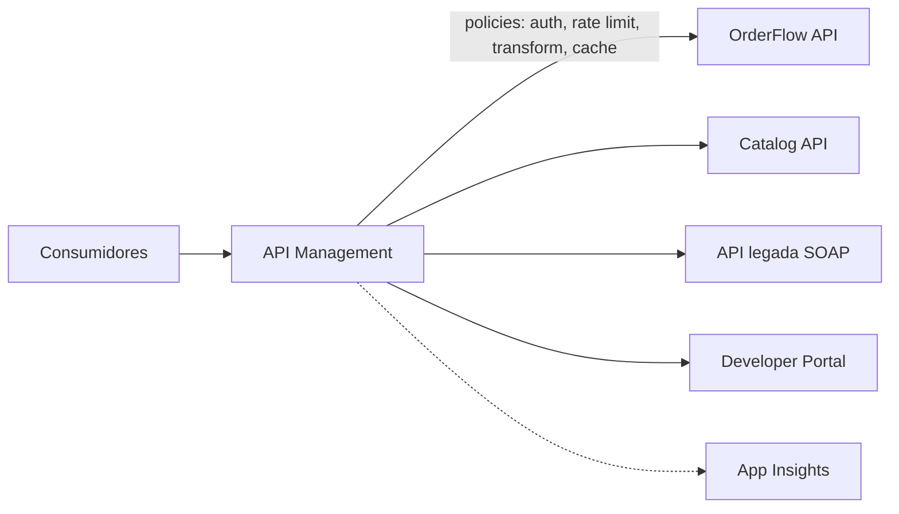

# 4.2 Gobernanza de APIs

[⬅ Anterior: Código y arquitectura](01-gobernanza-codigo-arquitectura.md) · [Índice](../README.md) · [Siguiente: Gobernanza en Azure ➡](03-gobernanza-azure.md)

## 🎯 Objetivos
- Diseñar APIs consistentes con una guía de estilo.
- Generar y validar contratos OpenAPI (*API-first* o *code-first* con disciplina).
- Versionar sin romper consumidores.
- Gobernar APIs a escala con Azure API Management y API Center.

---

## 1. Guía de estilo de API (ejemplo resumido)

| Tema | Regla |
|------|-------|
| URLs | Sustantivos en plural, kebab-case: `/orders`, `/orders/{orderId}/items`, `/payment-methods` |
| Acciones no CRUD | Sub-recurso verbal: `POST /orders/{id}/cancel` |
| JSON | camelCase; fechas ISO 8601 con zona (`2026-11-13T10:00:00-05:00`); montos como decimal + moneda |
| Errores | **ProblemDetails (RFC 9457)** con `type`, `title`, `status`, `detail`, `traceId`, `errors` |
| Paginación | Cursor: `?limit=20&after=<cursor>` → respuesta con `nextCursor` |
| Filtros/orden | `?status=paid&sort=-createdAt` |
| Idempotencia | `Idempotency-Key` en POST que crean recursos o cobran |
| Concurrencia | `ETag` + `If-Match` en actualizaciones → `412 Precondition Failed` |
| Seguridad | OAuth 2.0 / Entra ID; scopes por recurso (`Orders.Read`, `Orders.Write`) |
| Correlación | Propagar `traceparent` |

> Referencias públicas: **Microsoft REST API Guidelines** (en GitHub), Zalando RESTful API Guidelines, Google AIP.

---

## 2. OpenAPI en .NET

Desde .NET 9, ASP.NET Core genera OpenAPI de forma nativa (`Microsoft.AspNetCore.OpenApi`), y .NET 10 soporta OpenAPI 3.1.

```csharp
builder.Services.AddOpenApi(o =>
{
    o.AddDocumentTransformer((doc, ctx, ct) =>
    {
        doc.Info = new() { Title = "OrderFlow API", Version = "v1", Description = "API de pedidos" };
        return Task.CompletedTask;
    });
});

app.MapOpenApi();                 // /openapi/v1.json
if (app.Environment.IsDevelopment())
    app.MapScalarApiReference();  // UI interactiva (paquete Scalar.AspNetCore) — Swashbuckle ya no viene en las plantillas

app.MapPost("/orders", PlaceOrder.Handle)
   .WithName("PlaceOrder")
   .WithSummary("Crea un pedido")
   .WithTags("Orders")
   .Produces<PlaceOrder.Response>(StatusCodes.Status201Created)
   .ProducesValidationProblem()
   .ProducesProblem(StatusCodes.Status409Conflict)
   .RequireAuthorization("Orders.Write");
```

### Generar el documento en build (para versionarlo y compararlo)
```xml
<!-- OrderFlow.Api.csproj -->
<PackageReference Include="Microsoft.Extensions.ApiDescription.Server" />
<PropertyGroup>
  <OpenApiDocumentsDirectory>$(MSBuildProjectDirectory)/../../contracts</OpenApiDocumentsDirectory>
</PropertyGroup>
```
Ahora `contracts/OrderFlow.Api.json` se versiona en git: **cualquier cambio de contrato se ve en el PR**.

### Lint del contrato con Spectral (en el pipeline)
```yaml
# .spectral.yaml
extends: ["spectral:oas"]
rules:
  paths-kebab-case:
    description: Las rutas deben estar en kebab-case
    given: $.paths[*]~
    then: { function: pattern, functionOptions: { match: "^(/[a-z0-9-{}]+)+$" } }
  operation-operationId: error
  operation-tags: error
```
```bash
npx @stoplight/spectral-cli lint contracts/OrderFlow.Api.json --fail-severity=error
```

### Detectar breaking changes
Compara el contrato del PR contra el de `main` con **oasdiff** (`oasdiff breaking base.json pr.json --fail-on ERR`). Un breaking change sin nueva versión = PR bloqueado.

| ¿Breaking? | Cambio |
|-----------|--------|
| ❌ No | Agregar endpoint, agregar campo opcional en request, agregar campo en response |
| ✅ Sí | Eliminar/renombrar campo o endpoint, cambiar tipo, hacer obligatorio un campo, cambiar códigos de estado o semántica |

---

## 3. Versionado

```bash
dotnet add package Asp.Versioning.Http
```
```csharp
builder.Services.AddApiVersioning(o =>
{
    o.DefaultApiVersion = new ApiVersion(1);
    o.ReportApiVersions = true;                       // header api-supported-versions
    o.ApiVersionReader = new UrlSegmentApiVersionReader();
}).AddApiExplorer(o => { o.GroupNameFormat = "'v'V"; o.SubstituteApiVersionInUrl = true; });

var orders = app.NewVersionedApi("Orders");
var v1 = orders.MapGroup("/v{version:apiVersion}/orders").HasApiVersion(1);
var v2 = orders.MapGroup("/v{version:apiVersion}/orders").HasApiVersion(2);

v1.MapGet("/{id:guid}", GetOrderV1.Handle);
v2.MapGet("/{id:guid}", GetOrderV2.Handle);   // nueva forma de respuesta
```

| Estrategia | Ejemplo | Pros / contras |
|-----------|---------|----------------|
| URL | `/v2/orders` | Visible, fácil de enrutar y cachear (la más común) |
| Query | `/orders?api-version=2` | Estilo de las APIs de Azure |
| Header | `api-version: 2` | URLs limpias; menos visible |

**Política de deprecación:** anuncia con headers `Deprecation` y `Sunset` (RFC 8594), mide quién usa la versión vieja (telemetría por `client_id`), y retira tras el plazo acordado (ej. 6 meses).

---

## 4. Contract testing
- **Proveedor:** tests de integración con `WebApplicationFactory` que validan respuestas contra el OpenAPI.
- **Consumer-driven contracts** con **Pact** (PactNet): cada consumidor publica lo que espera; el pipeline del proveedor verifica que no lo rompe. Muy útil entre microservicios.

---

## 5. Azure API Management (APIM)

Gateway + portal + políticas para **todas** las APIs de la organización.



### Política de ejemplo (XML)
```xml
<policies>
  <inbound>
    <base />
    <validate-azure-ad-token tenant-id="{{tenant-id}}">
      <audiences><audience>api://orderflow-api</audience></audiences>
      <required-claims>
        <claim name="scp" match="any" separator=" "><value>Orders.Read</value><value>Orders.Write</value></claim>
      </required-claims>
    </validate-azure-ad-token>
    <rate-limit-by-key calls="100" renewal-period="60"
        counter-key="@(context.Request.Headers.GetValueOrDefault("Authorization","").AsJwt()?.Subject)" />
    <set-header name="X-Forwarded-By" exists-action="override"><value>apim</value></set-header>
  </inbound>
  <backend><base /></backend>
  <outbound>
    <base />
    <set-header name="X-Powered-By" exists-action="delete" />
  </outbound>
  <on-error><base /></on-error>
</policies>
```

Capacidades clave: productos y suscripciones, versionado y revisiones, transformación (SOAP→REST), caché, mock de respuestas, **AI gateway** (límites de tokens para APIs de LLM), workspaces por equipo (gobierno federado).

### Azure API Center
Inventario central de **todas** las APIs (incluso las que no pasan por APIM), con metadatos, dueños, ciclo de vida y **linting automático** de especificaciones. Es la pieza de "gobernanza" del ecosistema de APIs.

### APIOps
Gestiona la configuración de APIM como código (extraer/publicar con pipelines). Microsoft publica el toolkit *APIOps* para Azure DevOps y GitHub.

## ✅ Checklist
- [ ] Tengo (o adopté) una guía de estilo de API.
- [ ] El contrato OpenAPI se genera en build y se versiona.
- [ ] El pipeline hace lint (Spectral) y detecta breaking changes (oasdiff).
- [ ] Sé versionar con `Asp.Versioning` y deprecar con `Sunset`.
- [ ] Entiendo el rol de APIM y API Center.

## 🏋️ Ejercicio (OrderFlow)
1. Escribe la guía de estilo de OrderFlow (1 página) en `docs/`.
2. Genera OpenAPI en build hacia `contracts/`; agrega Spectral y oasdiff al pipeline.
3. Crea `v2` de `GET /orders/{id}` con un cambio incompatible y deprecia `v1`.
4. (Opcional) Publica la API en APIM (tier Developer/Basic v2) con validación de token y rate limit.

## 📚 Profundiza
- [Microsoft REST API Guidelines](https://github.com/microsoft/api-guidelines).
- [OpenAPI in ASP.NET Core](https://learn.microsoft.com/aspnet/core/fundamentals/openapi/overview).
- [Azure API Management](https://learn.microsoft.com/azure/api-management/) · [Azure API Center](https://learn.microsoft.com/azure/api-center/).
