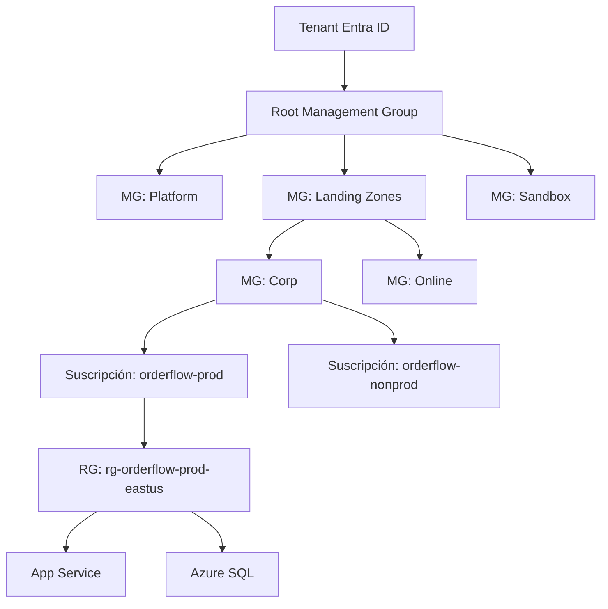

# 4.3 Gobernanza en Azure

[⬅ Anterior: APIs](02-gobernanza-apis.md) · [Índice](../README.md) · [Siguiente módulo: CI/CD ➡](../modulo-05-cicd-azure-devops/01-fundamentos-pipelines-yaml.md)

## 🎯 Objetivos
- Entender la jerarquía de recursos de Azure y dónde aplicar controles.
- Usar Azure Policy para imponer estándares (tags, regiones, seguridad).
- Aplicar convenciones de nombres y etiquetado.
- Controlar costos con presupuestos y alertas.
- Conocer Azure Landing Zones y el Cloud Adoption Framework.

---

## 1. Jerarquía de Azure



**Principio:** las políticas y permisos asignados arriba **se heredan** hacia abajo. Gobierna en el nivel más alto posible; da autonomía en los niveles bajos.

| Nivel | Qué se gobierna típicamente |
|-------|------------------------------|
| Management Group | Policies corporativas (regiones, seguridad), RBAC de plataforma |
| Suscripción | Límite de facturación y cuotas, presupuesto, separación prod/no-prod |
| Resource Group | Ciclo de vida común (se crean/borran juntos), RBAC del equipo |
| Recurso | Configuración específica, locks |

---

## 2. Convenciones de nombres y tags

### Nombres (Cloud Adoption Framework)
`<tipo>-<carga>-<entorno>-<región>-<instancia>`

| Recurso | Ejemplo |
|---------|---------|
| Resource group | `rg-orderflow-prod-eastus` |
| App Service | `app-orderflow-api-prod-eastus` |
| SQL Server | `sql-orderflow-prod-eastus` |
| Key Vault | `kv-orderflow-prod-eus` (máx. 24 caracteres) |
| Storage | `storderflowprodeus` (sin guiones, minúsculas) |
| Log Analytics | `log-orderflow-prod-eastus` |

### Tags obligatorios (ejemplo)
| Tag | Ejemplo | Para qué |
|-----|---------|----------|
| `environment` | `prod` | Filtrado, políticas, costos |
| `application` | `orderflow` | Costos por aplicación |
| `owner` | `equipo-ordering@empresa.com` | ¿A quién llamo? |
| `costCenter` | `CC-1234` | Chargeback/showback |
| `dataClassification` | `confidential` | Seguridad y cumplimiento |

---

## 3. Azure Policy ⭐

Evalúa recursos contra reglas y **audita, deniega, modifica o despliega** automáticamente.

| Efecto | Qué hace |
|--------|----------|
| `Audit` | Marca como no conforme, no bloquea |
| `Deny` | Bloquea la creación/modificación |
| `Modify` | Agrega/cambia propiedades (ej. heredar tags del RG) |
| `DeployIfNotExists` | Despliega algo faltante (ej. diagnostic settings) |
| `AuditIfNotExists` | Audita si falta un recurso relacionado |

### Política: exigir el tag `owner` en resource groups
```json
{
  "properties": {
    "displayName": "Exigir tag 'owner' en resource groups",
    "mode": "All",
    "policyRule": {
      "if": {
        "allOf": [
          { "field": "type", "equals": "Microsoft.Resources/subscriptions/resourceGroups" },
          { "field": "tags['owner']", "exists": "false" }
        ]
      },
      "then": { "effect": "deny" }
    }
  }
}
```

### Asignar políticas integradas con Bicep
```bicep
targetScope = 'subscription'

// Política integrada: "Allowed locations"
resource allowedLocations 'Microsoft.Authorization/policyAssignments@2024-04-01' = {
  name: 'allowed-locations'
  properties: {
    displayName: 'Solo East US y East US 2'
    policyDefinitionId: '/providers/Microsoft.Authorization/policyDefinitions/e56962a6-4747-49cd-b67b-bf8b01975c4c'
    parameters: { listOfAllowedLocations: { value: [ 'eastus', 'eastus2' ] } }
  }
}
```
> Verifica los IDs de políticas integradas en el portal (Policy → Definitions) antes de usarlos.

### Políticas útiles para equipos de desarrollo
- Ubicaciones permitidas; SKUs permitidos en no-prod (evita sorpresas en la factura).
- Exigir tags; heredar tags del resource group (`Modify`).
- **Azure SQL / Storage / Key Vault: deshabilitar acceso público** (o exigir Private Endpoint).
- Exigir TLS 1.2+ y HTTPS only en App Service y Storage.
- Exigir autenticación solo Entra ID en SQL (sin usuarios SQL).
- `DeployIfNotExists`: enviar diagnostic settings a Log Analytics.
- Denegar creación de IPs públicas en spokes corporativos.

### Initiatives
Agrupan políticas (ej. **Microsoft Cloud Security Benchmark**, ISO 27001, PCI-DSS). Se asignan como una unidad y alimentan la puntuación de **Microsoft Defender for Cloud**.

### Policy as Code
Guarda definiciones y asignaciones en un repo y despliégalas con pipeline (proyecto de referencia: **Enterprise Policy as Code (EPAC)**). Prueba primero con efecto `Audit`, luego `Deny`.

---

## 4. Otros controles

| Control | Uso |
|---------|-----|
| **Resource locks** (`CanNotDelete`, `ReadOnly`) | Proteger BD de producción de borrados accidentales |
| **Azure RBAC** con mínimo privilegio | Devs: Reader en prod, Contributor en dev ([6.3](../modulo-06-microsoft-entra/03-managed-identities-rbac.md)) |
| **PIM** | Acceso elevado temporal y aprobado ([6.4](../modulo-06-microsoft-entra/04-seguridad-avanzada.md)) |
| **Defender for Cloud** | Postura de seguridad, recomendaciones, Defender for DevOps |
| **Azure Resource Graph** | Inventario y consultas sobre todos los recursos |

```kusto
// Resource Graph: recursos sin tag owner
resources
| where isempty(tags['owner'])
| project name, type, resourceGroup, subscriptionId
```

---

## 5. Gobernanza de costos (FinOps)

1. **Presupuestos** por suscripción/RG con alertas al 50 %, 80 %, 100 % (y pronóstico).
2. **Tags de costo** para showback por aplicación/equipo.
3. **Rightsizing:** Azure Advisor recomienda reducir SKUs infrautilizados.
4. **Apagar no-prod** fuera de horario (automation, Container Apps escalan a 0).
5. **Reservas / Savings Plans** para cargas estables de producción.
6. **Retención de logs** adecuada (los logs son uno de los mayores costos ocultos).

```bicep
resource budget 'Microsoft.Consumption/budgets@2023-11-01' = {
  name: 'budget-orderflow-nonprod'
  properties: {
    category: 'Cost'
    amount: 300
    timeGrain: 'Monthly'
    timePeriod: { startDate: '2026-12-01' }
    notifications: {
      actual80: {
        enabled: true, operator: 'GreaterThan', threshold: 80, thresholdType: 'Actual'
        contactEmails: [ 'equipo-ordering@empresa.com' ]
      }
      forecast100: {
        enabled: true, operator: 'GreaterThan', threshold: 100, thresholdType: 'Forecasted'
        contactEmails: [ 'equipo-ordering@empresa.com' ]
      }
    }
  }
}
```

---

## 6. Azure Landing Zones y Cloud Adoption Framework (CAF)

- **CAF:** marco de Microsoft para adoptar la nube (estrategia, plan, preparación, adopción, **gobierno**, gestión, seguridad).
- **Azure Landing Zones:** implementación de referencia: jerarquía de management groups, hub de red, identidad, políticas, logging central. Despliegue con módulos Bicep (**Azure Verified Modules**) o Terraform.
- **Well-Architected Framework (WAF):** 5 pilares — confiabilidad, seguridad, optimización de costos, excelencia operacional, eficiencia de rendimiento. Usa la **Azure Well-Architected Review** para evaluar OrderFlow.

> Como desarrollador normalmente **consumes** una landing zone que te da plataforma. Entenderla te permite diseñar dentro de sus reglas (y no pelear con ellas).

## ✅ Checklist
- [ ] Explico la jerarquía MG → Suscripción → RG → Recurso y la herencia.
- [ ] Sigo convención de nombres y tags.
- [ ] Sé crear y asignar una Azure Policy (Audit → Deny).
- [ ] Tengo presupuesto con alertas en mis entornos.
- [ ] Conozco CAF, Landing Zones y Well-Architected Framework.

## 🏋️ Ejercicio (OrderFlow)
1. Define la convención de nombres y tags de OrderFlow (en un ADR).
2. Asigna en tu suscripción de pruebas: ubicaciones permitidas + tag `owner` obligatorio + heredar tags del RG.
3. Crea un presupuesto con alertas para no-prod.
4. Haz la Well-Architected Review de OrderFlow y anota 5 mejoras.

## 📚 Profundiza
- [Cloud Adoption Framework — Govern](https://learn.microsoft.com/azure/cloud-adoption-framework/govern/).
- [Azure Policy documentation](https://learn.microsoft.com/azure/governance/policy/).
- [Azure Well-Architected Framework](https://learn.microsoft.com/azure/well-architected/).
- [Azure naming conventions](https://learn.microsoft.com/azure/cloud-adoption-framework/ready/azure-best-practices/resource-naming).
