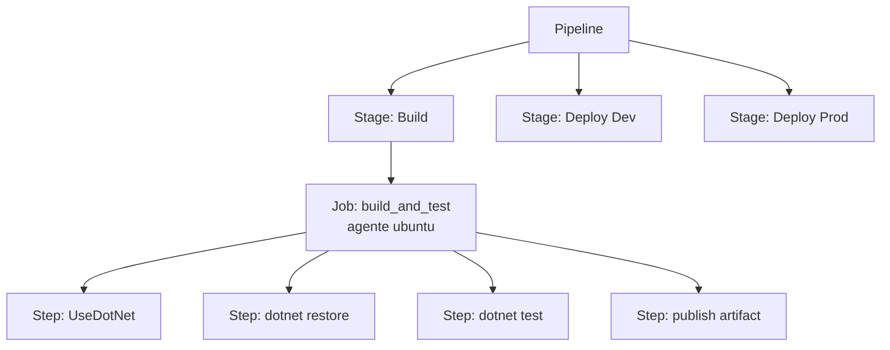
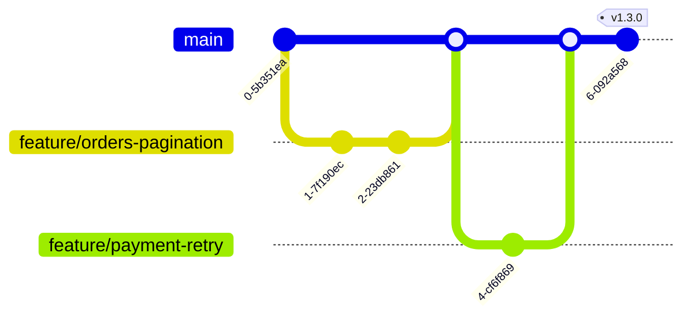

# 5.1 Fundamentos de Azure Pipelines en YAML

[⬅ Módulo anterior](../modulo-04-gobernabilidad/03-gobernanza-azure.md) · [Índice](../README.md) · [Siguiente: Templates ➡](02-templates-reutilizacion.md)

## 🎯 Objetivos
- Entender CI/CD y la anatomía de un pipeline YAML (stages, jobs, steps, tasks).
- Construir un pipeline de CI completo para .NET: restore, build, test, cobertura, artefacto.
- Usar triggers, variables, condiciones, caché y branch policies.

---

## 🧠 Conceptos

| Término | Significado |
|---------|-------------|
| **CI (Continuous Integration)** | Cada cambio se integra a `main` frecuentemente y se valida automáticamente (build + tests) |
| **CD (Continuous Delivery)** | Cada cambio validado **puede** desplegarse a producción con un clic |
| **Continuous Deployment** | Cada cambio validado **se despliega** automáticamente a producción |

### Jerarquía de un pipeline

- **Stage:** fase lógica (Build, Deploy QA…). Pueden tener dependencias y aprobaciones.
- **Job:** se ejecuta en **un agente**. Jobs del mismo stage pueden correr en paralelo.
- **Step:** una tarea (`task:`) o un script (`script:`, `pwsh:`, `bash:`).
- **Agent:** máquina que ejecuta el job — *Microsoft-hosted* (`ubuntu-latest`, `windows-latest`), *self-hosted*, o **Managed DevOps Pools**.

---

## Ejemplo mínimo
```yaml
# azure-pipelines.yml
trigger:
  - main

pool:
  vmImage: ubuntu-latest

steps:
  - task: UseDotNet@2
    inputs:
      packageType: sdk
      useGlobalJson: true
  - script: dotnet build --configuration Release
    displayName: Build
```

> 💡 Agrega un `global.json` en la raíz para fijar la versión del SDK (mismo SDK en local y CI):
> ```json
> { "sdk": { "version": "10.0.100", "rollForward": "latestFeature" } }
> ```

---

## Pipeline de CI completo para OrderFlow ⭐

```yaml
# azure-pipelines-ci.yml
name: $(Date:yyyyMMdd)$(Rev:.r)

trigger:
  branches:
    include: [ main ]
  paths:
    exclude: [ docs/*, '*.md' ]

pr:
  branches:
    include: [ main ]

variables:
  buildConfiguration: Release
  NUGET_PACKAGES: $(Pipeline.Workspace)/.nuget/packages
  DOTNET_CLI_TELEMETRY_OPTOUT: 1
  DOTNET_NOLOGO: 1

pool:
  vmImage: ubuntu-latest

stages:
  - stage: Build
    displayName: Build & Test
    jobs:
      - job: build
        displayName: Build, test y publicar
        steps:
          - checkout: self
            fetchDepth: 0   # historial completo (útil para versionado y Sonar)

          - task: UseDotNet@2
            displayName: Instalar .NET SDK
            inputs:
              packageType: sdk
              useGlobalJson: true

          - task: Cache@2
            displayName: Cache NuGet
            inputs:
              key: 'nuget | "$(Agent.OS)" | **/Directory.Packages.props, **/packages.lock.json'
              restoreKeys: 'nuget | "$(Agent.OS)"'
              path: $(NUGET_PACKAGES)

          - script: dotnet restore --locked-mode
            displayName: Restore

          - script: dotnet format --verify-no-changes --no-restore
            displayName: Verificar formato

          - script: dotnet build --configuration $(buildConfiguration) --no-restore
            displayName: Build

          - script: >
              dotnet test --configuration $(buildConfiguration) --no-build
              --logger trx --results-directory $(Agent.TempDirectory)/TestResults
              --collect "XPlat Code Coverage"
            displayName: Tests

          - task: PublishTestResults@2
            displayName: Publicar resultados de tests
            condition: succeededOrFailed()
            inputs:
              testResultsFormat: VSTest
              testResultsFiles: '$(Agent.TempDirectory)/TestResults/**/*.trx'

          - task: PublishCodeCoverageResults@2
            displayName: Publicar cobertura
            inputs:
              summaryFileLocation: '$(Agent.TempDirectory)/TestResults/**/coverage.cobertura.xml'

          - script: dotnet list package --vulnerable --include-transitive
            displayName: Auditoría de vulnerabilidades

          - script: >
              dotnet publish src/OrderFlow.Api/OrderFlow.Api.csproj
              --configuration $(buildConfiguration) --no-build
              --output $(Build.ArtifactStagingDirectory)/api
            displayName: Publish API

          - task: PublishPipelineArtifact@1
            displayName: Publicar artefacto
            inputs:
              targetPath: $(Build.ArtifactStagingDirectory)/api
              artifact: api
```

> `--locked-mode` exige `packages.lock.json` (activa `<RestorePackagesWithLockFile>true</RestorePackagesWithLockFile>`): builds reproducibles, nadie cuela una versión distinta.
> Tests de integración con contenedores (**Testcontainers**) funcionan en agentes `ubuntu-latest` (traen Docker).

---

## Triggers

| Trigger | Ejemplo | Cuándo corre |
|---------|---------|--------------|
| `trigger` (CI) | `branches: include: [main]` | Push a esas ramas |
| `pr` | `branches: include: [main]` | PRs hacia esas ramas (en **Azure Repos** se configura vía *branch policy → build validation*, no con `pr:`) |
| `schedules` | `cron: "0 6 * * 1-5"` | Programado (ej. escaneos nocturnos) |
| `resources.pipelines` | Pipeline A dispara B al terminar | Encadenamiento |
| `trigger: none` | | Solo manual |

```yaml
schedules:
  - cron: "0 11 * * 1-5"       # UTC → 6:00 am Bogotá
    displayName: Escaneo diario
    branches: { include: [ main ] }
    always: true
```

---

## Variables

```yaml
variables:
  - name: buildConfiguration
    value: Release
  - group: orderflow-common          # variable group (Library)
  - ${{ if eq(variables['Build.SourceBranchName'], 'main') }}:
    - name: deployEnabled
      value: true
```

| Sintaxis | Se evalúa | Uso |
|----------|-----------|-----|
| `${{ variables.x }}` | Al **compilar** el YAML (template expression) | Condiciones estructurales, parámetros de templates |
| `$(x)` | Justo antes de ejecutar cada task (macro) | Uso general en inputs y scripts |
| `$[ variables.x ]` | En runtime (runtime expression) | Condiciones y variables calculadas |

### Pasar valores entre steps y jobs
```yaml
- bash: echo "##vso[task.setvariable variable=imageTag;isOutput=true]$(Build.BuildId)"
  name: setTag

# en otro job:
variables:
  tag: $[ dependencies.build.outputs['setTag.imageTag'] ]
```

> 🔐 Secretos: **nunca** en el YAML. Variables secretas, variable groups enlazados a Key Vault, o la task `AzureKeyVault@2`. Ver [5.3](03-seguridad-environments.md).

---

## Condiciones y dependencias
```yaml
stages:
  - stage: Build
  - stage: DeployDev
    dependsOn: Build
    condition: and(succeeded(), eq(variables['Build.SourceBranch'], 'refs/heads/main'))
```
Funciones útiles: `succeeded()`, `failed()`, `always()`, `eq()`, `ne()`, `startsWith()`, `in()`, `contains()`.

---

## Jobs en paralelo y matrices
```yaml
jobs:
  - job: tests
    strategy:
      matrix:
        linux:   { vmImage: ubuntu-latest }
        windows: { vmImage: windows-latest }
      maxParallel: 2
    pool:
      vmImage: $(vmImage)
    steps:
      - script: dotnet test
```

---

## Branch policies (Azure Repos) — el complemento indispensable

En *Project settings → Repositories → main → Policies*:
- ✅ Require a minimum number of reviewers (1–2; no permitir aprobar tus propios cambios).
- ✅ Check for linked work items.
- ✅ Check for comment resolution.
- ✅ **Build validation:** el pipeline de CI debe pasar (expira si `main` cambia).
- ✅ Limit merge types (ej. squash merge para historial limpio).
- ✅ Automatically included reviewers por ruta (CODEOWNERS de Azure Repos).

### Estrategia de ramas recomendada: trunk-based

Ramas cortas (< 2 días), PR pequeño, `main` siempre desplegable, *feature flags* para lo incompleto. GitFlow solo si tienes releases versionadas con múltiples versiones mantenidas en paralelo.

---

## Variables predefinidas útiles
| Variable | Valor |
|----------|-------|
| `Build.BuildId` / `Build.BuildNumber` | ID numérico / nombre del build |
| `Build.SourceBranch` / `Build.SourceBranchName` | `refs/heads/main` / `main` |
| `Build.SourceVersion` | SHA del commit |
| `Build.Reason` | `IndividualCI`, `PullRequest`, `Manual`, `Schedule` |
| `Build.ArtifactStagingDirectory` | Carpeta para preparar artefactos |
| `Pipeline.Workspace` | Raíz del workspace del agente |
| `System.PullRequest.PullRequestId` | ID del PR |

## ✅ Checklist
- [ ] Explico stage / job / step / task / agent.
- [ ] Mi CI hace restore bloqueado, formato, build, tests, cobertura, auditoría y artefacto.
- [ ] Diferencio `${{ }}`, `$( )` y `$[ ]`.
- [ ] `main` está protegida con build validation y revisores.

## 🏋️ Ejercicio (OrderFlow)
1. Crea `azure-pipelines-ci.yml` como el de arriba y conéctalo en Azure DevOps.
2. Configura branch policies en `main` con build validation.
3. Haz un PR que rompa un test y comprueba que no se puede completar.
4. Agrega un job paralelo que ejecute los tests de arquitectura y el lint del OpenAPI.

## 📚 Profundiza
- [YAML schema reference](https://learn.microsoft.com/azure/devops/pipelines/yaml-schema/).
- [Build, test, and deploy .NET apps](https://learn.microsoft.com/azure/devops/pipelines/ecosystems/dotnet-core).
- [Expressions](https://learn.microsoft.com/azure/devops/pipelines/process/expressions).
- Certificación: **AZ-400 (DevOps Engineer Expert)**.
