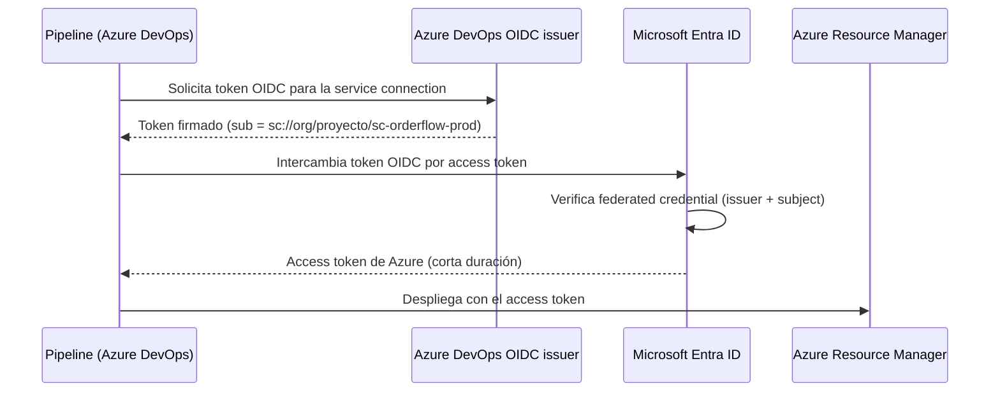
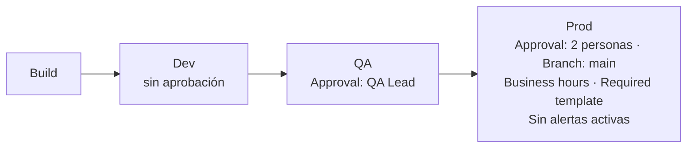

# 5.3 Seguridad del pipeline: environments, approvals, secretos y Workload Identity Federation

[⬅ Anterior: Templates](02-templates-reutilizacion.md) · [Índice](../README.md) · [Siguiente: IaC y despliegues ➡](04-iac-bicep-despliegues.md)

## 🎯 Objetivos
- Conectar Azure DevOps con Azure **sin secretos** (Workload Identity Federation).
- Gestionar secretos con Key Vault y variable groups.
- Proteger producción con environments, approvals y checks.
- Endurecer el pipeline contra ataques a la cadena de suministro.

---

## 🧠 El pipeline es un objetivo de ataque
Tu pipeline tiene credenciales para desplegar en producción. Si alguien puede modificar el YAML o un script que ejecuta, puede hacer **cualquier cosa** que esas credenciales permitan. Por eso:

1. **Sin secretos de larga duración** (usa federación).
2. **Mínimo privilegio** por entorno.
3. **Controles en el recurso**, no solo en el YAML (approvals/checks en environments y service connections).
4. **Trazabilidad** de quién desplegó qué y cuándo.

---

## 1. Service connections con Workload Identity Federation (WIF) ⭐

### Antes: secreto de service principal
Un *client secret* guardado en la service connection: expira, se rota a mano, puede filtrarse.

### Ahora: federación OIDC (recomendado por Microsoft)

- **No hay secreto** que guardar, rotar ni filtrar.
- La identidad puede ser una **app registration** o una **user-assigned managed identity**.
- Se crea desde *Project settings → Service connections → Azure Resource Manager → Workload identity federation* (automático o manual). Las conexiones existentes con secreto se pueden **convertir**.

### Mínimo privilegio
| Service connection | Identidad | Rol | Scope |
|-------------------|-----------|-----|-------|
| `sc-orderflow-dev` | `id-ado-orderflow-dev` | Contributor | `rg-orderflow-dev-eastus` |
| `sc-orderflow-prod` | `id-ado-orderflow-prod` | Website Contributor + roles específicos | `rg-orderflow-prod-eastus` |

> ❌ Evita service connections con *Owner* sobre la suscripción completa. Si el pipeline debe asignar roles (ej. desplegar Bicep con role assignments), usa **Role Based Access Control Administrator** con condiciones que limiten qué roles puede asignar.

### Proteger la service connection
En la service connection → *Security*: limita qué pipelines pueden usarla (no "Grant access to all pipelines"). En *Approvals and checks*: agrega **Required template** y/o aprobaciones.

---

## 2. Secretos

### Jerarquía de preferencia
1. 🥇 **No tener el secreto**: identidad federada / Managed Identity (la app accede a SQL, Service Bus, Storage con Entra ID — [6.3](../modulo-06-microsoft-entra/03-managed-identities-rbac.md)).
2. 🥈 **Key Vault** referenciado en runtime por la app (App Service *Key Vault references*, o `AddAzureKeyVault` en configuración).
3. 🥉 Key Vault leído por el pipeline (variable group enlazado o task `AzureKeyVault@2`).
4. Variables secretas del pipeline (último recurso).
5. ❌ Nunca en el YAML, en `appsettings.json` del repo, ni en logs.

### Variable group enlazado a Key Vault
*Pipelines → Library → + Variable group → Link secrets from an Azure key vault*.
```yaml
variables:
  - group: kv-orderflow-prod   # los secretos aparecen como $(NombreSecreto), enmascarados en logs
```

### Task AzureKeyVault
```yaml
- task: AzureKeyVault@2
  inputs:
    azureSubscription: sc-orderflow-prod
    KeyVaultName: kv-orderflow-prod-eus
    SecretsFilter: 'PaymentsApiKey'
    RunAsPreJob: false
```

### Reglas con secretos en scripts
- Los secretos **no** se exponen automáticamente como variables de entorno en scripts; mápealos explícitamente:
```yaml
- script: ./scripts/call-api.sh
  env:
    PAYMENTS_API_KEY: $(PaymentsApiKey)
```
- Nunca hagas `echo` de un secreto (aunque se enmascara, transformaciones como Base64 lo revelan).
- **Secret scanning** (GitHub Advanced Security for Azure DevOps) bloquea pushes con secretos.

---

## 3. Environments, approvals y checks ⭐

Un **Environment** (`Pipelines → Environments`) representa un destino (`orderflow-dev`, `orderflow-qa`, `orderflow-prod`). Los `deployment` jobs que lo referencian:
- Quedan en un **historial de despliegues** (qué commit/work items llegaron a prod).
- Deben pasar los **checks** configurados **en el environment** (no en el YAML → un dev no puede saltárselos editando el pipeline).

| Check | Uso |
|-------|-----|
| **Approvals** | Personas/grupos que aprueban (no puede aprobar quien disparó el run, si así se configura) |
| **Branch control** | Solo se despliega desde `refs/heads/main` o `refs/tags/*` |
| **Business hours** | Solo de lunes a jueves 8:00–16:00 (nada de deploys el viernes a las 5 pm 😅) |
| **Required template** | El pipeline debe extender el template corporativo |
| **Exclusive lock** | Un solo despliegue a la vez en el environment |
| **Query Azure Monitor alerts** | No desplegar si hay alertas activas en prod |
| **Invoke Azure Function / REST API** | Validaciones personalizadas (ej. ticket de cambio aprobado en ServiceNow) |



---

## 4. Agentes y red

| Tipo | Cuándo |
|------|--------|
| **Microsoft-hosted** | Por defecto; limpios en cada job; no llegan a recursos privados |
| **Managed DevOps Pools** | Agentes gestionados por Azure **dentro de tu VNet**, escalables, con imágenes propias — la opción moderna para recursos privados |
| **Self-hosted (VM / contenedor / VMSS)** | Control total; tú mantienes parches y seguridad |

Si tus recursos usan Private Endpoints ([7.4](../modulo-07-redes/04-redes-en-azure.md)), despliegues de datos (migraciones SQL, Key Vault) requieren un agente con línea de vista a la VNet.

---

## 5. Seguridad de la cadena de suministro

- **Protege el YAML:** branch policies en el repo de templates y de la app; el pipeline de prod solo corre desde `main`.
- **Settings de organización/proyecto** recomendados: limitar el *job authorization scope* al proyecto actual, proteger el acceso a repositorios en YAML, deshabilitar la creación de pipelines clásicos, restringir variables settable at queue time.
- **Fija versiones** de tasks (`AzureWebApp@1`), de templates (tags) y de imágenes de contenedor (digest o tag inmutable).
- **Escaneo:** dependencias (NuGet audit, Advanced Security), código (CodeQL), secretos, imágenes (Defender for Containers), IaC (Checkov/PSRule for Azure).
- **SBOM** y firma de artefactos.
- **Pipelines de PR desde forks:** no exponen secretos por defecto; mantenlo así.
- **Auditoría:** Azure DevOps *Auditing* → stream a Log Analytics para detectar cambios en service connections, permisos y policies.

## ✅ Checklist
- [ ] Todas mis service connections a Azure usan Workload Identity Federation.
- [ ] Cada service connection tiene mínimo privilegio y está restringida a pipelines específicos.
- [ ] No hay secretos en el repo ni en variables en texto plano.
- [ ] Producción tiene approvals, branch control, business hours y required template.
- [ ] Sé cuándo necesito Managed DevOps Pools / agentes en VNet.

## 🏋️ Ejercicio (OrderFlow)
1. Crea service connections `sc-orderflow-dev` y `sc-orderflow-prod` con WIF y roles mínimos por RG.
2. Crea Key Vault con un secreto de prueba y enlázalo a un variable group.
3. Crea los environments `dev`, `qa`, `prod` con los checks de la tabla.
4. Intenta desplegar a prod desde una rama `feature/*` y verifica que el branch control lo bloquea.

## 📚 Profundiza
- [Connect to Azure with workload identity federation](https://learn.microsoft.com/azure/devops/pipelines/library/connect-to-azure).
- [Environments, approvals and checks](https://learn.microsoft.com/azure/devops/pipelines/process/approvals).
- [Securing Azure Pipelines](https://learn.microsoft.com/azure/devops/pipelines/security/overview).
- [Managed DevOps Pools](https://learn.microsoft.com/azure/devops/managed-devops-pools/overview).
