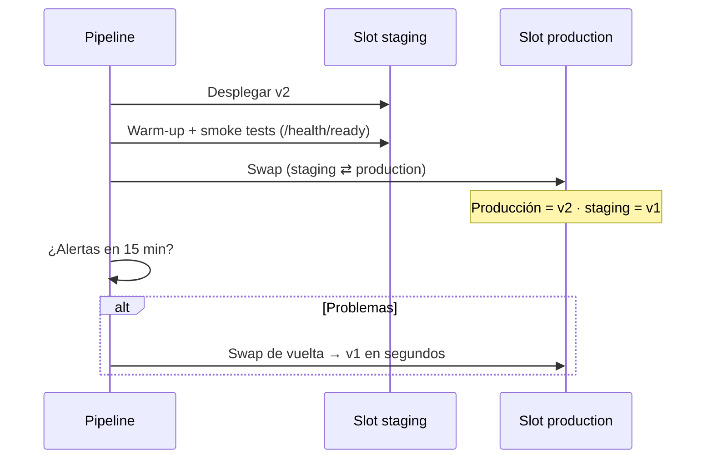
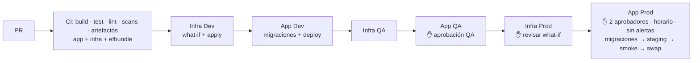

# 5.4 Infraestructura como código (Bicep) y estrategias de despliegue

[⬅ Anterior: Seguridad](03-seguridad-environments.md) · [Índice](../README.md) · [Siguiente módulo: Microsoft Entra ➡](../modulo-06-microsoft-entra/01-fundamentos-identidad.md)

## 🎯 Objetivos
- Definir la infraestructura de OrderFlow en Bicep (módulos, parámetros por entorno).
- Desplegar IaC desde Azure Pipelines con validación y *what-if*.
- Aplicar estrategias de despliegue sin downtime (slots, blue-green, canary, feature flags).
- Ejecutar migraciones de EF Core de forma segura.

---

## 1. ¿Por qué IaC?
| Sin IaC (click-ops) | Con IaC |
|---------------------|---------|
| "¿Quién cambió esto en el portal?" | Historial en git y revisión en PR |
| Dev ≠ QA ≠ Prod | Entornos idénticos desde el mismo código |
| Recrear un entorno: días | Recrear un entorno: minutos |
| Documentación desactualizada | El código **es** la documentación |

**Bicep vs Terraform:** Bicep es nativo de Azure, sin archivo de estado, soporte día 0 de nuevas APIs. Terraform es multi-cloud con un gran ecosistema. Ambos son buenas opciones; aquí usamos Bicep por el foco en Azure.

---

## 2. Estructura del proyecto IaC
```text
infra/
├── main.bicep                   # orquestador
├── main.dev.bicepparam
├── main.prod.bicepparam
└── modules/
    ├── monitoring.bicep         # Log Analytics + App Insights
    ├── appservice.bicep         # Plan + Web App + slot + identidad
    ├── sql.bicep                # SQL Server (solo Entra auth) + DB
    ├── keyvault.bicep
    └── roleAssignments.bicep
```

### `main.bicep`
```bicep
targetScope = 'resourceGroup'

@allowed([ 'dev', 'qa', 'prod' ])
param env string
param location string = resourceGroup().location
param appServiceSku string = 'B1'
@description('Object ID del grupo de Entra que administra SQL')
param sqlAdminGroupObjectId string
param sqlAdminGroupName string

var suffix = 'orderflow-${env}-${location}'
var tags = { environment: env, application: 'orderflow', owner: 'equipo-ordering@empresa.com' }

module monitoring 'modules/monitoring.bicep' = {
  name: 'monitoring'
  params: { suffix: suffix, location: location, tags: tags }
}

module app 'modules/appservice.bicep' = {
  name: 'appservice'
  params: {
    suffix: suffix
    location: location
    tags: tags
    sku: appServiceSku
    createStagingSlot: env == 'prod'
    appInsightsConnectionString: monitoring.outputs.appInsightsConnectionString
  }
}

module sql 'modules/sql.bicep' = {
  name: 'sql'
  params: {
    suffix: suffix
    location: location
    tags: tags
    adminGroupObjectId: sqlAdminGroupObjectId
    adminGroupName: sqlAdminGroupName
  }
}

output webAppName string = app.outputs.webAppName
output webAppPrincipalId string = app.outputs.principalId
```

### `modules/appservice.bicep` (extracto)
```bicep
param suffix string
param location string
param tags object
param sku string
param createStagingSlot bool
@secure()
param appInsightsConnectionString string

resource plan 'Microsoft.Web/serverfarms@2024-04-01' = {
  name: 'asp-${suffix}'
  location: location
  tags: tags
  sku: { name: sku }
  kind: 'linux'
  properties: { reserved: true }
}

resource web 'Microsoft.Web/sites@2024-04-01' = {
  name: 'app-${suffix}'
  location: location
  tags: tags
  identity: { type: 'SystemAssigned' }   // Managed Identity (módulo 6.3)
  properties: {
    serverFarmId: plan.id
    httpsOnly: true
    siteConfig: {
      linuxFxVersion: 'DOTNETCORE|10.0'
      minTlsVersion: '1.2'
      ftpsState: 'Disabled'
      healthCheckPath: '/health/ready'
      alwaysOn: sku != 'F1'
      appSettings: [
        { name: 'APPLICATIONINSIGHTS_CONNECTION_STRING', value: appInsightsConnectionString }
        { name: 'ASPNETCORE_ENVIRONMENT', value: 'Production' }
      ]
    }
  }
}

resource staging 'Microsoft.Web/sites/slots@2024-04-01' = if (createStagingSlot) {
  parent: web
  name: 'staging'
  location: location
  identity: { type: 'SystemAssigned' }
  properties: { serverFarmId: plan.id, httpsOnly: true }
}

output webAppName string = web.name
output principalId string = web.identity.principalId
```

### Parámetros por entorno (`main.prod.bicepparam`)
```bicep
using 'main.bicep'

param env = 'prod'
param appServiceSku = 'P1v3'
param sqlAdminGroupObjectId = '00000000-0000-0000-0000-000000000000'
param sqlAdminGroupName = 'grp-orderflow-sql-admins'
```

> 💡 No reinventes: usa **Azure Verified Modules (AVM)** — módulos Bicep oficiales, probados y alineados al Well-Architected Framework (`br/public:avm/res/web/site:<versión>`).

---

## 3. Pipeline de infraestructura

```yaml
# stages/deploy-infra.yml (template)
parameters:
  - name: environment
    type: string
  - name: serviceConnection
    type: string
  - name: resourceGroup
    type: string
  - name: location
    type: string
    default: eastus

stages:
  - stage: Infra_${{ parameters.environment }}
    jobs:
      - job: whatif
        displayName: Validar y What-If
        pool: { vmImage: ubuntu-latest }
        steps:
          - task: AzureCLI@2
            displayName: Lint + What-If
            inputs:
              azureSubscription: ${{ parameters.serviceConnection }}
              scriptType: bash
              scriptLocation: inlineScript
              inlineScript: |
                set -e
                az bicep build --file infra/main.bicep          # lint/compilación
                az group create -n ${{ parameters.resourceGroup }} -l ${{ parameters.location }} --tags application=orderflow environment=${{ parameters.environment }}
                az deployment group what-if \
                  --resource-group ${{ parameters.resourceGroup }} \
                  --parameters infra/main.${{ parameters.environment }}.bicepparam

      - deployment: apply
        displayName: Aplicar infraestructura
        dependsOn: whatif
        environment: orderflow-infra-${{ parameters.environment }}   # aprobación tras revisar el what-if
        pool: { vmImage: ubuntu-latest }
        strategy:
          runOnce:
            deploy:
              steps:
                - checkout: self
                - task: AzureCLI@2
                  inputs:
                    azureSubscription: ${{ parameters.serviceConnection }}
                    scriptType: bash
                    scriptLocation: inlineScript
                    inlineScript: |
                      az deployment group create \
                        --resource-group ${{ parameters.resourceGroup }} \
                        --name orderflow-$(Build.BuildId) \
                        --parameters infra/main.${{ parameters.environment }}.bicepparam
```
> **What-if** muestra qué se creará, modificará o eliminará — el equivalente a `terraform plan`. Revísalo antes de aprobar.
> **Deployment stacks** (`az stack group create`) agregan gestión del ciclo de vida (borrar recursos que ya no están en el código, *deny settings* para impedir cambios manuales). Vale la pena evaluarlos.
> Valida buenas prácticas de IaC con **PSRule for Azure** o **Checkov** en el pipeline.

---

## 4. Estrategias de despliegue

| Estrategia | Cómo | Rollback | Costo | Cuándo |
|------------|------|----------|-------|--------|
| **Recreate / in-place** | Reemplaza la versión | Redesplegar anterior | Bajo | Dev, apps internas |
| **Rolling** | Actualiza instancias por lotes | Lento | Bajo | VMs/K8s con varias réplicas |
| **Blue-Green** (slots) | Despliega en `staging`, valida, **swap** | Swap de vuelta (segundos) | Medio | ⭐ Estándar con App Service |
| **Canary** | % pequeño de tráfico a la nueva versión | Quitar tráfico | Medio | Cambios riesgosos; Container Apps (revisions), App Service (traffic %), Front Door |
| **Feature flags** | Código desplegado pero apagado | Apagar el flag | Bajo | Separar *deploy* de *release* |

### Blue-green con slots de App Service

- Marca como **slot settings** (*sticky*) la configuración que no debe viajar con el swap (ej. connection strings por slot, flags de entorno).
- Ten en cuenta la Managed Identity del slot (cada slot tiene la suya si es system-assigned → asígnale permisos también, o usa user-assigned).

### Canary con Container Apps
```bash
az containerapp ingress traffic set -n orderflow-api -g rg-orderflow-prod \
  --revision-weight orderflow-api--v1=90 orderflow-api--v2=10
```

### Feature flags con Azure App Configuration
```csharp
builder.Configuration.AddAzureAppConfiguration(o =>
    o.Connect(new Uri(builder.Configuration["AppConfig:Endpoint"]!), new DefaultAzureCredential())
     .UseFeatureFlags(f => f.SetRefreshInterval(TimeSpan.FromSeconds(30))));
builder.Services.AddAzureAppConfiguration().AddFeatureManagement();

app.MapPost("/orders", async (IFeatureManager features, ...) =>
{
    if (await features.IsEnabledAsync("NewPricingEngine")) { /* nuevo */ } else { /* actual */ }
});
```
Permite *targeting* (activar para un % de usuarios o un grupo de Entra) y apagar algo roto sin desplegar.

---

## 5. Migraciones de EF Core en el pipeline ⭐

### ❌ No hagas
`db.Database.Migrate()` al arrancar la app en producción: varias instancias compiten, la identidad de la app necesita permisos DDL, y un fallo deja la app sin arrancar.

### ✅ Opción recomendada: migration bundle
```yaml
# En el build: generar un ejecutable autocontenido con las migraciones
- script: |
    dotnet tool restore
    dotnet ef migrations bundle \
      --project src/OrderFlow.Infrastructure --startup-project src/OrderFlow.Api \
      --configuration Release --self-contained -r linux-x64 \
      --output $(Build.ArtifactStagingDirectory)/migrations/efbundle
  displayName: Crear migration bundle

# También: script idempotente para revisión humana / DBA
- script: >
    dotnet ef migrations script --idempotent
    --project src/OrderFlow.Infrastructure --startup-project src/OrderFlow.Api
    --output $(Build.ArtifactStagingDirectory)/migrations/migrate.sql
  displayName: Generar script SQL idempotente
```
```yaml
# En el deploy (antes del swap), con una identidad que SÍ tiene permisos DDL:
- task: AzureCLI@2
  displayName: Aplicar migraciones
  inputs:
    azureSubscription: ${{ parameters.serviceConnection }}
    scriptType: bash
    scriptLocation: inlineScript
    inlineScript: |
      chmod +x $(Pipeline.Workspace)/migrations/efbundle
      $(Pipeline.Workspace)/migrations/efbundle \
        --connection "Server=tcp:sql-orderflow-prod-eastus.database.windows.net;Database=orderflow;Authentication=Active Directory Default;Encrypt=True"
```
> `Authentication=Active Directory Default` usa la identidad del pipeline (WIF vía Azure CLI) — sin password. Esa identidad debe existir como usuario en la BD con rol `db_ddladmin` (ver [6.3](../modulo-06-microsoft-entra/03-managed-identities-rbac.md)).
> Si la BD tiene Private Endpoint, el agente debe estar en la VNet ([5.3](03-seguridad-environments.md#4-agentes-y-red)).

### Cambios de esquema compatibles (expand / contract)
Con blue-green, **v1 y v2 conviven** contra la misma BD durante un tiempo. Las migraciones deben ser compatibles hacia atrás:
1. **Expand:** agregar columna nueva (nullable), escribir en ambas.
2. Desplegar la app que usa la nueva columna.
3. Migrar datos.
4. **Contract:** en un release posterior, eliminar la columna vieja.

Nunca renombres o elimines una columna en el mismo release que deja de usarla.

---

## 6. Pipeline completo de OrderFlow (visión general)


## ✅ Checklist
- [ ] La infraestructura de OrderFlow está 100 % en Bicep con parámetros por entorno.
- [ ] El pipeline ejecuta what-if y requiere aprobación antes de aplicar en prod.
- [ ] Despliego con slots y puedo hacer rollback con un swap.
- [ ] Las migraciones corren con un bundle desde el pipeline, no al arrancar la app.
- [ ] Diseño cambios de esquema expand/contract.

## 🏋️ Ejercicio (OrderFlow)
1. Escribe `infra/` con los módulos de esta página (o usando AVM).
2. Crea el stage de infraestructura con what-if + aprobación.
3. Implementa blue-green con slot `staging`, smoke test y swap.
4. Genera y aplica un migration bundle en dev.
5. **Prueba de fuego:** borra el RG de dev y recréalo completo con el pipeline.

## 📚 Profundiza
- [Bicep documentation](https://learn.microsoft.com/azure/azure-resource-manager/bicep/).
- [Azure Verified Modules](https://azure.github.io/Azure-Verified-Modules/).
- [EF Core: applying migrations](https://learn.microsoft.com/ef/core/managing-schemas/migrations/applying).
- [App Service deployment slots](https://learn.microsoft.com/azure/app-service/deploy-staging-slots).
