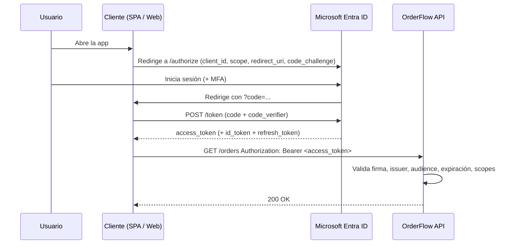
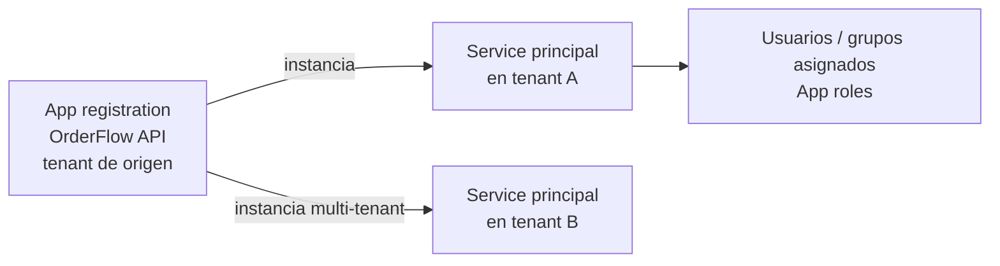

# 6.1 Fundamentos de identidad: OAuth 2.0, OpenID Connect y tokens

[⬅ Módulo anterior](../modulo-05-cicd-azure-devops/04-iac-bicep-despliegues.md) · [Índice](../README.md) · [Siguiente: App registrations ➡](02-app-registrations-identity-web.md)

## 🎯 Objetivos
- Diferenciar autenticación de autorización, y OAuth 2.0 de OpenID Connect.
- Elegir el flujo OAuth correcto para cada tipo de aplicación.
- Leer e interpretar un JWT emitido por Microsoft Entra ID.
- Entender el vocabulario de Entra: tenant, app registration, service principal, scopes, app roles.

---

## 🧠 ¿Qué es Microsoft Entra?

**Microsoft Entra** es la familia de productos de identidad y acceso de Microsoft. Los más relevantes para un desarrollador:

| Producto | Qué es |
|----------|--------|
| **Microsoft Entra ID** (antes *Azure Active Directory*) | Directorio e identidad en la nube: usuarios, grupos, apps, tokens |
| **Microsoft Entra External ID** | Identidad para clientes y socios externos (CIAM). Sucesor de Azure AD B2C para clientes nuevos |
| **Microsoft Entra Workload ID** | Identidades para software: service principals, managed identities, federación |
| **Microsoft Entra ID Governance** | Ciclo de vida de accesos, revisiones de acceso, PIM |
| **Microsoft Entra Conditional Access** | Motor de políticas de acceso (parte de Entra ID P1/P2) |

---

## 1. AuthN vs AuthZ

| | Autenticación (AuthN) | Autorización (AuthZ) |
|--|----------------------|----------------------|
| Pregunta | ¿**Quién** eres? | ¿**Qué** puedes hacer? |
| Protocolo | **OpenID Connect** | **OAuth 2.0** |
| Token resultante | **ID token** (para el cliente) | **Access token** (para la API) |
| En ASP.NET Core | `UseAuthentication()` | `UseAuthorization()`, policies, `[Authorize]` |

---

## 2. OAuth 2.0 en una imagen

**Roles:**
- **Resource Owner:** el usuario dueño de los datos.
- **Client:** la aplicación que quiere acceder (SPA, web app, daemon).
- **Authorization Server:** Microsoft Entra ID (emite tokens).
- **Resource Server:** tu API (valida tokens).



---

## 3. ¿Qué flujo uso? ⭐

| Escenario | Flujo | Notas |
|-----------|-------|-------|
| SPA (React, Angular, Blazor WASM) | **Authorization Code + PKCE** | MSAL.js / MSAL para Blazor. Nunca *implicit flow* (obsoleto) |
| Web app con servidor (MVC, Razor Pages, Blazor Server) | **Authorization Code** (+ PKCE) con client credential | Microsoft.Identity.Web |
| App móvil / escritorio | **Authorization Code + PKCE** (cliente público) | MSAL .NET, broker (Authenticator) |
| API que llama a otra API **en nombre del usuario** | **On-Behalf-Of (OBO)** | El usuario original se preserva en la cadena |
| Servicio/daemon sin usuario (job, worker) | **Client Credentials** | Con **Managed Identity** o federación — evita secretos |
| Dispositivos sin navegador (CLI, TV) | **Device Code** | `az login --use-device-code` lo usa |
| ~~Usuario y contraseña directo~~ | ~~ROPC~~ | ❌ No usar: rompe MFA y Conditional Access |

---

## 4. Anatomía de un access token (JWT)

Un JWT tiene tres partes separadas por puntos: `header.payload.signature` (Base64URL). Puedes inspeccionarlo en **https://jwt.ms** (de Microsoft; decodifica localmente).

```json
// Payload de ejemplo (access token v2.0 para OrderFlow API)
{
  "aud": "api://orderflow-api",                         // ← para QUÉ API es (o el client ID de la API)
  "iss": "https://login.microsoftonline.com/<tenant-id>/v2.0", // ← QUIÉN lo emitió
  "iat": 1763046000, "nbf": 1763046000,
  "exp": 1763049600,                                     // ← expira (≈ 60-90 min)
  "azp": "6f1c...",                                      // client ID de la app que pidió el token
  "name": "Alexander Ortiz",
  "oid": "8c2a...",                                      // ← ID inmutable del usuario en el tenant (úsalo como clave)
  "tid": "<tenant-id>",                                  // tenant
  "scp": "Orders.Read Orders.Write",                     // ← permisos DELEGADOS (hay usuario)
  "roles": [ "Orders.Admin" ],                           // ← app roles asignados (usuario o app)
  "sub": "AAAAAAAA...",                                  // ID del usuario específico para esta app
  "ver": "2.0"
}
```

| Claim | Úsalo para | ⚠️ Cuidado |
|-------|-----------|-----------|
| `aud` | La API **debe** validar que es ella | Sin validar audience, aceptarías tokens para otras APIs |
| `iss` / `tid` | Validar el tenant emisor | En apps multi-tenant, valida contra una lista de tenants permitidos |
| `oid` (+ `tid`) | Identificar al usuario en tu BD | **No** uses `email`/`upn`/`name` como clave: pueden cambiar o reasignarse |
| `scp` | Permisos delegados | Solo existe si hay usuario |
| `roles` | App roles (de usuario o de aplicación) | En client credentials, los permisos llegan **solo** en `roles` |
| `exp` | Expiración | Respeta el *clock skew* (5 min por defecto) |

> 🔐 **El access token es para la API, no para el cliente.** El cliente no debe parsearlo ni depender de su formato. El **ID token** es el que describe al usuario para el cliente.

### Tipos de token
| Token | Para | Vida típica |
|-------|------|-------------|
| **ID token** | El cliente (saber quién inició sesión) | ~1 h |
| **Access token** | La API | 60–90 min (variable) |
| **Refresh token** | Obtener nuevos access tokens sin re-login | Hasta 90 días (24 h en SPAs), revocable |

---

## 5. Vocabulario de Entra ID ⭐

| Concepto | Explicación |
|----------|-------------|
| **Tenant** | Instancia de Entra ID de una organización (`contoso.onmicrosoft.com`), identificada por un GUID |
| **App registration** | La **definición global** de una aplicación: client ID, redirect URIs, permisos, scopes expuestos, app roles, credenciales |
| **Service principal** (Enterprise application) | La **instancia** de esa app en un tenant concreto; a ella se asignan permisos, usuarios y roles |
| **Managed identity** | Un service principal especial administrado por Azure, sin credenciales que gestionar |
| **Client ID** (Application ID) | Identificador público de la app |
| **Object ID** | ID del objeto en el directorio (la app registration y el service principal tienen object IDs distintos) |
| **Scope** (delegated permission) | Permiso que una API expone para que apps actúen **en nombre del usuario**: `api://orderflow-api/Orders.Read` |
| **App role** | Rol definido en la app; se asigna a usuarios, grupos o aplicaciones |
| **Application permission** | App role asignado a **otra aplicación** (sin usuario) — requiere *admin consent* |
| **Consent** | Aprobación (del usuario o del admin) para que una app use ciertos permisos |
| **Application ID URI** | Identificador de la API para los scopes (`api://<client-id>` o `api://orderflow-api`) |
| **`.default` scope** | "Todos los permisos estáticos ya consentidos": `api://orderflow-api/.default` (obligatorio en client credentials) |



---

## 6. Tres tipos de "roles" (fuente clásica de confusión)

| Tipo | Controla acceso a | Ejemplo | Dónde se asigna |
|------|-------------------|---------|-----------------|
| **Entra roles** (directory roles) | Administrar **Entra ID** mismo | Global Administrator, Application Administrator | Entra ID → Roles and administrators |
| **Azure RBAC roles** | **Recursos de Azure** (control plane y data plane) | Contributor, Key Vault Secrets User, Storage Blob Data Reader | IAM del recurso/RG/suscripción |
| **App roles** | **Tu aplicación** | `Orders.Admin`, `Orders.Approver` | App registration + Enterprise app → Users and groups |

---

## 7. Endpoints útiles
| Endpoint | URL |
|----------|-----|
| Metadata OIDC | `https://login.microsoftonline.com/{tenant}/v2.0/.well-known/openid-configuration` |
| Authorize | `https://login.microsoftonline.com/{tenant}/oauth2/v2.0/authorize` |
| Token | `https://login.microsoftonline.com/{tenant}/oauth2/v2.0/token` |
| Claves públicas (JWKS) | indicado en `jwks_uri` del metadata |

`{tenant}` puede ser el tenant ID, el dominio, o `organizations` / `common` / `consumers` para apps multi-tenant.

---

## ✅ Checklist
- [ ] Explico la diferencia entre OAuth 2.0 y OIDC, y entre ID token y access token.
- [ ] Sé qué flujo usar para SPA, web app, API→API, daemon.
- [ ] Interpreto `aud`, `iss`, `oid`, `tid`, `scp`, `roles` en un token real.
- [ ] Distingo app registration de service principal.
- [ ] Distingo Entra roles, Azure RBAC y app roles.

## 🏋️ Ejercicio
1. Obtén un token con `az account get-access-token --resource https://management.azure.com` y decodifícalo en jwt.ms. Identifica cada claim.
2. Abre el documento `.well-known/openid-configuration` de tu tenant y localiza el `jwks_uri`.
3. Dibuja el flujo Authorization Code + PKCE sin mirar.

## 📚 Profundiza
- [Microsoft identity platform documentation](https://learn.microsoft.com/entra/identity-platform/).
- [OAuth 2.0 and OpenID Connect protocols on the Microsoft identity platform](https://learn.microsoft.com/entra/identity-platform/v2-protocols).
- *OAuth 2 in Action* — Richer & Sanso.
- Certificación opcional: **SC-300 (Identity and Access Administrator)**.
