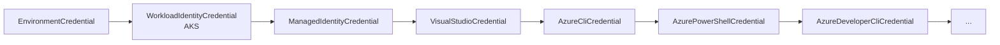

# 6.3 Managed Identities y Azure RBAC

[⬅ Anterior: App registrations](02-app-registrations-identity-web.md) · [Índice](../README.md) · [Siguiente: Seguridad avanzada ➡](04-seguridad-avanzada.md)

## 🎯 Objetivos
- Eliminar connection strings con contraseñas y API keys usando Managed Identities.
- Usar `Azure.Identity` (`DefaultAzureCredential` y credenciales específicas) correctamente en local y en Azure.
- Asignar roles Azure RBAC de **data plane** con mínimo privilegio.
- Conectar a Azure SQL, Key Vault, Service Bus, Storage y Redis sin secretos.

---

## 🧠 El problema de los secretos
Cada secreto (password de SQL, key de Storage, connection string de Service Bus) hay que: crearlo, guardarlo, distribuirlo, rotarlo, auditarlo... y tarde o temprano termina en un `appsettings.json` commiteado o en un log.

> **Managed Identity:** Azure le da a tu recurso (App Service, Container App, Function, VM, AKS pod) una identidad en Entra ID. El recurso obtiene tokens del endpoint local de metadatos; **no hay secreto que tú veas o gestiones**.

| Tipo | Ciclo de vida | Cuándo |
|------|--------------|--------|
| **System-assigned** | Nace y muere con el recurso; 1:1 | Un recurso, permisos propios. Simple |
| **User-assigned** | Recurso independiente; se asigna a uno o varios recursos | Varios recursos comparten permisos; preasignar permisos antes de crear el recurso; slots; federación con app registrations |

---

## 1. Azure.Identity en .NET

```bash
dotnet add package Azure.Identity
```

### `DefaultAzureCredential`: una credencial para local y nube
Prueba, en orden, varias fuentes hasta que una funciona:


- **En tu PC:** usa tu sesión de Visual Studio o `az login`.
- **En Azure:** usa la Managed Identity.

```csharp
var credential = new DefaultAzureCredential();
var secrets = new SecretClient(new Uri("https://kv-orderflow-prod-eus.vault.azure.net/"), credential);
```

### ⚠️ Recomendación para producción
`DefaultAzureCredential` es ideal para desarrollo, pero en producción la cadena de intentos añade latencia y comportamiento poco determinista. Microsoft recomienda **ser explícito** en producción:

```csharp
TokenCredential credential = builder.Environment.IsDevelopment()
    ? new DefaultAzureCredential()   // o: new AzureCliCredential() / VisualStudioCredential
    : new ManagedIdentityCredential(
        ManagedIdentityId.FromUserAssignedClientId(builder.Configuration["AZURE_CLIENT_ID"]!));
        // o ManagedIdentityId.SystemAssigned para system-assigned

builder.Services.AddSingleton(credential);
```
> Alternativa: `new DefaultAzureCredential(DefaultAzureCredential.DefaultEnvironmentVariableName)` con la variable `AZURE_TOKEN_CREDENTIALS` para restringir la cadena según el entorno (disponible en versiones recientes de Azure.Identity).
> Registra la credencial y los clientes como **singletons**: cachean tokens y conexiones.

### Registrar clientes de Azure con DI
```csharp
builder.Services.AddAzureClients(clients =>
{
    clients.UseCredential(credential);
    clients.AddSecretClient(new Uri(builder.Configuration["KeyVault:Uri"]!));
    clients.AddBlobServiceClient(new Uri(builder.Configuration["Storage:BlobUri"]!));
    clients.AddServiceBusClientWithNamespace(builder.Configuration["ServiceBus:Namespace"]!);
});
```

---

## 2. Azure RBAC: control plane vs data plane ⭐

| Plano | Qué controla | Ejemplos de roles |
|-------|-------------|-------------------|
| **Control plane** (gestión) | Crear/configurar/borrar el recurso | Owner, Contributor, Reader, Website Contributor |
| **Data plane** (datos) | Leer/escribir **el contenido** | Key Vault Secrets User, Storage Blob Data Contributor, Azure Service Bus Data Sender/Receiver, App Configuration Data Reader |

> ⚠️ **Contributor NO da acceso a los datos.** Un Contributor puede crear un Key Vault pero no leer sus secretos (con el modelo RBAC). Y al revés: tu app necesita roles de **data plane**, nunca Contributor.

### Roles de data plane más usados por una app .NET
| Recurso | Rol para la app |
|---------|-----------------|
| Key Vault (modelo RBAC) | **Key Vault Secrets User** (leer secretos) |
| Storage Blob | **Storage Blob Data Reader** / **Contributor** |
| Storage Queue | **Storage Queue Data Message Sender / Processor** |
| Service Bus | **Azure Service Bus Data Sender** / **Receiver** |
| Event Hubs | **Azure Event Hubs Data Sender** / **Receiver** |
| App Configuration | **App Configuration Data Reader** |
| Cosmos DB | Roles SQL de data plane propios de Cosmos (`Cosmos DB Built-in Data Contributor`) |
| Azure SQL | Usuarios **dentro** de la BD (ver abajo) — no es Azure RBAC |
| Azure Cache for Redis / Azure Managed Redis | Access policies de Entra ID (data owner / contributor) |

### Scope: tan bajo como sea posible
`Management group > Subscription > Resource group > Resource > (sub-recurso, ej. un contenedor de blobs o una cola)`.
Asigna el rol a nivel del **recurso** (o sub-recurso), no de la suscripción.

### Bicep: asignar un rol a la Managed Identity de la app
```bicep
param webAppPrincipalId string
param keyVaultName string

resource kv 'Microsoft.KeyVault/vaults@2023-07-01' existing = { name: keyVaultName }

var keyVaultSecretsUser = '4633458b-17de-408a-b874-0445c86b69e6' // ID del rol integrado

resource kvSecretsUser 'Microsoft.Authorization/roleAssignments@2022-04-01' = {
  name: guid(kv.id, webAppPrincipalId, keyVaultSecretsUser)   // nombre determinista → idempotente
  scope: kv
  properties: {
    principalId: webAppPrincipalId
    principalType: 'ServicePrincipal'
    roleDefinitionId: subscriptionResourceId('Microsoft.Authorization/roleDefinitions', keyVaultSecretsUser)
  }
}
```
> Los IDs de roles integrados son estables y públicos (documentación *Azure built-in roles*); verifica el ID antes de usarlo.

### Azure CLI (para pruebas)
```bash
az role assignment create \
  --assignee-object-id <principalId> --assignee-principal-type ServicePrincipal \
  --role "Azure Service Bus Data Receiver" \
  --scope $(az servicebus namespace show -n sb-orderflow-prod -g rg-orderflow-prod --query id -o tsv)
```

---

## 3. Recetas sin secretos

### Azure SQL / EF Core
1. En el servidor SQL: configura un **administrador de Entra** (un grupo) y, idealmente, **"Microsoft Entra-only authentication"** (deshabilita usuarios SQL con password).
2. Conectado como admin de Entra, crea el usuario de la Managed Identity:
```sql
CREATE USER [app-orderflow-prod-eastus] FROM EXTERNAL PROVIDER;   -- nombre de la MI (o del recurso con system-assigned)
ALTER ROLE db_datareader ADD MEMBER [app-orderflow-prod-eastus];
ALTER ROLE db_datawriter ADD MEMBER [app-orderflow-prod-eastus];
-- La identidad del pipeline de migraciones (no la app) recibe db_ddladmin
```
3. Connection string sin password:
```json
{
  "ConnectionStrings": {
    "OrderFlow": "Server=tcp:sql-orderflow-prod-eastus.database.windows.net,1433;Database=orderflow;Authentication=Active Directory Default;Encrypt=True;"
  }
}
```
Con user-assigned MI: `Authentication=Active Directory Managed Identity;User Id=<client-id>`. En local, `Active Directory Default` usa tu `az login` / Visual Studio.

### Key Vault como fuente de configuración
```csharp
builder.Configuration.AddAzureKeyVault(
    new Uri(builder.Configuration["KeyVault:Uri"]!), credential);
// El secreto "Payments--ApiKey" se lee como configuración "Payments:ApiKey"
```
O en App Service: *Key Vault references* en app settings: `@Microsoft.KeyVault(SecretUri=https://kv.../secrets/Payments-ApiKey)`.

### Service Bus
```csharp
var client = new ServiceBusClient("sb-orderflow-prod.servicebus.windows.net", credential);
```

### Blob Storage
```csharp
var blobs = new BlobServiceClient(new Uri("https://storderflowprodeus.blob.core.windows.net"), credential);
```
Deshabilita *shared key access* en la cuenta (`allowSharedKeyAccess: false`) cuando todo use Entra ID.

### Redis (StackExchange.Redis + Entra ID)
```csharp
var options = await ConfigurationOptions.Parse($"{host}:6380").ConfigureForAzureWithTokenCredentialAsync(credential);
// Paquete Microsoft.Azure.StackExchangeRedis
```

### Application Insights
Ingesta autenticada con Entra ID (`DisableLocalAuth: true` en el recurso + rol **Monitoring Metrics Publisher** para la identidad).

---

## 4. Desarrollo local sin secretos
1. `az login` (o inicia sesión en Visual Studio con tu cuenta corporativa).
2. Asígnate (o mejor, a un **grupo de desarrolladores**) los mismos roles de data plane en los recursos de **dev**.
3. `DefaultAzureCredential` hace el resto. Nada de connection strings con keys en `user-secrets`.
4. Para recursos locales (emuladores/contenedores de Aspire) no hace falta identidad.

---

## 5. Federación: identidades sin secretos fuera de Azure
**Workload Identity Federation** permite que un sistema externo que emite tokens OIDC obtenga tokens de Entra sin secretos:
- **Azure DevOps** service connections ([5.3](../modulo-05-cicd-azure-devops/03-seguridad-environments.md)).
- **GitHub Actions** (`azure/login` con OIDC).
- **AKS Workload Identity** (pods con service accounts de Kubernetes).
- **Otra nube** (AWS, GCP) u otro proveedor OIDC.
- **App registration ← Managed Identity** (credencial de la API en [6.2](02-app-registrations-identity-web.md#on-behalf-of-en-nombre-del-usuario)).

---

## ⚠️ Errores comunes
| Síntoma | Causa |
|---------|-------|
| `403 Forbidden` desde Key Vault/Storage | Tiene rol de control plane (Contributor) pero no de data plane |
| Funciona en local, `403` en Azure | Asignaste el rol a tu usuario, no a la Managed Identity |
| `403` justo después de asignar el rol | Propagación de RBAC (hasta varios minutos); los tokens cacheados no tienen el cambio |
| `ManagedIdentityCredential authentication unavailable` | La identidad no está habilitada en el recurso, o tienes varias user-assigned y no especificaste el client ID |
| Slot de staging falla tras el swap | La system-assigned del slot es otra identidad y no tiene roles |
| Login failed for user `<token-identified principal>` en SQL | Falta `CREATE USER ... FROM EXTERNAL PROVIDER` |

## ✅ Checklist
- [ ] Mi app no tiene ni un secreto para recursos de Azure.
- [ ] Diferencio roles de control plane y data plane.
- [ ] Asigno roles al menor scope posible, en Bicep.
- [ ] Uso credenciales explícitas en producción y `DefaultAzureCredential` en local.
- [ ] Azure SQL usa Entra-only authentication.

## 🏋️ Ejercicio (OrderFlow)
1. Crea una user-assigned managed identity para la API y asígnala al App Service (y al slot).
2. En Bicep: roles Key Vault Secrets User, Service Bus Data Sender/Receiver, Storage Blob Data Contributor.
3. Conecta EF Core a Azure SQL con `Active Directory Default`; habilita Entra-only auth.
4. Elimina **todas** las keys/connection strings con secretos de la configuración. Verifica con una búsqueda en el repo (`AccountKey=`, `Password=`, `SharedAccessKey=`).

## 📚 Profundiza
- [Managed identities for Azure resources](https://learn.microsoft.com/entra/identity/managed-identities-azure-resources/overview).
- [Authentication best practices with the Azure Identity library for .NET](https://learn.microsoft.com/dotnet/azure/sdk/authentication/best-practices).
- [Azure built-in roles](https://learn.microsoft.com/azure/role-based-access-control/built-in-roles).
- [Passwordless connections for Azure services](https://learn.microsoft.com/azure/developer/intro/passwordless-overview).
