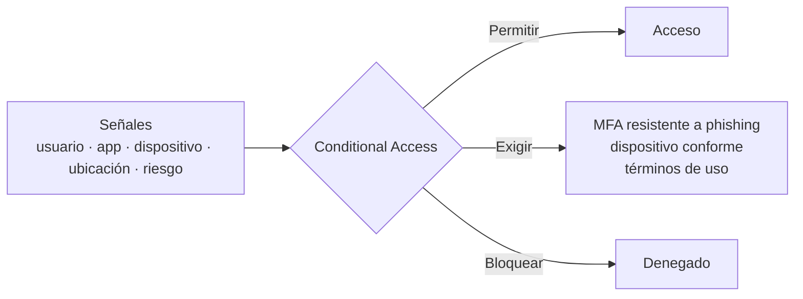

# 6.4 Seguridad avanzada: Conditional Access, PIM, External ID y Workload ID

[⬅ Anterior: Managed Identities](03-managed-identities-rbac.md) · [Índice](../README.md) · [Proyecto integrador ➡](../proyecto-integrador/README.md)

## 🎯 Objetivos
- Entender Zero Trust aplicado a identidad.
- Conocer Conditional Access y su impacto en tus aplicaciones.
- Usar PIM para acceso privilegiado *just-in-time*.
- Elegir entre Entra ID (workforce) y Entra External ID (clientes).
- Gobernar workload identities (service principals, apps, managed identities).

> 📝 Muchas de estas capacidades requieren licencias **Entra ID P1/P2** o **Entra ID Governance** y las administra el equipo de identidad. Como desarrollador, necesitas **entenderlas** para diseñar apps compatibles y pedir lo correcto.

---

## 1. Zero Trust en identidad

**Principios:**
1. **Verificar explícitamente:** autenticar y autorizar con todas las señales disponibles (identidad, dispositivo, ubicación, riesgo).
2. **Mínimo privilegio:** acceso *just-in-time* y *just-enough*.
3. **Asumir brecha:** segmentar, cifrar, monitorear, limitar el radio de impacto.



---

## 2. Conditional Access (CA)

Políticas "**si** (asignaciones + condiciones) **entonces** (controles)".

| Política típica | Si… | Entonces… |
|-----------------|-----|-----------|
| MFA para todos | Cualquier usuario, cualquier app | Exigir MFA |
| Admins con MFA resistente a phishing | Roles administrativos | Exigir *authentication strength* (FIDO2/passkeys, Windows Hello) |
| Bloquear autenticación heredada | Clientes con protocolos legacy | Bloquear |
| Apps sensibles solo desde dispositivos administrados | App OrderFlow Admin | Dispositivo conforme (Intune) o híbrido unido |
| Riesgo de inicio de sesión alto | Sign-in risk = alto (P2) | MFA o bloquear |
| Workload identities fuera de IPs conocidas | Service principals (Workload ID Premium) | Bloquear |

### Impacto en tus aplicaciones ⚠️
- **No uses ROPC** (usuario/contraseña directos): no puede satisfacer MFA ni CA.
- Tu app debe manejar **claims challenges**: cuando CA exige un factor adicional a mitad de sesión (ej. al llamar a una API sensible), Entra devuelve un error con un *claims challenge* que el cliente debe re-enviar en una nueva solicitud interactiva. MSAL y Microsoft.Identity.Web tienen soporte (`MsalUiRequiredException`, `[AuthorizeForScopes]`, `ConsentHandler`).
- **Continuous Access Evaluation (CAE):** los tokens pueden revocarse casi en tiempo real ante eventos críticos (usuario deshabilitado, cambio de contraseña, cambio de ubicación). Las apps "CAE-capable" reciben tokens de vida más larga pero deben manejar el challenge.
- **Authentication context:** permite que tu app pida "step-up" (ej. MFA reciente) solo para acciones sensibles (aprobar un reembolso grande), etiquetando la acción con un contexto (`acrs` claim).

```csharp
// Verificar que el token incluye el authentication context "c1" (ej. MFA reciente) para acciones sensibles
app.MapPost("/orders/{id:guid}/refund", (ClaimsPrincipal user) =>
{
    var acrs = user.FindAll("acrs").Select(c => c.Value);
    if (!acrs.Contains("c1"))
        return Results.Challenge(); // + header WWW-Authenticate con claims challenge (ver docs de CA auth context)
    // ...
}).RequireAuthorization("Orders.Admin");
```

---

## 3. Privileged Identity Management (PIM)

Elimina el acceso privilegiado **permanente**:
- **Elegible vs activo:** eres *elegible* para "Owner de rg-orderflow-prod", pero solo lo **activas** cuando lo necesitas, por X horas, con justificación, MFA y (opcionalmente) aprobación.
- Aplica a **Entra roles**, **Azure RBAC** y **grupos** (PIM for Groups).
- Genera auditoría y alertas.

**Modelo recomendado para un equipo de desarrollo:**
| Entorno | Acceso permanente | Acceso vía PIM |
|---------|-------------------|----------------|
| Dev | Contributor (grupo de devs) | — |
| QA | Reader | Contributor (2 h) |
| Prod | Reader (o nada) | Contributor / acceso a datos (1–4 h, aprobación) |

> Producción la cambia **el pipeline**, no las personas. PIM es para emergencias y diagnóstico.

### Otros controles de gobernanza de identidad
- **Access reviews:** revisiones periódicas ("¿estas 12 personas siguen necesitando acceso a prod?").
- **Entitlement management / access packages:** paquetes de acceso solicitables con aprobación y expiración.
- **Lifecycle workflows:** altas/bajas automáticas (joiner-mover-leaver).

---

## 4. Entra External ID (clientes de tus aplicaciones)

| | **Entra ID (workforce)** | **Entra External ID** |
|--|-------------------------|-----------------------|
| Usuarios | Empleados, socios B2B invitados | **Clientes / consumidores** y usuarios de negocio externos |
| Registro | Lo administra TI | Autoregistro (*sign-up*) |
| Proveedores | Cuenta corporativa | Email + contraseña/OTP, Google, Facebook, Apple, OIDC/SAML personalizados |
| Branding | Limitado | Personalización completa |
| Configuración | Tenant de la organización | **External tenant** dedicado |
| Antecesor | — | **Azure AD B2C** (ya no disponible para clientes nuevos desde mayo de 2025; los existentes siguen soportados) |

Desde el punto de vista del código, una app .NET con External ID usa **los mismos** Microsoft.Identity.Web / MSAL, cambiando la *authority* al dominio del tenant externo (`https://<tenant>.ciamlogin.com/`). Los *user flows* definen qué atributos se piden en el registro; los **custom authentication extensions** permiten llamar a tu API durante el flujo (ej. enriquecer claims, validar datos).

### B2B collaboration
Para **socios** que usan su propia cuenta corporativa: se invitan como *guests* al tenant workforce (o se configura *cross-tenant access*). No confundir con CIAM.

---

## 5. Gobernanza de workload identities

Las identidades de software suelen superar en número a las humanas y se gobiernan peor.

| Buena práctica | Cómo |
|----------------|------|
| Preferir Managed Identities y federación | Cero secretos ([6.3](03-managed-identities-rbac.md)) |
| Si hay secretos, que expiren pronto | Política de app management: máx. 90–180 días; preferir certificados |
| **Restringir credenciales por política** | *App management policies*: prohibir client secrets en nuevas apps del tenant |
| Dueños definidos | Cada app registration con ≥ 2 owners |
| Inventario y limpieza | Revisa apps sin uso, permisos excesivos (`Directory.ReadWrite.All` en una app de reportes…) |
| Permisos de Graph mínimos | `User.Read.All` solo si de verdad lo necesitas; considera **RBAC para aplicaciones** en Exchange/SharePoint (*Sites.Selected*) |
| Monitoreo | Sign-in logs de service principals; **Workload ID Premium**: Conditional Access y detección de riesgo para workloads |
| Cuidado con *consent phishing* | Restringir el consentimiento de usuarios a apps verificadas / permisos de bajo riesgo |

---

## 6. Monitoreo y auditoría de identidad
- **Sign-in logs** (usuarios y service principals) y **Audit logs** → *Diagnostic settings* hacia Log Analytics.
- Consultas útiles:
```kusto
// Fallos de inicio de sesión de tus apps (service principals)
AADServicePrincipalSignInLogs
| where TimeGenerated > ago(1d) and ResultType != "0"
| summarize failures = count() by ServicePrincipalName, ResultType, ResultDescription
| order by failures desc
```
```kusto
// Cambios en credenciales de aplicaciones (posible persistencia de un atacante)
AuditLogs
| where OperationName has_any ("Add service principal credentials", "Update application – Certificates and secrets management")
| project TimeGenerated, OperationName, InitiatedBy, TargetResources
```
- **Microsoft Entra ID Protection** (P2): riesgo de usuario y de inicio de sesión.
- **Microsoft Sentinel**: SIEM que correlaciona identidad con el resto de señales.

## ✅ Checklist
- [ ] Explico los 3 principios de Zero Trust aplicados a identidad.
- [ ] Sé qué es un claims challenge y por qué ROPC rompe Conditional Access.
- [ ] Propongo un modelo de acceso con PIM para dev/qa/prod.
- [ ] Sé cuándo usar Entra External ID vs B2B vs Entra ID workforce.
- [ ] Conozco las buenas prácticas para gobernar workload identities.

## 🏋️ Ejercicio (OrderFlow)
1. Diseña (documento) las políticas de Conditional Access que pedirías para OrderFlow Admin.
2. Propón el modelo PIM del equipo (tabla de arriba adaptada) en un ADR.
3. (Opcional, con tenant de pruebas) Crea un external tenant de Entra External ID y conecta una página de registro de clientes a OrderFlow.
4. Revisa las app registrations de tu tenant de pruebas: owners, expiración de secretos, permisos de Graph.

## 📚 Profundiza
- [Zero Trust guidance center](https://learn.microsoft.com/security/zero-trust/).
- [Conditional Access: developer guidance](https://learn.microsoft.com/entra/identity-platform/v2-conditional-access-dev-guide).
- [Microsoft Entra External ID](https://learn.microsoft.com/entra/external-id/).
- [Privileged Identity Management](https://learn.microsoft.com/entra/id-governance/privileged-identity-management/).
- [Securing workload identities](https://learn.microsoft.com/entra/workload-id/).
