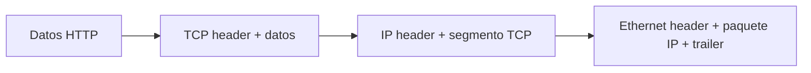
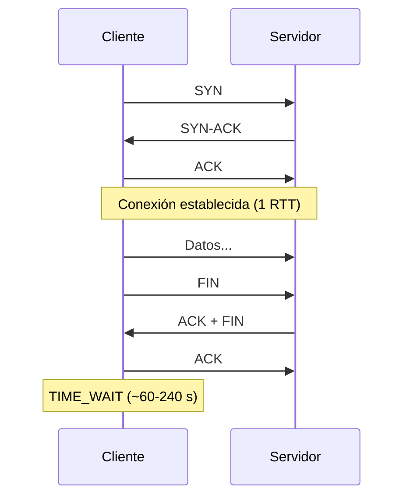

# 7.1 Fundamentos de redes para ingenieros de software

[⬅ Anterior: Cloud-native](../modulo-02-arquitectura/05-cloud-native-aspire.md) · [Índice](../README.md) · [Siguiente: HTTP y TLS ➡](02-http-tls-dns.md)

## 🎯 Objetivos
- Entender qué pasa realmente desde que haces `HttpClient.GetAsync()` hasta que llega la respuesta.
- Dominar los modelos OSI y TCP/IP, direccionamiento IP, subnetting (CIDR), TCP vs UDP, puertos y NAT.
- Tener vocabulario suficiente para hablar con equipos de infraestructura y diagnosticar problemas.

> 💡 **¿Por qué un dev necesita redes?** Porque la mitad de los incidentes "raros" en producción son de red: timeouts, DNS, certificados, puertos agotados, firewalls, latencia entre regiones. El ingeniero que entiende la red los resuelve en minutos; el que no, en días.

---

## 1. Modelos de capas

### OSI (7 capas) vs TCP/IP (4 capas)

| OSI | TCP/IP | Qué hace | Ejemplos | Unidad |
|-----|--------|----------|----------|--------|
| 7 Aplicación | Aplicación | Protocolo de la app | HTTP, gRPC, DNS, SMTP, AMQP | Mensaje |
| 6 Presentación | Aplicación | Formato, cifrado | TLS*, JSON, Protobuf | |
| 5 Sesión | Aplicación | Sesiones | (TLS sessions, WebSockets) | |
| 4 Transporte | Transporte | Comunicación extremo a extremo, puertos | **TCP, UDP**, QUIC | Segmento / datagrama |
| 3 Red | Internet | Direccionamiento y enrutamiento entre redes | **IP**, ICMP | Paquete |
| 2 Enlace | Acceso a red | Comunicación en la red local | Ethernet, Wi-Fi, ARP, VLAN | Trama (frame) |
| 1 Física | Acceso a red | Bits en el medio | Cable, fibra, radio | Bit |

\* TLS no encaja perfectamente en ninguna capa; se suele ubicar entre la 4 y la 7.

> 🧠 **Por qué importa:** cuando alguien dice "es un balanceador de **capa 4**" significa que enruta por IP/puerto (no ve HTTP). "Capa 7" significa que entiende HTTP: puede enrutar por URL, headers, terminar TLS, aplicar WAF.

### Encapsulamiento

Cada capa agrega su propio encabezado. El receptor los quita en orden inverso.

---

## 2. Direccionamiento IP

### IPv4
- 32 bits, notación decimal: `10.0.1.25`.
- **Rangos privados (RFC 1918)** — no enrutables en internet, los usarás en VNets:
  - `10.0.0.0/8`
  - `172.16.0.0/12`
  - `192.168.0.0/16`
- `127.0.0.1` = localhost (loopback). `0.0.0.0` = "todas las interfaces" (cuando un servidor escucha).
- `169.254.169.254` = endpoint de metadatos en Azure (de ahí sale el token de Managed Identity).

### CIDR y subnetting ⭐
`10.0.1.0/24` → los primeros **24 bits** son la red; los 8 restantes, los hosts.

| CIDR | Máscara | Direcciones | Uso típico en Azure |
|------|---------|-------------|---------------------|
| /16 | 255.255.0.0 | 65.536 | VNet completa |
| /20 | 255.255.240.0 | 4.096 | Subnet grande (AKS) |
| /24 | 255.255.255.0 | 256 | Subnet de aplicación |
| /27 | 255.255.255.224 | 32 | Subnet pequeña (Bastion necesita /26) |
| /28 | 255.255.255.240 | 16 | Subnet mínima para algunos servicios |
| /32 | 255.255.255.255 | 1 | Una IP específica (reglas de firewall) |

**Fórmula:** direcciones = 2^(32 − prefijo). En Azure, **cada subnet reserva 5 IPs** (la primera, las tres siguientes y la última), así que un /24 da 251 utilizables.

### Ejemplo: planear la VNet de OrderFlow
```text
VNet: 10.20.0.0/16
├── snet-appservice-integration  10.20.1.0/24   (VNet integration de App Service)
├── snet-private-endpoints       10.20.2.0/24   (SQL, Key Vault, Service Bus, Redis)
├── snet-container-apps          10.20.8.0/21   (Container Apps environment)
└── snet-appgw                   10.20.20.0/24  (Application Gateway)
```
> ⚠️ **Planifica sin solapamientos.** Si tu VNet usa `10.0.0.0/16` y la red de la oficina también, nunca podrás conectarlas por VPN/peering sin dolor. Coordina con infraestructura un plan de direccionamiento (IPAM).

### IPv6
128 bits (`2001:db8::1`). Elimina la escasez y en gran parte la necesidad de NAT. Azure lo soporta en *dual stack*; conviene saber leerlo.

---

## 3. TCP vs UDP

| | **TCP** | **UDP** |
|--|---------|---------|
| Conexión | Orientado a conexión (handshake) | Sin conexión |
| Fiabilidad | Entrega garantizada, en orden, retransmisión | *Best effort*: puede perder o desordenar |
| Control de flujo/congestión | Sí | No |
| Overhead | Mayor | Mínimo |
| Usos | HTTP/1.1, HTTP/2, SQL, AMQP, SSH | DNS, streaming, VoIP, juegos, **QUIC (HTTP/3)** |

### TCP three-way handshake


**Consecuencias prácticas para un dev .NET:**
- Abrir una conexión cuesta **1 RTT** (más 1–2 RTT de TLS). Entre Bogotá y East US (~60–80 ms RTT), eso son ~200 ms antes de enviar un byte → **reutiliza conexiones** (connection pooling).
- Cada conexión cerrada queda en `TIME_WAIT` ocupando un puerto local. Crear un `new HttpClient()` por petición agota los puertos efímeros → **socket exhaustion** (ver [7.3](03-redes-en-dotnet.md)).

### Puertos
- 0–1023: *well-known* (80 HTTP, 443 HTTPS, 22 SSH, 53 DNS, 1433 SQL Server, 5432 PostgreSQL, 5671/5672 AMQP, 6379/6380 Redis).
- 49152–65535: **efímeros** (los usa el cliente para conexiones salientes).
- Una conexión se identifica por la tupla **(IP origen, puerto origen, IP destino, puerto destino, protocolo)**.

---

## 4. NAT, SNAT y por qué te debería importar

**NAT (Network Address Translation):** traduce IPs privadas a públicas. Toda tu VNet sale a internet a través de unas pocas IPs públicas.

**SNAT port exhaustion (Azure):** App Service y otros servicios tienen un número **limitado** de puertos SNAT para conexiones salientes hacia un mismo destino. Si abres conexiones sin reutilizarlas, se agotan → timeouts intermitentes que parecen "aleatorios".

Soluciones:
1. Reutiliza conexiones (`IHttpClientFactory`, singletons de clientes de Azure SDK, pooling de BD).
2. Usa **Private Endpoints** / Service Endpoints para servicios Azure (no consumen SNAT público).
3. **NAT Gateway** asociado a la subnet para muchas más IPs/puertos de salida y una IP de salida estable (útil cuando un tercero te pide "IP fija para whitelist").

---

## 5. Enrutamiento, ARP y otros básicos
- **Default gateway:** a dónde se envía el tráfico cuyo destino no está en la red local.
- **Tabla de rutas:** decide el siguiente salto. En Azure: *system routes* + **UDR** (User Defined Routes) para forzar tráfico por un firewall.
- **ARP:** traduce IP → MAC en la red local.
- **ICMP:** mensajes de control (`ping`, `traceroute`). Muchas redes en la nube lo bloquean → que `ping` falle no significa que el servicio esté caído; prueba con TCP (`Test-NetConnection`, `nc`).
- **MTU:** tamaño máximo de paquete (~1500 bytes en Ethernet; VPNs lo reducen). Problemas de MTU causan conexiones que "se cuelgan" con payloads grandes.

---

## 6. Latencia: números que todo ingeniero debería conocer (aprox.)

| Operación | Tiempo |
|-----------|--------|
| Referencia a memoria L1 | ~1 ns |
| Leer 1 MB secuencial de memoria | ~10 µs |
| Ida y vuelta dentro de una zona Azure | ~0,5–1 ms |
| Ida y vuelta entre zonas de disponibilidad | ~1–2 ms |
| Bogotá ↔ East US | ~60–80 ms |
| Bogotá ↔ West Europe | ~140–180 ms |
| Handshake TCP + TLS 1.3 (nueva conexión) | 2 RTT |

> **Consecuencia de diseño:** un endpoint que hace 20 llamadas secuenciales a una BD en otra región (80 ms c/u) tarda ≥ 1,6 s solo en red. **Coloca juntos** la app y sus datos (misma región, idealmente misma zona) y reduce viajes (*chattiness*).

---

## ✅ Checklist
- [ ] Explico la diferencia entre balanceo de capa 4 y capa 7.
- [ ] Calculo cuántas IPs tiene un /26 y cuántas son utilizables en Azure.
- [ ] Sé por qué crear conexiones nuevas es caro y qué es TIME_WAIT.
- [ ] Explico SNAT port exhaustion y tres formas de evitarlo.
- [ ] Conozco las latencias aproximadas entre regiones.

## 🏋️ Ejercicio
1. Diseña el plan de direccionamiento (VNet + subnets) para OrderFlow con espacio para crecer.
2. Ejecuta `tracert` (Windows) / `traceroute` hacia `learn.microsoft.com` e interpreta los saltos.
3. Con Wireshark, captura una petición HTTP a `http://example.com` e identifica el handshake TCP.

## 📚 Profundiza
- *Computer Networking: A Top-Down Approach* — Kurose & Ross (el libro de referencia).
- *High Performance Browser Networking* — Ilya Grigorik (gratis en hpbn.co; excelente para devs).
- Calculadora CIDR: `ipcalc` (Linux) o cualquier calculadora de subredes online.
