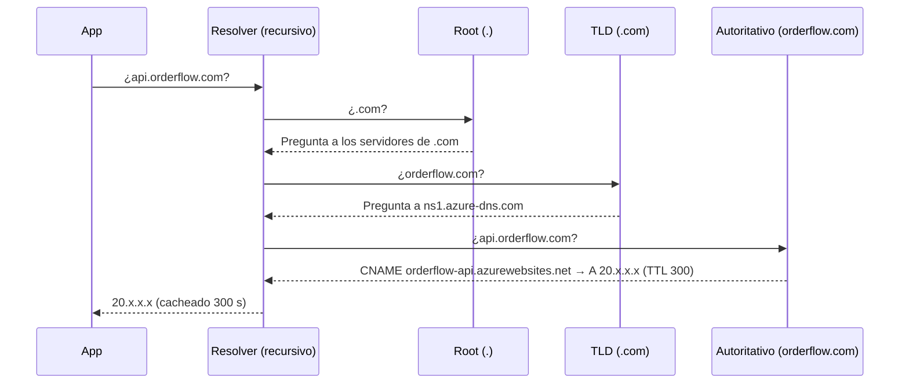
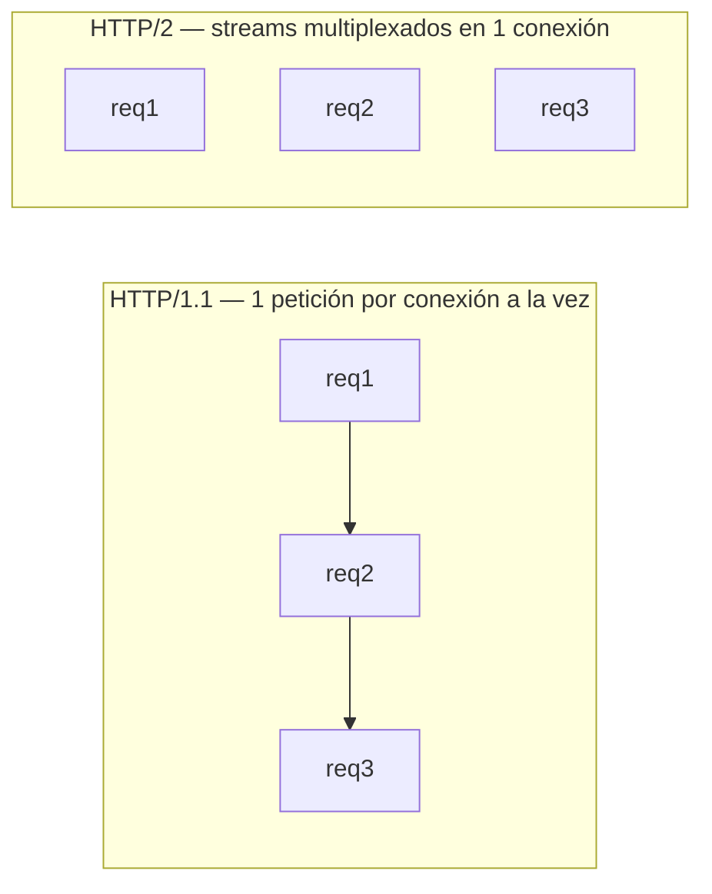

# 7.2 HTTP, TLS y DNS en profundidad

[⬅ Anterior: Fundamentos](01-fundamentos-redes.md) · [Índice](../README.md) · [Siguiente: Redes en .NET ➡](03-redes-en-dotnet.md)

## 🎯 Objetivos
- Entender la evolución HTTP/1.1 → HTTP/2 → HTTP/3 y su impacto en rendimiento.
- Entender TLS: certificados, cadena de confianza, handshake, mTLS.
- Entender DNS: resolución, registros, TTL, DNS privado y por qué "siempre es DNS".

---

## 1. DNS — "It's always DNS" 🔎

### ¿Qué pasa al resolver `api.orderflow.com`?


### Tipos de registro
| Registro | Para qué | Ejemplo |
|----------|----------|---------|
| **A** / **AAAA** | Nombre → IPv4 / IPv6 | `api → 20.50.1.10` |
| **CNAME** | Alias a otro nombre | `api → orderflow-api.azurewebsites.net` |
| **TXT** | Texto libre (verificación de dominio, SPF, DKIM) | `asuid.api → <id>` (App Service) |
| **MX** | Servidores de correo | |
| **NS** | Servidores autoritativos de la zona | |
| **SRV** | Servicio + puerto | Descubrimiento de servicios |
| **CAA** | Qué CAs pueden emitir certificados para tu dominio | |

### TTL
Tiempo que los resolvers cachean la respuesta. TTL alto = menos consultas pero cambios lentos. **Antes de una migración, baja el TTL** (ej. a 60 s) un día antes.

### DNS privado en Azure ⭐
Cuando usas **Private Endpoints**, `orderflow-sql.database.windows.net` debe resolver a una **IP privada** dentro de tu VNet, no a la pública. Eso se logra con **Azure Private DNS Zones** (`privatelink.database.windows.net`) vinculadas a la VNet.

> 🐛 **El bug más común con Private Endpoints:** la app resuelve la IP pública (porque la zona DNS privada no está vinculada a la VNet, o el DNS custom on-premise no reenvía) → la conexión es rechazada porque el acceso público está deshabilitado. **Siempre verifica primero qué IP resuelve el nombre** desde donde corre la app.

```bash
# Desde la consola Kudu/SSH del App Service o un contenedor en la VNet
nslookup orderflow-sql.database.windows.net
# Esperado: 10.20.2.x (privada). Si ves una IP pública → problema de DNS.
```

### DNS y .NET
- .NET cachea resoluciones según el SO; `SocketsHttpHandler.PooledConnectionLifetime` asegura que las conexiones se renueven y se re-resuelva DNS (clave en failovers). Ver [7.3](03-redes-en-dotnet.md).

---

## 2. HTTP: evolución y lo que cambia para ti

| Versión | Transporte | Característica clave | Problema que resuelve |
|---------|-----------|----------------------|----------------------|
| **HTTP/1.1** | TCP | Keep-alive, una petición a la vez por conexión | Abrir conexión por petición (1.0) |
| **HTTP/2** | TCP + TLS | **Multiplexación** de streams en una conexión, headers comprimidos (HPACK), binario | Head-of-line blocking a nivel HTTP; muchas conexiones |
| **HTTP/3** | **QUIC sobre UDP** | Handshake 0-1 RTT, sin HOL blocking de TCP, migración de conexión | Pérdida de paquetes bloquea todos los streams en TCP |



**Para un dev .NET:**
- **gRPC requiere HTTP/2** (o HTTP/3).
- Kestrel soporta HTTP/1.1, 2 y 3. Habilitar HTTP/3:
```csharp
builder.WebHost.ConfigureKestrel(k =>
    k.ListenAnyIP(5001, o => { o.Protocols = HttpProtocols.Http1AndHttp2AndHttp3; o.UseHttps(); }));
```
- En `HttpClient` puedes pedir una versión:
```csharp
var req = new HttpRequestMessage(HttpMethod.Get, url)
{
    Version = HttpVersion.Version20,
    VersionPolicy = HttpVersionPolicy.RequestVersionOrLower
};
```

### Semántica HTTP que los ingenieros deben dominar
| Método | Seguro | Idempotente | Uso |
|--------|--------|-------------|-----|
| GET | ✅ | ✅ | Leer |
| PUT | ❌ | ✅ | Reemplazar |
| DELETE | ❌ | ✅ | Borrar |
| POST | ❌ | ❌ | Crear / acciones |
| PATCH | ❌ | ❌* | Modificación parcial |

| Código | Significado | Reintentar? |
|--------|-------------|-------------|
| 400 / 422 | Error del cliente / validación | No |
| 401 | No autenticado | No (renueva token) |
| 403 | Sin permiso | No |
| 404 | No existe | No |
| 408 / 429 | Timeout / demasiadas peticiones | Sí, respetando `Retry-After` |
| 500 | Error del servidor | Con cuidado (solo idempotentes) |
| 502 / 503 / 504 | Gateway / no disponible / timeout de gateway | Sí (transitorio) |

### Headers importantes
- `Cache-Control`, `ETag`, `If-None-Match` → caching HTTP (304 Not Modified ahorra ancho de banda).
- `traceparent` → contexto de traza W3C (OpenTelemetry lo propaga solo; ver [3.3](../modulo-03-observabilidad/03-opentelemetry-dotnet.md)).
- `X-Forwarded-For`, `X-Forwarded-Proto` → IP/protocolo real del cliente detrás de un proxy/balanceador.

```csharp
// Detrás de App Gateway / Front Door: necesario para IP real del cliente, redirects HTTPS correctos y OAuth
builder.Services.Configure<ForwardedHeadersOptions>(o =>
{
    o.ForwardedHeaders = ForwardedHeaders.XForwardedFor | ForwardedHeaders.XForwardedProto;
    o.KnownIPNetworks.Clear(); o.KnownProxies.Clear(); // restringe a tus proxies en prod si puedes
});
app.UseForwardedHeaders();
```
> En .NET 10 la propiedad es `KnownIPNetworks` (antes `KnownNetworks`).

---

## 3. TLS 🔒

### ¿Qué garantiza?
1. **Confidencialidad** (cifrado), 2. **Integridad** (nadie modificó los datos), 3. **Autenticación** del servidor (y opcionalmente del cliente).

### Handshake TLS 1.3 (simplificado)
```mermaid
sequenceDiagram
    participant C as Cliente
    participant S as Servidor
    C->>S: ClientHello (versiones, cifrados, key share, SNI=api.orderflow.com)
    S->>C: ServerHello + certificado + Finished
    Note over C: Valida certificado: cadena, fecha, nombre (SAN), revocación
    C->>S: Finished
    Note over C,S: Datos cifrados (1 RTT; 0-RTT en reanudación)
```

### Certificados y cadena de confianza
```text
Root CA (preinstalada en el SO)  →  Intermediate CA  →  Certificado del servidor (CN/SAN = api.orderflow.com)
```
Errores típicos:
| Error | Causa |
|-------|-------|
| `RemoteCertificateNameMismatch` | El nombre que usas no está en el SAN del certificado |
| `RemoteCertificateChainErrors` | Falta el intermedio o la CA no es de confianza (certificados corporativos/internos) |
| Certificado expirado | Renovación manual olvidada → **automatiza** (App Service Managed Certificates, Key Vault + auto-renew) |

> ❌ **Nunca** hagas esto en producción:
> ```csharp
> handler.ServerCertificateCustomValidationCallback = (_, _, _, _) => true; // desactiva TLS de facto
> ```
> Si es una CA interna, instala la CA raíz en el contenedor/host o valida contra ella explícitamente.

### SNI
*Server Name Indication*: el cliente indica el hostname en el `ClientHello`, permitiendo muchos certificados en una misma IP (así funcionan App Service y Front Door).

### mTLS (mutual TLS)
El **cliente** también presenta un certificado. Se usa en integraciones B2B, bancos, service meshes.
```csharp
builder.Services.AddHttpClient("bank").ConfigurePrimaryHttpMessageHandler(() =>
{
    var handler = new SocketsHttpHandler();
    handler.SslOptions.ClientCertificates = [ LoadCertFromKeyVault() ];
    return handler;
});
```

### Terminación TLS
En arquitecturas cloud, el TLS suele terminarse en el borde (**Front Door / Application Gateway**) y re-cifrarse hacia el backend (*end-to-end TLS*). Decide conscientemente dónde termina y si el tramo interno va cifrado (en Zero Trust: sí).

### HSTS
`Strict-Transport-Security` obliga al navegador a usar siempre HTTPS. `app.UseHsts()` en producción.

---

## 4. WebSockets, SSE y gRPC (cuándo usar cada uno)

| Tecnología | Dirección | Transporte | Uso |
|------------|-----------|-----------|-----|
| REST/JSON | Petición-respuesta | HTTP/1.1-2-3 | APIs públicas, interoperabilidad |
| **gRPC** | Unario + streaming bidireccional | HTTP/2 | Servicio a servicio, alto rendimiento, contratos Protobuf |
| **WebSockets** (SignalR) | Bidireccional persistente | Upgrade sobre HTTP/1.1 | Tiempo real (chat, dashboards) |
| **SSE** (Server-Sent Events) | Servidor → cliente | HTTP | Notificaciones, streaming de respuestas de IA (`TypedResults.ServerSentEvents` desde .NET 10) |

> ⚠️ Conexiones de larga duración (WebSockets, streaming gRPC) y balanceadores: revisa *idle timeouts* (Azure Load Balancer ~4 min por defecto) y usa keep-alives/pings.

---

## ✅ Checklist
- [ ] Sé diagnosticar si un problema es de DNS (y qué IP resuelve desde la app).
- [ ] Explico por qué HTTP/2 mejora el rendimiento y por qué gRPC lo necesita.
- [ ] Sé qué códigos HTTP son reintentables.
- [ ] Entiendo la cadena de confianza de un certificado y los errores típicos.
- [ ] Configuro Forwarded Headers detrás de un proxy.

## 🏋️ Ejercicio
1. `nslookup` / `Resolve-DnsName` de tu App Service; sigue la cadena de CNAMEs.
2. `curl -v --http2 https://<tu-api>` e identifica: versión HTTP negociada, certificado, headers.
3. Inspecciona un certificado con `openssl s_client -connect <host>:443 -servername <host>`: ¿quién lo emitió? ¿cuándo expira? ¿qué SANs tiene?
4. Agrega Forwarded Headers a OrderFlow y verifica que `HttpContext.Connection.RemoteIpAddress` muestra la IP real.

## 📚 Profundiza
- *High Performance Browser Networking* — capítulos de TLS, HTTP/2.
- [MDN: HTTP](https://developer.mozilla.org/es/docs/Web/HTTP).
- [Cloudflare Learning Center](https://www.cloudflare.com/learning/) — DNS, TLS, DDoS explicados simple.
