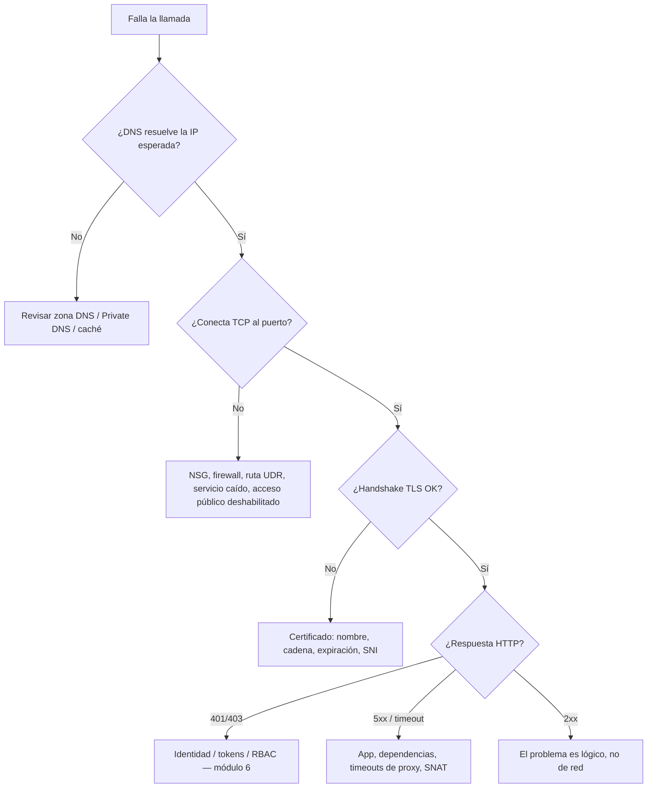

# 7.3 Redes desde .NET: HttpClient, conexiones, gRPC y troubleshooting

[⬅ Anterior: HTTP, TLS y DNS](02-http-tls-dns.md) · [Índice](../README.md) · [Siguiente: Redes en Azure ➡](04-redes-en-azure.md)

## 🎯 Objetivos
- Usar `HttpClient` correctamente (sin socket exhaustion ni DNS obsoleto).
- Configurar `SocketsHttpHandler`: pooling, timeouts, keep-alive, HTTP/2.
- Exponer y consumir gRPC.
- Diagnosticar problemas de red con herramientas y con la telemetría de .NET.

---

## 1. HttpClient: los dos errores clásicos

### ❌ Error 1: `new HttpClient()` por petición → socket exhaustion
```csharp
public async Task<string> GetAsync(string url)
{
    using var client = new HttpClient();   // cada Dispose deja el socket en TIME_WAIT
    return await client.GetStringAsync(url);
}
```
Bajo carga: miles de sockets en `TIME_WAIT` → `SocketException: Only one usage of each socket address...` o agotamiento SNAT en Azure.

### ❌ Error 2: un `HttpClient` estático para siempre → DNS obsoleto
```csharp
private static readonly HttpClient Client = new(); // nunca re-resuelve DNS
```
Si el destino hace failover y cambia de IP, sigues apuntando a la vieja.

### ✅ Solución A: `IHttpClientFactory` (recomendada en apps con DI)
```csharp
builder.Services.AddHttpClient<IPaymentsApi, PaymentsApi>(c =>
{
    c.BaseAddress = new Uri("https://payments.internal/");
    c.DefaultRequestHeaders.UserAgent.ParseAdd("OrderFlow/1.0");
})
.AddStandardResilienceHandler();   // ver módulo 2.4

public sealed class PaymentsApi(HttpClient http) : IPaymentsApi
{
    public async Task<PaymentDto?> GetAsync(Guid id, CancellationToken ct) =>
        await http.GetFromJsonAsync<PaymentDto>($"payments/{id}", ct);
}
```
La factory reutiliza los handlers (pool de conexiones) y los rota periódicamente (por defecto cada 2 min) para refrescar DNS.

> ⚠️ No inyectes un *typed client* en un Singleton: capturarías el `HttpClient` para siempre y perderías la rotación.

### ✅ Solución B: `HttpClient` de larga vida + `PooledConnectionLifetime` (sin DI, librerías, consolas)
```csharp
private static readonly HttpClient Client = new(new SocketsHttpHandler
{
    PooledConnectionLifetime = TimeSpan.FromMinutes(2)   // renueva conexiones → re-resuelve DNS
});
```

---

## 2. Afinando `SocketsHttpHandler`

```csharp
builder.Services.AddHttpClient<ICatalogApi, CatalogApi>()
    .ConfigurePrimaryHttpMessageHandler(() => new SocketsHttpHandler
    {
        PooledConnectionLifetime = TimeSpan.FromMinutes(5),
        PooledConnectionIdleTimeout = TimeSpan.FromMinutes(1),
        MaxConnectionsPerServer = 100,                        // límite de concurrencia hacia el host
        ConnectTimeout = TimeSpan.FromSeconds(5),             // solo la fase de conexión TCP/TLS
        EnableMultipleHttp2Connections = true,                // evita cuello de botella de streams HTTP/2
        KeepAlivePingDelay = TimeSpan.FromSeconds(60),        // HTTP/2 ping para conexiones largas (gRPC)
        KeepAlivePingTimeout = TimeSpan.FromSeconds(30),
        AutomaticDecompression = DecompressionMethods.All
    })
    .SetHandlerLifetime(Timeout.InfiniteTimeSpan); // el handler ya gestiona su propio lifetime
```

### Los distintos timeouts (confusión frecuente)
| Timeout | Dónde | Qué cubre |
|---------|-------|-----------|
| `ConnectTimeout` | `SocketsHttpHandler` | DNS + TCP + TLS |
| `HttpClient.Timeout` (100 s por defecto) | `HttpClient` | Toda la petición |
| `AttemptTimeout` / `TotalRequestTimeout` | Resilience handler | Por intento / total con retries |
| `CancellationToken` | Tu código | Lo que tú decidas (ej. el request entrante) |
| Timeouts del servidor/proxy | Kestrel, App Gateway (por defecto ~20–30 s en varios servicios), Front Door | Te cortan aunque tu cliente siga esperando |

> **Regla:** timeout del cliente < timeout del proxy < timeout del servidor... y todos documentados. Si App Service corta a los 230 s, una operación de 5 min debe ser asíncrona (202 + polling).

### Streaming de respuestas grandes
```csharp
using var response = await http.GetAsync(url, HttpCompletionOption.ResponseHeadersRead, ct);
response.EnsureSuccessStatusCode();
await using var stream = await response.Content.ReadAsStreamAsync(ct);
await foreach (var item in JsonSerializer.DeserializeAsyncEnumerable<OrderDto>(stream, cancellationToken: ct))
    Process(item!);
```
`ResponseHeadersRead` evita cargar todo el body en memoria.

---

## 3. Clientes de bases de datos y SDKs de Azure
- **ADO.NET/EF Core** ya hacen connection pooling por connection string. No abras conexiones fuera de `using`. Ajusta `Max Pool Size` solo con evidencia.
- **SDKs de Azure** (`BlobServiceClient`, `ServiceBusClient`, `SecretClient`, `CosmosClient`): son **thread-safe y deben ser singletons**. Crearlos por request repite handshakes y agota conexiones.
- **Redis** (`StackExchange.Redis`): un único `ConnectionMultiplexer` por app.

---

## 4. gRPC en .NET

### Contrato (`orders.proto`)
```protobuf
syntax = "proto3";
option csharp_namespace = "OrderFlow.Grpc";

service OrderService {
  rpc GetOrder (GetOrderRequest) returns (OrderReply);
  rpc StreamOrderUpdates (GetOrderRequest) returns (stream OrderStatusUpdate);
}

message GetOrderRequest { string order_id = 1; }
message OrderReply { string order_id = 1; string status = 2; double total = 3; }
message OrderStatusUpdate { string status = 1; int64 timestamp = 2; }
```

### Servidor
```csharp
builder.Services.AddGrpc();
app.MapGrpcService<OrderGrpcService>();

public sealed class OrderGrpcService(IOrderQueries queries) : OrderService.OrderServiceBase
{
    public override async Task<OrderReply> GetOrder(GetOrderRequest request, ServerCallContext context)
    {
        var dto = await queries.GetAsync(Guid.Parse(request.OrderId), context.CancellationToken)
                  ?? throw new RpcException(new Status(StatusCode.NotFound, "Pedido no existe"));
        return new OrderReply { OrderId = dto.Id.ToString(), Status = dto.Status, Total = (double)dto.Total };
    }
}
```

### Cliente
```csharp
builder.Services.AddGrpcClient<OrderService.OrderServiceClient>(o =>
        o.Address = new Uri("https://ordering.internal"))
    .AddStandardResilienceHandler();
```

| Aspecto | REST/JSON | gRPC |
|---------|-----------|------|
| Formato | Texto (JSON) | Binario (Protobuf) — más pequeño y rápido |
| Contrato | OpenAPI (opcional) | `.proto` obligatorio, codegen |
| Streaming | Limitado | Nativo (bidireccional) |
| Navegadores | ✅ | Requiere gRPC-Web |
| Ideal para | APIs públicas | Comunicación interna servicio-a-servicio |

> En Azure, gRPC funciona en App Service (Linux, con HTTP/2 habilitado), Container Apps y AKS. Revisa que tu balanceador soporte HTTP/2 hacia el backend.

---

## 5. Diagnóstico de red desde .NET

### Métricas integradas (sin código)
```bash
dotnet-counters monitor -n OrderFlow.Api --counters System.Net.Http,System.Net.Sockets,System.Net.NameResolution
```
Verás: requests activas, conexiones abiertas por versión HTTP, duración de resolución DNS, tiempo en cola esperando conexión (`http.client.request.time_in_queue`) — este último delata `MaxConnectionsPerServer` bajo o pool saturado.

### Con OpenTelemetry
`AddHttpClientInstrumentation()` + los meters `System.Net.Http` y `System.Net.NameResolution` te dan latencia de DNS, conexión y petición por destino en tus dashboards ([3.3](../modulo-03-observabilidad/03-opentelemetry-dotnet.md)).

### Herramientas de línea de comandos ⭐

| Pregunta | Windows (PowerShell) | Linux / contenedor |
|----------|---------------------|--------------------|
| ¿Qué IP resuelve? | `Resolve-DnsName host` | `nslookup host` / `dig host` |
| ¿Llego al puerto? | `Test-NetConnection host -Port 443` | `nc -zv host 443` / `curl -v telnet://host:443` |
| ¿Qué responde HTTP? | `curl.exe -v https://host/health` | `curl -v https://host/health` |
| ¿Cuánto tarda cada fase? | — | `curl -w "dns:%{time_namelookup} tcp:%{time_connect} tls:%{time_appconnect} ttfb:%{time_starttransfer} total:%{time_total}\n" -o /dev/null -s https://host` |
| ¿Certificado? | — | `openssl s_client -connect host:443 -servername host` |
| ¿Ruta? | `tracert host` | `traceroute host` / `mtr host` |
| ¿Conexiones abiertas? | `netstat -ano` / `Get-NetTCPConnection` | `ss -tanp` |
| Captura de paquetes | Wireshark | `tcpdump -i any port 443 -w cap.pcap` |
| Proxy HTTP para inspeccionar | Fiddler | mitmproxy |

### Metodología de troubleshooting (de abajo hacia arriba)


---

## ✅ Checklist
- [ ] Nunca creo `HttpClient` por petición; uso la factory o `PooledConnectionLifetime`.
- [ ] Conozco los distintos timeouts y cómo encadenarlos.
- [ ] Mis clientes de Azure SDK y Redis son singletons.
- [ ] Sé crear un servicio y un cliente gRPC.
- [ ] Sigo la metodología DNS → TCP → TLS → HTTP para diagnosticar.

## 🏋️ Ejercicio (OrderFlow)
1. Escribe una prueba de carga contra un endpoint que use `new HttpClient()` por petición; observa con `netstat`/`ss` los `TIME_WAIT`. Corrígelo con la factory y compara.
2. Expón `GetOrder` por gRPC además de REST; consúmelo desde el Worker.
3. Mide con `curl -w` las fases de una petición a tu API desplegada en Azure.
4. Configura `dotnet-counters` y observa el pool de conexiones durante la prueba de carga.

## 📚 Profundiza
- [Guidelines for using HttpClient](https://learn.microsoft.com/dotnet/fundamentals/networking/http/httpclient-guidelines).
- [Networking telemetry in .NET](https://learn.microsoft.com/dotnet/fundamentals/networking/telemetry/overview).
- [gRPC on .NET](https://learn.microsoft.com/aspnet/core/grpc/).
