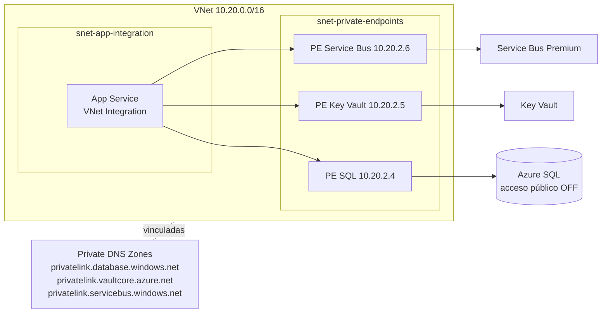
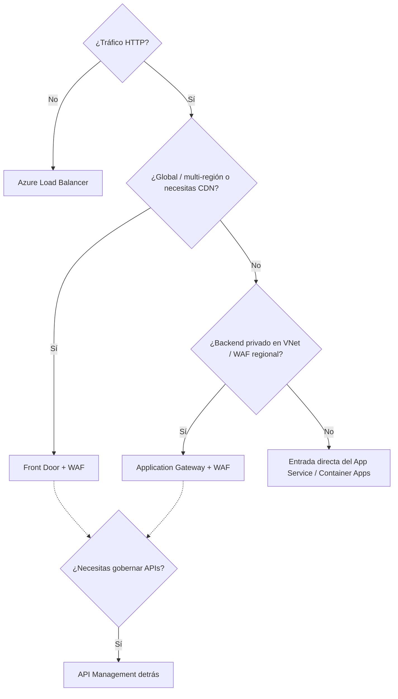
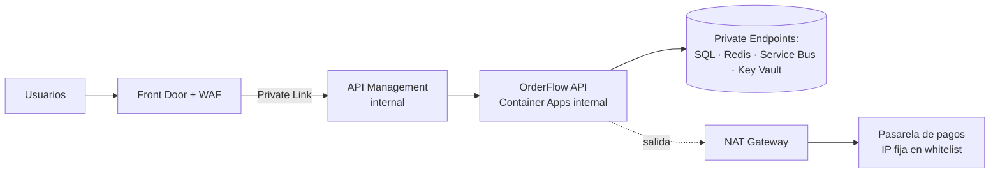
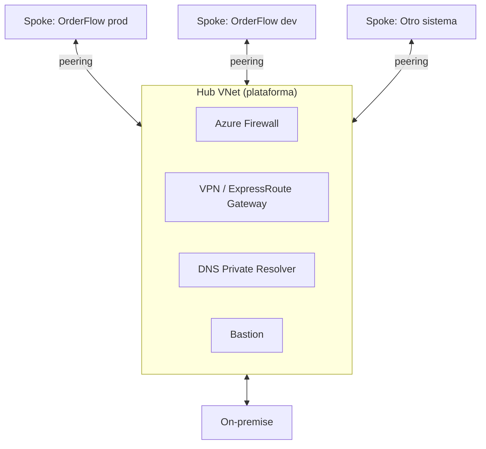

# 7.4 Redes en Azure

[⬅ Anterior: Redes en .NET](03-redes-en-dotnet.md) · [Índice](../README.md) · [Siguiente módulo: Observabilidad ➡](../modulo-03-observabilidad/01-fundamentos.md)

## 🎯 Objetivos
- Diseñar una red segura en Azure para una aplicación .NET (VNet, subnets, NSG, Private Endpoints).
- Elegir el balanceador / punto de entrada correcto (Front Door, Application Gateway, Load Balancer, APIM).
- Conectar App Service / Container Apps a recursos privados.
- Entender topologías hub-spoke y conectividad híbrida a nivel conceptual.

---

## 1. Bloques básicos

| Recurso | Qué es | Analogía |
|---------|--------|----------|
| **VNet** (Virtual Network) | Red privada aislada en una región | Tu red de oficina |
| **Subnet** | Segmento de la VNet | Un piso del edificio |
| **NSG** (Network Security Group) | Firewall de capa 4 (IP/puerto/protocolo) por subnet o NIC | Guardia con lista de permitidos |
| **ASG** (Application Security Group) | Agrupa NICs por rol para usar en reglas NSG | "Todos los servidores web" |
| **Route Table / UDR** | Rutas personalizadas | Señalización de desvíos |
| **VNet Peering** | Conecta dos VNets (misma o distinta región) con tráfico privado | Puente entre edificios |
| **NAT Gateway** | Salida a internet con IPs estables y muchos puertos SNAT | Recepción por donde sale todo |
| **Azure Firewall** | Firewall administrado de capa 3–7 (FQDN, TLS inspection en Premium) | Aduana central |
| **Azure Bastion** | Acceso RDP/SSH a VMs sin IP pública | Portería con escolta |

### Reglas NSG — ejemplo
| Prioridad | Nombre | Origen | Destino | Puerto | Acción |
|-----------|--------|--------|---------|--------|--------|
| 100 | Allow-AppGw-to-App | `snet-appgw` | `snet-app` | 443 | Allow |
| 110 | Allow-AzureLB | `AzureLoadBalancer` | Any | Any | Allow |
| 4096 | Deny-All-Inbound | Any | Any | Any | Deny |

> Usa **service tags** (`AzureLoadBalancer`, `Storage.EastUS`, `AzureMonitor`, `AzureDevOps`) en lugar de IPs: Microsoft las mantiene actualizadas.

---

## 2. Acceso privado a servicios PaaS ⭐

### Service Endpoints vs Private Endpoints

| | **Service Endpoint** | **Private Endpoint** (Private Link) |
|--|---------------------|-------------------------------------|
| ¿Qué hace? | El tráfico de la subnet al servicio va por el backbone de Azure; el servicio filtra por subnet | Crea una **IP privada** de tu VNet para el servicio |
| IP del servicio | Sigue siendo pública | Privada (10.x.x.x) |
| DNS | Sin cambios | Requiere **Private DNS Zone** |
| Acceso desde on-prem / otras VNets | No | Sí (vía peering/VPN) |
| Protección contra exfiltración | Limitada | Fuerte (apunta a **tu** instancia) |
| Recomendación | Escenarios simples / costo | **Estándar empresarial** |



### Entrada vs salida en App Service (confusión frecuente)
- **VNet Integration** = tráfico **saliente** de la app hacia la VNet (para llegar a Private Endpoints).
- **Private Endpoint en el App Service** = tráfico **entrante** privado hacia la app (la app deja de ser accesible públicamente).
- Container Apps: el *environment* se despliega **dentro** de una subnet (internal o external).

### Bicep — Private Endpoint para Azure SQL (extracto)
```bicep
resource sqlPe 'Microsoft.Network/privateEndpoints@2024-05-01' = {
  name: 'pe-sql-orderflow'
  location: location
  properties: {
    subnet: { id: peSubnetId }
    privateLinkServiceConnections: [
      {
        name: 'sql'
        properties: {
          privateLinkServiceId: sqlServer.id
          groupIds: [ 'sqlServer' ]
        }
      }
    ]
  }
}

resource sqlDnsZone 'Microsoft.Network/privateDnsZones@2020-06-01' = {
  name: 'privatelink${environment().suffixes.sqlServerHostname}'
  location: 'global'
}

resource dnsLink 'Microsoft.Network/privateDnsZones/virtualNetworkLinks@2020-06-01' = {
  parent: sqlDnsZone
  name: 'link-vnet-orderflow'
  location: 'global'
  properties: { virtualNetwork: { id: vnetId }, registrationEnabled: false }
}

resource peDnsGroup 'Microsoft.Network/privateEndpoints/privateDnsZoneGroups@2024-05-01' = {
  parent: sqlPe
  name: 'default'
  properties: {
    privateDnsZoneConfigs: [ { name: 'sql', properties: { privateDnsZoneId: sqlDnsZone.id } } ]
  }
}
```
> Las versiones de API cambian; usa las que sugiera la extensión de Bicep en VS Code. En empresas grandes, las Private DNS Zones suelen ser centrales (en el hub) y gestionadas por plataforma con Azure Policy.

---

## 3. Puntos de entrada y balanceo

| Servicio | Capa | Alcance | Características | Úsalo para |
|----------|------|---------|----------------|-----------|
| **Azure Front Door** | 7 | **Global** | CDN, WAF, enrutamiento por latencia, failover multi-región, TLS en el borde | Apps públicas globales, multi-región |
| **Application Gateway** | 7 | Regional | WAF, enrutamiento por path/host, TLS end-to-end, integración con VNet | Entrada regional a apps privadas |
| **Azure Load Balancer** | 4 | Regional | TCP/UDP, altísimo rendimiento, sin inspección HTTP | VMs, tráfico no HTTP, interno |
| **Traffic Manager** | DNS | Global | Balanceo por DNS (no proxy) | Failover simple entre regiones |
| **API Management** | 7 (API) | Regional/multi | Gateway de APIs: auth, rate limit, transformaciones, portal | Gobernar y exponer APIs ([4.2](../modulo-04-gobernabilidad/02-gobernanza-apis.md)) |



### Arquitectura de referencia para OrderFlow


---

## 4. Topologías empresariales

### Hub-and-spoke

- El **hub** centraliza servicios compartidos (firewall, conectividad híbrida, DNS).
- Cada **spoke** es una carga de trabajo; el tráfico entre spokes y hacia internet pasa por el firewall (vía UDR).
- **Azure Virtual WAN** es la versión administrada de este modelo para organizaciones grandes.
- Es parte de las **Azure Landing Zones** ([4.3](../modulo-04-gobernabilidad/03-gobernanza-azure.md)).

### Conectividad híbrida
| Opción | Características |
|--------|----------------|
| **Site-to-Site VPN** | Túnel IPsec sobre internet. Barato, rápido de montar, ancho de banda limitado. |
| **Point-to-Site VPN** | Desarrolladores individuales conectándose a la VNet. |
| **ExpressRoute** | Conexión privada dedicada vía proveedor. Latencia predecible, alto ancho de banda, más caro. |

### DNS híbrido
On-premise necesita resolver `privatelink.*` → usa **Azure DNS Private Resolver** (inbound endpoint) y reenviadores condicionales desde el DNS corporativo.

---

## 5. Seguridad de red (Zero Trust aplicado)
1. **Deshabilita el acceso público** en SQL, Storage, Key Vault, Service Bus cuando uses Private Endpoints (`publicNetworkAccess: 'Disabled'`).
2. **WAF** delante de todo lo público (OWASP rules, rate limiting, geo-filtering).
3. **DDoS Protection** (Network o IP Protection) en recursos críticos con IP pública.
4. **Segmenta** con subnets + NSG; deniega por defecto.
5. **Red no reemplaza identidad:** aun dentro de la VNet, cada servicio se autentica con Managed Identity ([6.3](../modulo-06-microsoft-entra/03-managed-identities-rbac.md)).
6. **Agentes de CI/CD:** si los recursos son privados, los agentes Microsoft-hosted no llegan → usa **Managed DevOps Pools** o agentes self-hosted dentro de la VNet ([5.3](../modulo-05-cicd-azure-devops/03-seguridad-environments.md)).

---

## 6. Diagnóstico en Azure
| Herramienta | Para qué |
|-------------|----------|
| **Network Watcher → Connection troubleshoot** | ¿Hay conectividad de A a B? ¿Qué regla la bloquea? |
| **IP flow verify** | ¿Esta NSG permite este paquete? |
| **Effective security rules / Effective routes** | Reglas y rutas **reales** aplicadas a una NIC |
| **VNet flow logs** + Traffic Analytics | Quién habla con quién (sucesor de NSG flow logs) |
| **App Service → Diagnose and solve problems** | SNAT, conectividad, DNS desde la app |
| Consola Kudu / SSH en contenedor | `nslookup`, `curl`, `tcpping` desde dentro |

## ⚠️ Errores comunes
- Private Endpoint creado pero la zona DNS privada no vinculada a la VNet.
- Rangos IP solapados con on-premise u otras VNets.
- Subnets demasiado pequeñas para escalar (Container Apps, AKS consumen muchas IPs).
- NSG bloqueando el health probe del balanceador.
- Asumir que "está en la VNet" = "es seguro" (sin autenticación entre servicios).
- Pipelines que fallan al desplegar porque el agente no tiene línea de vista a recursos privados.

## ✅ Checklist
- [ ] Explico la diferencia entre Service Endpoint y Private Endpoint.
- [ ] Sé por qué un Private Endpoint necesita una Private DNS Zone.
- [ ] Diferencio VNet Integration (salida) de Private Endpoint en App Service (entrada).
- [ ] Elijo entre Front Door, Application Gateway, Load Balancer y APIM con criterio.
- [ ] Dibujo una topología hub-spoke y explico el rol del hub.

## 🏋️ Ejercicio (OrderFlow)
1. En Bicep: VNet con subnets, NSG, Private Endpoints para SQL y Key Vault con sus zonas DNS.
2. App Service (o Container Apps) con VNet Integration; deshabilita el acceso público de SQL.
3. Desde la consola de la app, verifica con `nslookup` que SQL resuelve a IP privada.
4. Usa Network Watcher *Connection troubleshoot* para comprobar conectividad app → SQL.
5. Dibuja la arquitectura de red objetivo de OrderFlow con Front Door + WAF.

## 📚 Profundiza
- [Azure networking documentation](https://learn.microsoft.com/azure/networking/).
- [Hub-spoke network topology in Azure](https://learn.microsoft.com/azure/architecture/networking/architecture/hub-spoke).
- [Azure Private Endpoint DNS configuration](https://learn.microsoft.com/azure/private-link/private-endpoint-dns).
- Certificación opcional: **AZ-700 (Azure Network Engineer Associate)**.
