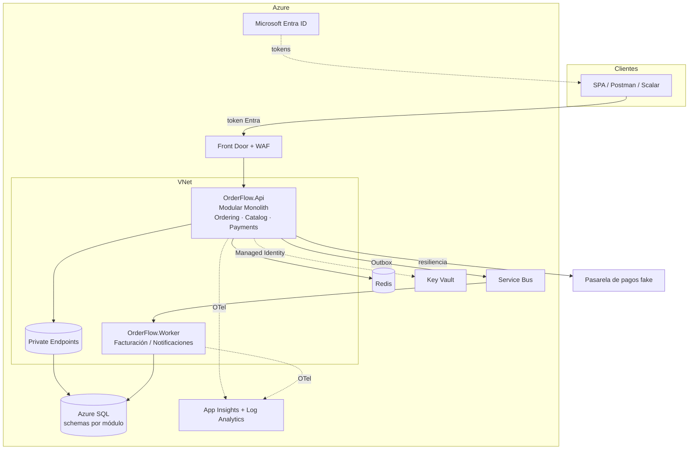

# 🛒 Proyecto integrador: OrderFlow

[⬅ Índice](../README.md) · [Plan de estudio](../00-plan-de-estudio.md)

> Un sistema de pedidos que construyes **incrementalmente** a lo largo del plan. Al final tendrás un proyecto de portafolio que demuestra patrones, arquitectura, redes, observabilidad, gobernanza, CI/CD e identidad — todo con .NET y Azure.

---

## 1. Contexto de negocio

Una tienda en línea colombiana necesita un backend para:
- Consultar un **catálogo** de productos con precios en COP.
- Crear **pedidos** con varios ítems, aplicar descuentos y calcular envío.
- **Cobrar** a través de una pasarela externa (simulada) que a veces falla.
- **Notificar** al cliente y **facturar** de forma asíncrona.
- Permitir a **administradores** ver todos los pedidos y emitir reembolsos.

### Actores
| Actor | Hace |
|-------|------|
| Cliente | Consulta catálogo, crea y paga pedidos, ve sus pedidos |
| Administrador | Ve todos los pedidos, reembolsa, gestiona catálogo |
| Worker de facturación (sistema) | Procesa eventos y genera facturas |
| Pasarela de pagos (externo) | Autoriza cobros (simulada con fallos aleatorios) |

---

## 2. Arquitectura objetivo



### Estructura de la solución
```text
OrderFlow/
├── global.json · Directory.Build.props · Directory.Packages.props · .editorconfig
├── azure-pipelines.yml
├── docs/
│   ├── adr/            (0001-…, 0002-…)
│   ├── api-style-guide.md
│   ├── runbooks/
│   └── diagrams/       (C4 nivel 1 y 2)
├── contracts/          (OpenAPI generado)
├── infra/              (Bicep)
├── src/
│   ├── Aspire/  OrderFlow.AppHost · OrderFlow.ServiceDefaults
│   ├── Host/    OrderFlow.Api · OrderFlow.Worker
│   ├── Modules/ Ordering · Catalog · Payments (Domain/Application/Infrastructure/Contracts)
│   └── Shared/  OrderFlow.BuildingBlocks
└── tests/
    ├── *.Domain.Tests · *.Application.Tests
    ├── OrderFlow.Api.IntegrationTests (WebApplicationFactory + Testcontainers)
    └── OrderFlow.ArchitectureTests (NetArchTest)
```

---

## 3. Hitos (alineados al plan de estudio)

### 🏁 Hito 0 — Esqueleto (Semana 1)
- [ ] Repo en Azure Repos, solución con Web API vacía, `global.json`.
- [ ] Pipeline mínimo que compila.

### 🏁 Hito 1 — Dominio con patrones (Semanas 2–5)
- [ ] `Order` con factory method y `Result<T>`; máquina de estados del pedido.
- [ ] Strategy para envío y descuentos; Decorator de caché sobre catálogo.
- [ ] Commands/queries (CQRS ligero); Options validadas al arrancar.
- [ ] ≥ 80 % cobertura en dominio.

**Criterios de aceptación:**
- No se puede crear un pedido vacío ni pasar de `Shipped` a `Cancelled` (tests lo prueban).
- Agregar un nuevo tipo de envío no modifica clases existentes.

### 🏁 Hito 2 — Arquitectura escalable y robusta (Semanas 6–11)
- [ ] Clean Architecture → Modular Monolith (3 módulos, 3 schemas).
- [ ] Aggregates, Value Objects (`Money`, `Email`, `Address`), domain events.
- [ ] HybridCache en catálogo, paginación por cursor, rate limiting.
- [ ] Outbox + Service Bus + Worker idempotente.
- [ ] Cliente de pagos con `AddStandardResilienceHandler()`; `Idempotency-Key` en cobros.
- [ ] Aspire AppHost levanta todo con un comando.

**Criterios de aceptación:**
- Con la pasarela fallando el 30 % de las veces, ningún pedido queda cobrado dos veces ni sin estado final.
- Si Service Bus está caído 5 minutos, ningún evento se pierde (outbox).
- `GET /orders?limit=20&after=...` tiene tiempo constante con 1M de pedidos.

### 🏁 Hito 3 — Redes (Semanas 12–14)
- [ ] `HttpClient` vía factory; prueba de socket exhaustion antes/después.
- [ ] Endpoint gRPC `GetOrder` consumido por el Worker.
- [ ] Forwarded headers configurados.
- [ ] Bicep: VNet, subnets, NSG, Private Endpoints (SQL, Key Vault) con Private DNS Zones; acceso público de SQL deshabilitado.

**Criterios de aceptación:**
- Desde la app en Azure, `nslookup` del servidor SQL resuelve a IP privada.
- Diagrama de red de OrderFlow documentado en `docs/diagrams`.

### 🏁 Hito 4 — Observabilidad (Semanas 15–17)
- [ ] `[LoggerMessage]` en todo el código; ProblemDetails con `traceId`; redaction de PII.
- [ ] OTel: spans de casos de uso, métricas de negocio, propagación por Service Bus.
- [ ] `/alive` y `/health/ready`; Application Insights; Workbook; alerta de burn rate + runbook.

**Criterios de aceptación:**
- Dado un `traceId` de un error, se ve en < 2 minutos toda la cadena API → cola → worker → SQL.
- Existen 2 SLOs documentados con su consulta KQL.

### 🏁 Hito 5 — Gobernabilidad (Semanas 18–19)
- [ ] 3+ ADRs; `Directory.Build.props` con warnings como errores; CPM; `.editorconfig`.
- [ ] Tests de arquitectura (capas y módulos).
- [ ] OpenAPI en build + Spectral + oasdiff; versionado `v1`/`v2`.
- [ ] Azure Policy (ubicaciones, tags) y presupuesto en la suscripción de pruebas.

**Criterios de aceptación:**
- Un PR que haga que `Ordering.Domain` referencie EF Core falla en CI.
- Un PR que elimine un campo de la respuesta de `v1` falla en CI.

### 🏁 Hito 6 — CI/CD (Semanas 20–23)
- [ ] Repo `pipeline-templates` versionado; pipeline de OrderFlow con `extends`.
- [ ] Service connections con WIF; Key Vault; environments dev/qa/prod con checks.
- [ ] Infra en Bicep con what-if + aprobación; blue-green con slots; migration bundle.

**Criterios de aceptación:**
- Commit en `main` → producción con 2 aprobaciones, sin intervención manual adicional.
- Rollback de producción en < 1 minuto (swap).
- El RG de dev se puede borrar y recrear desde el pipeline.

### 🏁 Hito 7 — Identidad (Semanas 24–25)
- [ ] API protegida con Microsoft.Identity.Web: scopes, app roles, autorización por recurso.
- [ ] Worker usa permiso de aplicación.
- [ ] Managed Identity para SQL (Entra-only), Key Vault, Service Bus, Storage.

**Criterios de aceptación:**
- `grep -riE "Password=|AccountKey=|SharedAccessKey=" src infra` no devuelve nada.
- Un cliente no puede ver pedidos de otro cliente (test de integración).

### 🏁 Hito 8 — Entrega final (Semanas 26–27)
- [ ] Diagramas C4, README completo, runbooks.
- [ ] Demo de 10 minutos.
- [ ] Retrospectiva y autodiagnóstico final.

---

## 4. API mínima esperada (v1)

| Método | Ruta | Auth | Descripción |
|--------|------|------|-------------|
| GET | `/v1/products?limit&after` | Anónimo / `Orders.Read` | Catálogo paginado (cacheado) |
| GET | `/v1/products/{id}` | Anónimo | Detalle de producto |
| POST | `/v1/orders` | `Orders.Write` | Crear pedido |
| GET | `/v1/orders?limit&after&status` | `Orders.Read` | Mis pedidos (admins: todos) |
| GET | `/v1/orders/{id}` | `Orders.Read` + dueño | Detalle |
| POST | `/v1/orders/{id}/pay` | `Orders.Write` + `Idempotency-Key` | Pagar |
| POST | `/v1/orders/{id}/cancel` | `Orders.Write` + dueño | Cancelar |
| POST | `/v1/orders/{id}/refund` | `Orders.Admin` (+ step-up opcional) | Reembolsar |
| gRPC | `OrderService.GetOrder` | `Orders.Process` | Uso interno |
| GET | `/alive`, `/health/ready` | Anónimo (interno) | Salud |

---

## 5. Pasarela de pagos simulada
Crea un pequeño proyecto `FakePaymentGateway` (minimal API) que:
- Responde `201` el 70 % de las veces, `503` el 20 %, y tarda 10 s el 10 %.
- Respeta `Idempotency-Key` (misma key → misma respuesta).
- Expone `/health`.

```csharp
app.MapPost("/charges", async ([FromHeader(Name = "Idempotency-Key")] string key, ChargeRequest req) =>
{
    if (Store.TryGetValue(key, out var previous)) return Results.Created($"/charges/{previous.Id}", previous);
    var roll = Random.Shared.Next(100);
    if (roll < 20) return Results.StatusCode(503);
    if (roll < 30) await Task.Delay(TimeSpan.FromSeconds(10));
    var charge = new Charge(Guid.NewGuid(), req.Amount, "approved");
    Store[key] = charge;
    return Results.Created($"/charges/{charge.Id}", charge);
});
```

---

## 6. Ideas para ir más allá
- **Event Sourcing** del aggregate `Order` (Marten sobre PostgreSQL).
- **Saga** de checkout con Durable Functions o Wolverine.
- Extraer `Payments` a un **microservicio** en Container Apps (y documentar el ADR).
- **Multi-región** activo-pasivo con Front Door y failover de SQL.
- **Chaos engineering** con Azure Chaos Studio.
- **IA:** endpoint de recomendaciones con `Microsoft.Extensions.AI`, gobernado en APIM (AI gateway).

## 📏 Rúbrica de autoevaluación
| Área | Básico (1) | Competente (3) | Experto (5) |
|------|-----------|----------------|-------------|
| Diseño | Funciona | Patrones aplicados con criterio | Puedo justificar cada patrón y sus alternativas |
| Arquitectura | Capas | Módulos con fronteras verificadas | Evolución documentada en ADRs, lista para extraer servicios |
| Redes | Funciona en local | Conexiones bien gestionadas, recursos privados | Diagnostico problemas de red de punta a punta |
| Observabilidad | Logs | Trazas + métricas + dashboards | SLOs con alertas por burn rate y runbooks |
| Gobernanza | Convenciones verbales | Reglas automatizadas en CI | Políticas a nivel de plataforma + métricas DORA |
| CI/CD | Build automatizado | Deploy multi-entorno con aprobaciones | Templates corporativos, IaC, zero-downtime, rollback en segundos |
| Identidad | Login funciona | Scopes, roles, MI | Cero secretos, step-up, mínimo privilegio verificado |
